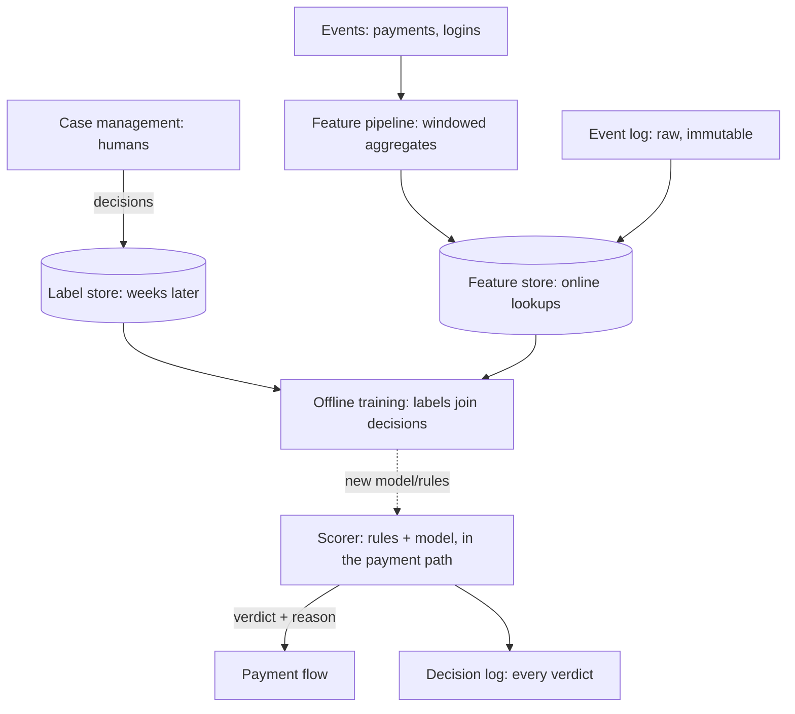

Fraud detection is the [recommendation](/system-design/hld/recommendation-system)'s
mirror image: same machinery (events, features, a learned model
over a scored context), opposite engineering values. The
recommender is *wrong* gracefully (a bad suggestion is a skipped
item); the fraud system is *wrong* expensively (a false positive
strands a paying customer, a false negative wires money to a
thief). That reversal drives every decision: the
[streaming](/system-design/fundamentals/stream-vs-batch-processing)
feature pipeline must be *correct under late and out-of-order
events*, the scorer must fit a *hard real-time budget*, and the
design must include **the path for the cases the model cannot
decide** (rules, hold-for-human, and the feedback loop that turns
human decisions into training data).

## Requirements

**Functional**

- Score transactions (payments, logins, account changes) in
  real time: a risk verdict (allow / challenge / block) per event,
  with a reason code.
- Velocity and history features: what this account, device, and
  card *has been doing* (counts and sums over recent windows).
- Rules and lists: the deterministic layer (known-bad bins,
  geography rules, thresholds) that must fire regardless of the
  model.
- Case management: the human queue for challenges and blocks,
  with decisions feeding back into training.
- Feedback ingestion: outcomes (chargebacks, confirmations) weeks
  later, joined to the original decisions.

**Non-functional**

- **Latency: a hard budget (~50-200ms) inside the checkout path**:
  fraud scoring sits on the critical path of every payment
  ([the payment system](/system-design/hld/payment-system)'s
  authorize step), so the budget is *the* constraint.
- **Precision at a usable recall**: the product trade is stated in
  dollars (a false positive costs customer-service and churn, a
  false negative costs the transaction), and the system's
  thresholds are set by that arithmetic, not by a
  generic-accuracy metric.
- **The label delay**: fraud labels (chargebacks) arrive *weeks*
  after the decision, so training is a
  [windowed-join](/system-design/fundamentals/stream-vs-batch-processing)
  problem with a long tail, not a same-day feedback loop.
- **Explainability**: a block needs a reason (regulatory, and
  customer service), so black-box-only scoring is a non-starter.

## The architecture: the streaming pipeline with a scoring spine



## The feature pipeline: streaming aggregates, honestly windowed

The features are the system's real content (the model is only as
good as what it sees), and they are **windowed aggregates over event
time**: "distinct merchants this card in 24h", "sum of payments this
account in 1h", "failed logins this device in 15m". The pipeline
is the [stream-vs-batch](/system-design/fundamentals/stream-vs-batch-processing)
page's machinery working for its living:

- **The online store** (the [feature-store](/system-design/fundamentals/olap-vs-oltp)
  pattern at serving scale): per-entity (card, account, device)
  running aggregates, updated from the event
  [queue](/system-design/fundamentals/message-queues-and-pubsub),
  readable in single-digit milliseconds at score time. The state
  (a few dozen counters per entity) is the
  [hot tier](/system-design/hld/distributed-cache), and the
  *bounded window* (counters over 15m/1h/24h) is what keeps it
  small and hot.
- **The watermark problem, stated honestly**: events arrive late
  and out of order (a [payment](/system-design/fundamentals/message-queues-and-pubsub)
  retry, a timezone-hostile batch), and a *fraud feature that
  under-counts because it closed the window too early* is a
  security hole, so the windows are
  [watermarked](/system-design/fundamentals/stream-vs-batch-processing)
  (close on a "no more events before T" claim), and late events
  update the corrected aggregate (the "reopen" cost) or land in the
  offline join (the training-time truth, which must match the
  *serving-time* view or the model trains on different data than
  it serves: the **training/serving skew** problem, the quiet
  killer of fraud models).
- **The device/session stitching**: half the features need "same
  device as the last transaction", which is identity resolution
  (cookie, fingerprint, account links), a
  [graph-shaped](/dsa/patterns/graph-specializations) problem at
  ingestion, and the reason the pipeline has an entity-resolution
  stage rather than trusting whatever ID arrived on the event.

## The scorer: rules, model, and the challenge verdict

The scoring path (inside the payment's
[authorize](/system-design/hld/payment-system) step, inside the
budget) is layered deliberately:

```cpp
struct Verdict {
    enum Action { Allow, Challenge, Block } action;
    std::string reasonCode;              // explainable, always
    double modelScore;                   // for the decision log
};

Verdict score(const Transaction& txn,
              const EntityFeatures& card,
              const EntityFeatures& device) {
    // Layer 1: deterministic rules, always first, always explainable.
    // Known-bad lists, geographic impossibilities (two payments, two
    // continents, ten minutes: the velocity rules), hard thresholds.
    if (auto blocked = rulesEngine(txn, card, device)) {
        return {Verdict::Block, blocked->reason, 0.0};
    }

    // Layer 2: the model, over the full feature vector.
    double risk = model.infer(features(txn, card, device));

    // Layer 3: thresholds as POLICY, set by the dollar arithmetic
    // (false positive vs false negative), not by accuracy metrics.
    if (risk > blockThreshold) {
        return {Verdict::Block, "model_high_risk", risk};
    }
    if (risk > challengeThreshold) {
        return {Verdict::Challenge, "model_borderline", risk};
    }
    return {Verdict::Allow, "", risk};
}
```

Three deliberate design points: **rules before model** (the
deterministic layer fires regardless of model drift, and the
regulatory/geographic absolutes never wait for a retrain), **the
challenge as a first-class verdict** (the middle outcome: 3DS
verification, a step-up auth, the *uncertain* case handled by
[asking](/system-design/fundamentals/idempotency-and-exactly-once)
rather than guessing: the same "park and escalate" discipline as
every [payment](/system-design/hld/payment-system) recovery path),
and **every decision logged with its inputs** (the decision log is
the training set's spine: score, features, verdict, and the
eventual label, joined later).

The **model serving** is a forward pass over the features (the
[recommendation](/system-design/hld/recommendation-system)'s
ranker-class work: microseconds at scoring time), and the model's
*lifecycle* is the hard operational part: **shadow deployment**
(the new model scores silently beside the old, both logged, no
traffic switched: the [observability](/system-design/fundamentals/observability)
discipline applied to models), then a
[canary](/system-design/fundamentals/reliability-engineering)
split, because "the model is worse" is discovered in production or
not at all, and the fraud system's *own* reliability is the
payment path's reliability.

## The label delay, and the human loop

Fraud's deepest structural problem: **the truth arrives weeks
late** (a chargeback is filed 30-60 days after the transaction), so
the training pipeline is a long-window
[join](/system-design/fundamentals/stream-vs-batch-processing)
(decisions x eventual labels, with the "no label yet" mass held
open), and the label's *bias* (only *challenged-blocked*
transactions generate the richest human review: the model only
learns from the cases it escalated, the
[feedback loop](/system-design/hld/recommendation-system)'s
meanest variant, answered by exploration: deliberately allowing
marginal cases to gather labels) is a named, standing problem.

The **case management** (the human queue: alerts, evidence, the
decisions) is not a bolt-on: it is the *label generator*, and its
decisions (this was fraud, that was legitimate) are the training
data's ground truth, which is why the case system's ergonomics and
the [event log](/system-design/fundamentals/event-sourcing-and-cqrs)'s
completeness are one design: **every human decision is an event**,
joined back to the decision it resolved, and the training set is
the fold.

## Capacity sketch

The arithmetic: the payment path's ~10k transactions/sec peak,
each scored in ~50-100ms (the feature lookups: ~10
[store](/system-design/hld/distributed-cache) reads at
single-digit ms, the rules: in-memory, the model: a forward pass),
which is a *small* fleet for the scoring tier and a
*medium* [stream](/system-design/fundamentals/stream-vs-batch-processing)
fleet for the features (every event updates a handful of entities'
windows: the ingestion is the
[queue](/system-design/hld/distributed-message-queue)-class
pipeline). The offline side (labels, joins, training) is a
[batch](/system-design/fundamentals/olap-vs-oltp)-class workload
over the decision and event logs: the two-tier split, again, as
the architecture.

## Related concepts

- [Design a Payment System](/system-design/hld/payment-system) is
  the host flow (the scoring step lives in its authorize).
- [Stream vs. Batch Processing](/system-design/fundamentals/stream-vs-batch-processing)
  is the windowing/watermark/skew machinery, formalized.
- [Design an Ad Click Aggregator](/system-design/hld/ad-click-aggregator)
  is the sibling streaming-count design (same windows, kinder
  stakes).
- [Idempotency & Exactly-Once Delivery](/system-design/fundamentals/idempotency-and-exactly-once)
  prices the "challenge then what" verdict.
- [Event Sourcing & CQRS](/system-design/fundamentals/event-sourcing-and-cqrs)
  is the decision-log-and-label-join architecture.
