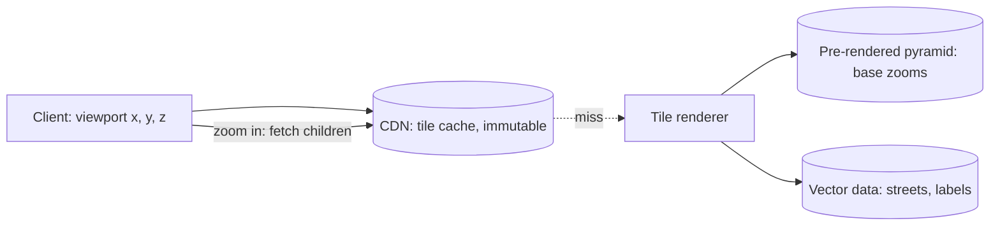

Google Maps is three systems wearing one interface, and the reason it
is a great HLD is that the three have almost opposite engineering
profiles. **Map rendering** is read-heavy, precomputable,
[CDN](/system-design/fundamentals/cdn)-shaped (the world, as
pictures, cached forever). **Routing** is compute-heavy, per-request,
[graph-search](/dsa/patterns/graph-specializations)-shaped (your
specific A-to-B, right now, over a billion edges). And **the updater
(loop closures, closures, new roads)** is a
[pipeline](/system-design/fundamentals/stream-vs-batch-processing)-shaped
system that keeps the other two's data from lying. Designing it well
means refusing to let one architecture serve all three.

## Requirements

**Functional**

- Display: pan/zoom a world map (streets, labels, satellite),
  smoothly, at every zoom level.
- Search: find places by name/category ("coffee near me").
- Directions: route between two points, by mode (car, transit, foot),
  with live traffic, in a second or two.
- Navigation: turn-by-turn, following a moving user, re-routing on
  deviation.
- Live layers: traffic, closures, business hours.

**Non-functional**

- **Tile serving at planet scale**: cached, edge-served,
  milliseconds, because *every* user touches it on *every* screen.
- **Routing in ~a second**: an interactive budget, over a graph
  orders of magnitude too large for naive
  [Dijkstra](/dsa/patterns/graph-specializations).
- **The world changes**: the map is never "done" (roads open,
  close, get renamed), so the data pipeline is a standing system.
- **Write-locality**: every user cares about *their* region, which
  the whole design exploits.

## System 1: tiles, the rendering pyramid

The map is served as **tiles**: fixed-size images (256px squares)
addressed by `(zoom, x, y)`, where zoom z's grid has 2^z tiles per
axis. The structure is a **pyramid**: each tile at zoom z is
parented by one at zoom z-1 (the world, refined level by level),
and a screen at zoom 17 shows ~10-20 tiles, fetched independently,
laid out by the client.

Two design decisions carry the pyramid:

- **Pre-rendered base vs render-on-miss**: the low zooms (the whole
  world: z 0-14-ish) are rendered *offline*, batch, updated on map
  changes (the world is one job: a day-long render farm, published
  as a new pyramid). The high zooms (z 15-22: every street corner)
  are rendered *on demand* and cached, because pre-rendering the
  planet at z 22 is ~10^18 tiles, and the long tail of
  never-requested tiles is the same
  [cache-economics](/system-design/hld/cdn-service) as every CDN's.
- **Vector tiles** (the modern answer): serve the *geometry*
  (roads as vectors, labels as text) instead of pixels, and the
  client renders (GPU, styleable, rotate-able without refetching,
  tiny payloads), which trades server-side rendering cost for
  client-side flexibility and a dramatically smaller cache. The
  raster/vector split is the "which layer does the work" decision,
  and the industry answer moved to vector with raster as the
  compatibility fallback.

The [CDN](/system-design/hld/cdn-service) in front of both is the
obvious tier: tiles are immutable (a map change is a *new* pyramid:
the [rename-not-update](/system-design/fundamentals/cdn) discipline
at planetary scale), cacheable forever, and the pyramid's
[locality](/system-design/fundamentals/geospatial-indexing) (a tile's
children are its neighbors) means panning is the warmest cache hit
there is.

## System 2: routing, the graph search at human scale

Routing is a shortest-path over the road graph (a billion edges:
every segment, every turn restriction, every transit line), and the
honest naive answer ([Dijkstra](/dsa/patterns/graph-specializations)
from A) is hopeless: a cross-country route expands
[wavefront-like](/dsa/patterns/graph-traversals) over millions of
nodes, and the 10^12-ish work is not interactive.

The design's stack of tricks, each buying orders of magnitude:

- **The bidirectional search** (from A and B simultaneously, meet
  in the middle): the [word ladder](/dsa/patterns/graph-traversals/problems/word-ladder)
  trick, at planet scale, halving the exponent of the explored
  region.
- **Contraction hierarchies / A\* landmarks** (the precomputation
  family): the graph is *preprocessed offline* into a smaller
  "highway hierarchy" (shortcuts over unimportant local roads:
  once you enter a highway network, you never re-descend mid-route),
  and a query becomes a tiny search on the precomputed structure:
  milliseconds, at the cost of a preprocessing pass per graph
  version (the same trade as
  [autocomplete's](/system-design/hld/search-autocomplete) offline
  trie: pay offline, serve hot). The
  [A\*](/dsa/patterns/graph-specializations) family with landmark
  distances as the heuristic is the same idea with a looser bound.
- **Live traffic on top**: the base graph is precomputed, but
  edge *weights* are live (minutes ago's speeds), so the hierarchy
  handles the topology and a per-request re-weighting handles the
  traffic: the design's split between *stable structure* (offline
  precompute) and *volatile costs* (online, cheap to apply).
- **The alternative routes** ("avoid highways", "3 options"): k
  shortest or plateau-diverse routes, the
  [fan-out](/system-design/hld/news-feed) of results rather than a
  single answer, each a query on the same precomputed structure.

**Navigation** (the moving user) is the routing system plus a
position stream: the user's location (GPS at 1/sec) is matched to
the road graph ([map matching](https://en.wikipedia.org/wiki/Map_matching):
the snap-to-road inference), and re-routing on deviation is the
*incremental* question (is the current route still valid from
*here*, checked cheaply, full re-search only on real deviation),
the same lazy-vs-eager trade as every
[cache invalidation](/system-design/fundamentals/caching) decision.

## System 3: the updater, and the pipeline that keeps the world honest

The map's truth sources are heterogeneous (satellite imagery,
street-view, government data, user edits, fleet GPS traces), and
the pipeline is [batch-meets-stream](/system-design/fundamentals/stream-vs-batch-processing):
user edits flow in ([event sourcing](/system-design/fundamentals/event-sourcing-and-cqrs)
with moderation: an edit is a fact pending review), GPS traces
stream into [traffic](/system-design/hld/log-aggregation-system)-shaped
aggregation (per-segment speeds as windowed streams), and imagery
uploads feed the batch pyramid renders.

The **loop closure** problem (a new road: every tile, route, and
[geocoded](/system-design/fundamentals/geospatial-indexing) index it
touches needs updating) is a
[migration](/system-design/hld/large-scale-migration)-shaped task:
the new road commits, the affected tiles' pyramid slots re-render,
the routing hierarchy re-precomputes (regionally: the hierarchy is
per-region, so a new road in Mumbai does not re-precompute Iowa),
and the [cache purge](/system-design/hld/cdn-service) fans the new
tiles out. "The world changed" is a *version bump of a pyramid plus
a regional rebuild*, which is the whole design's payoff.

## The search box, briefly

Place search is [inverted index](/system-design/fundamentals/search-and-inverted-index)
("coffee shops in this viewport": geo + text), the
[autocomplete](/system-design/hld/search-autocomplete) prefix layer
in front, and the geospatial
[grid](/system-design/fundamentals/geospatial-indexing) as the
"near me" filter: the search engine's standard machinery with a
location dimension, not a maps-specific design.

## Capacity sketch

The arithmetic that shapes it: the tile fleet serves the world's
map *browsing* (petabytes of pyramid, ~100% edge-cached, the
[CDN](/system-design/fundamentals/capacity-planning-and-estimation)
product), routing is ~100k queries/sec of *tiny* precomputed-graph
searches (the fleet is sized by precompute cycles and the long tail
of on-demand renders, not by the search itself), and the updater is
a batch/stream pipeline of imagery-petabytes and edit-hundreds. The
per-system numbers differ by orders of magnitude, which *is* the
three-systems argument.

## Related concepts

- [Geospatial Indexing](/system-design/fundamentals/geospatial-indexing)
  is the location machinery (cells, tiles' spatial addressing).
- [Design a CDN](/system-design/hld/cdn-service) is the tile tier's
  architecture, verbatim.
- [Design a Ride-Sharing App](/system-design/hld/ride-sharing-app)
  is the position-stream sibling (GPS ingestion, hot location
  stores) with matching instead of routing.
- [Graph Specializations](/dsa/patterns/graph-specializations) is
  the algorithm family (Dijkstra, A\*), and the
  [bidirectional](/dsa/patterns/graph-traversals/problems/word-ladder)
  trick is on this site.
- [Design a Proximity Service](/system-design/hld/proximity-service)
  is the "near me" half without the routing.
