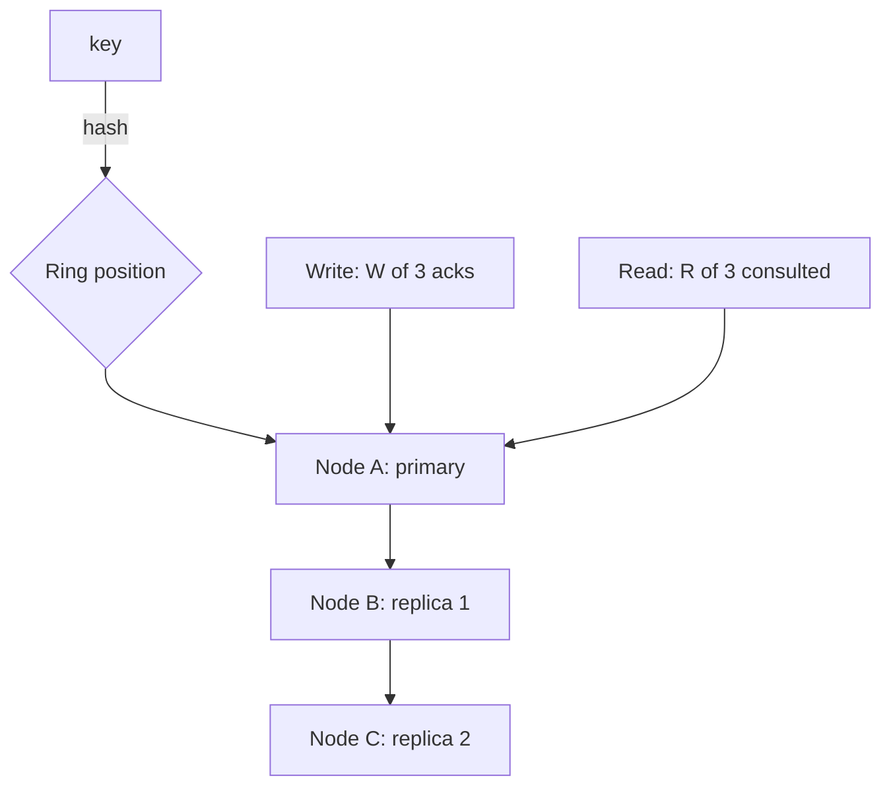

A key-value store is a database that only knows `get(key)` and
`put(key, value)`: no joins, no queries, no schema, just a hash map spread
across a fleet of machines. This is the design behind DynamoDB, Cassandra,
and Riak, and it is the interview problem where every theme in the
distributed-systems track (consistent hashing, replication, quorum, CAP)
shows up in one system. The reason it is a favorite is that each of those
themes is *forced* by the requirements rather than added for flavor: you
cannot store more data than one machine holds without partitioning, you
cannot survive a machine loss without replicating, and you cannot replicate
without deciding what consistency to offer.

## Requirements

**Functional**

- `put(key, value)` and `get(key)`, plus `delete(key)`.
- Values are opaque blobs (the store does not interpret them).
- Tunable consistency: the client may request strong or eventual reads.

**Non-functional**

- **Scalability**: petabytes of data, hundreds of thousands of operations
  per second, on commodity hardware.
- **Availability**: always writable, even during node failures and network
  partitions. This is the defining choice: Dynamo-style stores choose
  availability over consistency (AP in [CAP](/system-design/fundamentals/cap-theorem-and-consistency-models)).
- **Durability**: a write, once acknowledged, survives node loss.
- **Low latency**: single-digit milliseconds for a read or write.

## The core decisions

**Partitioning: consistent hashing with virtual nodes.** Keys are mapped
onto a hash ring, and each node owns a range. [Consistent
hashing](/system-design/fundamentals/consistent-hashing) makes adding and
removing nodes cheap (only ~1/N of keys move), and virtual nodes keep the
load balanced. The partition key is destiny: the store can only guarantee
fast lookups by key, never by value, because values are scattered.

**Replication: N copies, placed around the ring.** Each key is stored on
N nodes (typically 3): the node that owns its ring position and the next
N-1 clockwise. This is what provides durability and availability: losing
one node does not lose the key. Placement follows the ring, so the replica
set is deterministic from the key.

**Quorum: the consistency dial.** With N replicas, a write is acknowledged
by W nodes and a read consults R nodes. The rule `R + W > N` guarantees
that read and write sets overlap, so a read sees the latest write: this is
how a client asks for strong consistency. Setting `W = 1` gives fast,
always-writable puts; setting `R = 1` gives fast, possibly-stale gets;
setting `R = W = 2` with `N = 3` gives strong consistency at higher
latency. The client chooses per request, which is why this design is the
canonical "consistency is a dial, not a switch" system.

## The hard parts

**Conflict resolution when replicas diverge.** During a partition, two
replicas can accept conflicting writes to the same key (both are
"available", neither can see the other). When the partition heals, the
conflict must be resolved. Dynamo's approach is to store *all* versions as
a vector-clock-ordered set and hand the conflict to the application to
merge (or to resolve by "last writer wins", which silently drops one
write). This is the price of choosing availability, and it is why the store
exposes sibling versions rather than pretending a single truth always
exists. The alternative, a single leader per key that serializes writes,
avoids conflicts but sacrifices availability during partitions.

**Hinted handoff for transient failures.** If a replica is briefly down, the
write does not fail: a neighboring node accepts it and holds a "hint" to
deliver when the replica returns. This keeps writes available during short
outages, and it is why the system can promise "always writable" without
every node being up.

**Read repair and anti-entropy.** Replicas drift. On a read that consults
R nodes and finds them disagreeing, the coordinator repairs the stale
replicas with the newest value (read repair). A background process
(anti-entropy via Merkle trees) catches disagreements that reads never
touch. Together these keep replicas converging without a synchronous
consistency protocol.

**Membership and failure detection.** Nodes must agree on who is in the
ring, and a node that is merely slow must not be declared dead (which would
trigger needless rebalancing). Gossip protocols spread membership changes,
and suspicion-based failure detection avoids false positives. This is the
machinery that makes "commodity hardware, no single master" work.

## What the design gives up

Choosing availability (AP) means giving up strong consistency by default:
reads can be stale, and concurrent writes can conflict. That is a
deliberate trade for a store whose primary job is to be up and fast at
massive scale, and it is why key-value stores are the right home for
sessions, shopping carts, user preferences, and other data where a
slightly-stale read is harmless but downtime is not. For data that needs
multi-key transactions or strong consistency, this is the wrong tool, and
saying so is part of the design.

## Capacity sketch

Petabytes of data at, say, 5 replicas' worth of overhead, on nodes holding
a few terabytes each, is thousands of nodes; the ring, quorums, and gossip
all have to work at that scale. Latency budget: a quorum write is the
slowest of the W acknowledged nodes, so placement should keep a key's
replicas in the same region (cross-region replication is a separate,
explicit choice) to keep that latency in single-digit milliseconds.

## Related concepts

- [Consistent Hashing](/system-design/fundamentals/consistent-hashing) is
  the partitioning and placement scheme.
- [CAP Theorem & Consistency Models](/system-design/fundamentals/cap-theorem-and-consistency-models)
  is the R + W > N quorum rule in its natural habitat.
- [Database Fundamentals](/system-design/fundamentals/database-fundamentals)
  covers the replication concepts the store builds on.
- [Design a Distributed Cache](/system-design/hld/distributed-cache) is the
  read-optimized cousin: same ring, but losing data is acceptable.
