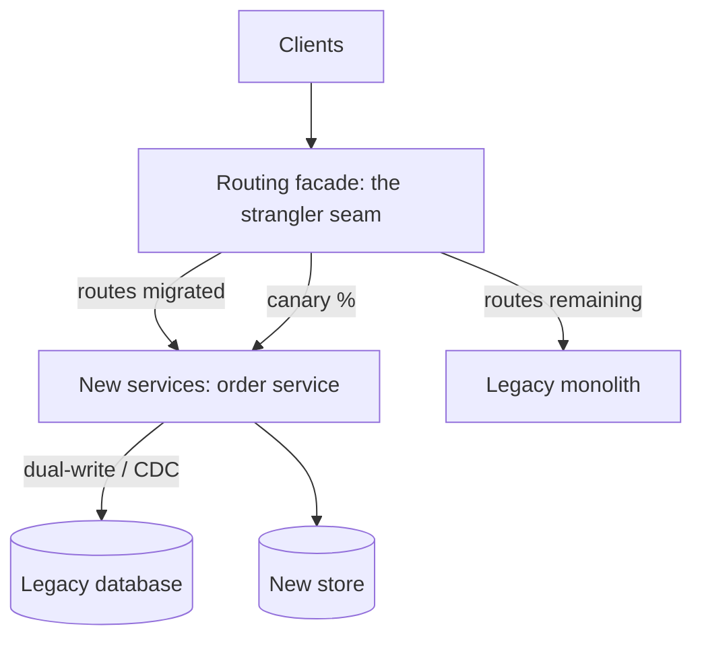

A large-scale migration ("move the monolith to microservices", "move
this database", "move to a new cloud") is the HLD that every big
company actually runs for years, and it is a *different kind* of
design problem: not "build a system" but **replace a system that
cannot stop running**. The classic naive answer ("freeze, rewrite,
cutover") fails for reasons the [big-bang](https://en.wikipedia.org/wiki/Big_bang_(disambiguation)#Computing)
projects made famous: the freeze lasts years, the new system is
untested against real traffic until the day nothing can be rolled
back, and the organization dies of uncertainty. The design subject
is the alternative: **incremental migration with always-deployable
state** ([strangler fig](https://martinfowler.com/blogs/2018/08/27/what-is-a-strangler-fig-application.html)),
the pattern behind every successful decade-long rewrite.

## Requirements

**Functional**

- Migrate functionality from the legacy system to the new system:
  the *product* behavior is unchanged (the same features, the same
  contracts), only the implementation moves.
- Coexistence: the old and new systems run together, serving
  production traffic, for the migration's *years-long* duration.
- Rollback: at every step, returning to the previous state is
  possible (per-component, not per-project).

**Non-functional**

- **Reversibility is the prime directive**: every step must be
  small, independently shippable, and independently *undoable*,
  because the alternative (cutover) is the design failure the
  whole pattern exists to prevent.
- **No user-visible change**: the migration is invisible (the
  same APIs, the same behavior, the same data), which is what makes
  "years of partial states" survivable.
- **Data consistency**: two systems hold overlapping truth during
  the migration (the old database and the new service's store),
  and the [CAP](/system-design/fundamentals/cap-theorem-and-consistency-models)
  question "which is right, when" is the design's hard center.
- **Organizational reality**: the legacy system *also* keeps
  receiving features during the years (the business does not stop),
  so the migration must tolerate the old system changing
  underneath it (the "moving target" problem, and the reason
  migration projects that assume a frozen legacy die).

## The pattern: strangler fig, the increment

The [strangler](https://martinfowler.com/blogs/2018/08/27/what-is-a-strangler-fig-application.html)
architecture: a **routing facade** in front of both systems (the
[API gateway](/system-design/fundamentals/api-gateway-and-service-mesh)
or a [proxy](/system-design/fundamentals/proxies) at the traffic
seam), which sends *per-route* traffic to either the legacy system
or the new one, and the migration is the progressive moving of
routes (and data, below) from old to new, one slice at a time,
with the legacy system shrinking ("strangled") until it is gone.

The three mechanisms, in the order they bite:

**The routing facade** (the seam): per-route, per-canary-percentage
routing (the [load balancer](/system-design/hld/load-balancer-system)'s
traffic-split machinery, applied to *migration* instead of
deployment), which makes every step reversible ("route 5%, then
50%, then 100%, then delete the legacy route" and the rollback at
each stage is a config change). The seam's *quality* determines the
migration's quality: it must route on enough context (per route,
per user, per entity) to make slices small, and it must be
*observable* enough (per-route legacy-vs-new telemetry) that
"the new route is worse" is *detected* before the 100% flip, the
[canary](/system-design/fundamentals/reliability-engineering)
discipline applied to a years-long deployment.

**The data seam** (the hard part): functionality migrating means
*data* migrating (the order-service owns `orders`, which lives in
the legacy database, with the legacy code still reading it), and
the standard mechanisms, honestly priced:

- **Dual-write** (the new code writes both stores): simple, and the
  *consistency hazard* is the classic: a write succeeds in one and
  fails in the other, and the stores *silently diverge* (the
  [distributed transaction](/system-design/fundamentals/distributed-transactions)
  page's problem, minus the machinery that solves it, because you
  cannot wrap the legacy database's writes in your transaction).
  The honest version: dual-write with **reconciliation**
  (a batch job that compares the stores and repairs divergence,
  the [payment system](/system-design/hld/payment-system)'s
  reconciliation discipline, applied continuously during the
  migration), and an explicit *source-of-truth* declaration per
  dataset ("the legacy store is truth until the cutover; the new
  store is a cache that reconciles") so every failure has a
  defined resolution.
- **[Change data capture](/system-design/fundamentals/olap-vs-oltp)**
  (the database's own log, mined: the legacy writes are captured
  as events, the new store is a projection): the *good* answer
  (asynchronous, the legacy code is untouched, no dual-write
  divergence because there is one writer: the legacy), with the
  costs of [eventual consistency](/system-design/fundamentals/cap-theorem-and-consistency-models)
  (the projection lags: the design must tolerate reading its own
  eventual data, or read the legacy for the transitional window).
- **Backfill + cutover** (the dataset's transition, the migration's
  real unit): copy the historical data (backfill: the batch load),
  capture the ongoing changes (CDC), **flip the ownership** (the
  moment the new store becomes the write-target: the smallest,
  scariest, most designed step), then catch up the residual delta
  and retire the capture. The sequence exists to make the flip's
  *window of divergence* small and *reconciled*.

## The increment discipline

The migration's unit of work, stated as the rule that makes the
years survivable:

1. **One slice** (one bounded context, one route, one dataset
   pair: the [microservices](/system-design/fundamentals/microservices-vs-monolith)
   boundary discipline, applied to extraction order: *carve where
   the seams already are*, the least-coupled datasets first, not
   the most painful ones).
2. **The strangler sequence** (facade route -> new service -> data
   seam -> backfill -> canary -> flip -> legacy code deleted), each
   step shippable and revertible on its own.
3. **The legacy keeps receiving features**: the new slices must
   *win on features too* (the team migrates the slice, then the
   feature work lands in the new home), which is why the
   "stop-the-world" migrations cannot compete: they freeze the
   legacy, and the business routes around them.

The **organizational** honesty, worth stating in any real answer:
the strangler migration *ends* (the legacy's last route deleted,
the legacy database retired), and the design must plan the ending
(the "last 10% is forever" trap: the low-value slices never migrate,
so the design assigns a *decommission budget* and an explicit
owner of the ending, because the pattern's default state is
permanent coexistence).

## Rollback, designed

Every step's reversibility, made mechanical: the route's rollback
is a config flip (the facade), the data's rollback is the
source-of-truth declaration (the legacy store *is* still the truth
until the flip: reverting means reverting *routing*, not
reverting *data*), and the flip's rollback (the one step that truly
moves ownership) is the step that gets the *most* design: the flip
is done behind a [canary](/system-design/fundamentals/reliability-engineering),
with dual-read verification (compare the new store's answers
against the legacy's, alert on divergence: the reconciliation
running *as a shadow* before it runs as a repair), and the
"undo the flip" path rehearsed before it is needed. The
[reliability](/system-design/fundamentals/availability-and-reliability)
discipline, pointed at the one irreversible moment in a
years-long project.

## Capacity sketch

The migration's own infrastructure is small (a facade at the
traffic tier: the [gateway](/system-design/fundamentals/api-gateway-and-service-mesh)'s
sizing, the CDC pipeline: the [log-tier](/system-design/hld/log-aggregation-system)'s
ingestion class, the reconciler: a batch fleet) relative to what
it migrates, and the *risk* budget (the canary percentages, the
divergence alerts, the rollback drills) is the real capacity
conversation: the migration spends *trust* as its scarce resource,
and the design above is the machinery that earns it back per-step.

## Related concepts

- [Microservices vs. Monolith](/system-design/fundamentals/microservices-vs-monolith)
  is the destination architecture, and the decomposition discipline
  that decides the slices.
- [Distributed Transactions](/system-design/fundamentals/distributed-transactions)
  is the dual-write hazard's theory, and the outbox/CDC answers.
- [Event Sourcing & CQRS](/system-design/fundamentals/event-sourcing-and-cqrs)
  is the CDC-projection architecture (the new store as a
  [read model](/system-design/fundamentals/olap-vs-oltp) of the
  legacy's log).
- [Reliability Engineering](/system-design/fundamentals/reliability-engineering)
  is the canary/rollback discipline that makes each step safe.
- [Load Balancing](/system-design/hld/load-balancer-system) is the
  routing facade's machinery (traffic splits, health).
