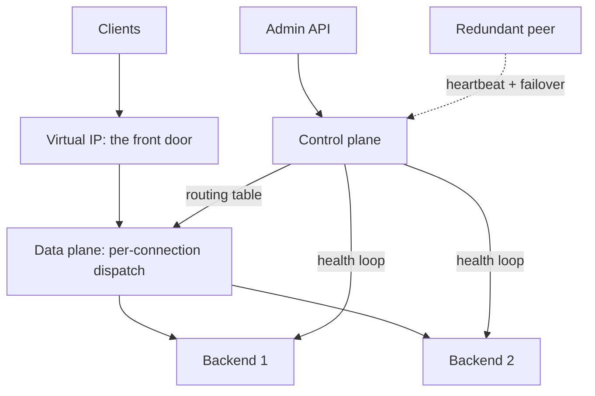
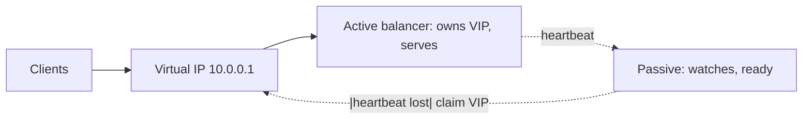

The [fundamentals page](/system-design/fundamentals/load-balancing)
covers what a load balancer *is* for: the policies, the placement, the
health checks, the trade-offs. This page is the HLD of *building one*,
which is a different question with a different shape: the product is
a **data plane** (the hot path, every packet) and a **control plane**
(the health checks, the config, the admin API), and almost every
design decision is about keeping the data plane dumb and fast while
the control plane does the thinking.

## Requirements

**Functional**

- Distribute TCP (L4) or HTTP (L7) traffic across a backend pool.
- Health-check the pool, add/remove servers from rotation
  automatically.
- Admin API: add backends, change policies, drain a server.
- Statistics: per-backend request counts, connection ages.

**Non-functional**

- **The balancer must not become the bottleneck**: at 100k+
  connections, per-connection overhead is the enemy, so the data plane
  is O(1) per decision with no locks on the hot path.
- **Availability of the balancer itself**: the front door is a
  single point of failure by definition, so redundancy is a
  requirement, not an optimization.
- **Config changes without restart**: pool changes must apply live,
  and a draining server must finish its connections.

## The architecture: two planes



**Data plane** (the hot path): accept, pick a backend, forward, and
remember the mapping. Every expensive decision is made *once per
connection* (L7) or *once per session* (L4 with sticky hash), cached
in a connection table, and the per-packet path is a lookup.

**Control plane** (the background): the health loop (poll every
backend every N seconds, mark up/down with a
flapping threshold), the routing table (backend pool + weights +
policy), and the admin API that mutates it. The planes communicate
through an atomically-swappable table (read-copy-update): the hot
path reads a snapshot, config changes build a new table and swap it
in, and no lock is ever held on the data path, which is the
[lock the bookkeeping, never the work](/system-design/fundamentals/concurrency-and-parallelism)
rule at systems scale.

## L4 versus L7, as an implementation choice

The two working depths ([fundamentals](/system-design/fundamentals/load-balancing))
are different products:

**L4 (TCP/UDP forwarding)** terminates the client TCP connection on
the balancer and opens one to the backend, shuffling bytes:

```cpp
class L4Dispatcher {
public:
    Backend& pick(const Connection& conn) {
        // Consistent hash by source IP: stateful sessions without
        // application state (see the routing decision below).
        uint64_t key = hashOf(conn.sourceIp());
        return ring_.lookup(key);            // O(1), lock-free ring read
    }
private:
    ConsistentHashRing ring_;                 // swapped atomically by CP
};
```

The cost model is beautiful: no parsing, no per-request work, so L4
scales to millions of packets per second per core, and the consistent
hash ([the ring](/system-design/fundamentals/consistent-hashing)) buys
sticky sessions: the same source IP lands on the same backend across
connections, so session state lives on the backend without the
balancer knowing anything about sessions.

**L7 (HTTP-aware)** parses requests, and the extra knowledge buys
per-path routing, header manipulation, rate limiting, and
[breadcrumbs](/system-design/fundamentals/observability)
(trace-id injection), at the cost of per-request CPU and TLS
termination (which makes the balancer the natural
[certificate](/system-design/fundamentals/security-fundamentals)
endpoint, the standard production topology).

## The health check loop, and the flapping problem

The naive loop (poll, mark down on 1 failure, mark up on 1 success)
produces oscillation: a backend at 90% CPU times out one check, is
pulled, immediately recovers, returns, times out again, and the pool
churns while traffic thrashes between servers. The standard design:

1. **Thresholds in both directions**: M-of-N failures to mark down
   (3 failures in 30 seconds), N-of-M successes to mark up, so a
   blip does not flap the pool.
2. **A real check, not a ping**: the health endpoint exercises a
   dependency (can the server reach its database?), because
   "process alive but melting" is the failure mode that matters.
3. **Half-open (the "slow drain")**: a down-marked server keeps
   existing connections but receives no new ones, so a recovery is
   proven by old connections finishing, not by new traffic
   arriving all at once. This is the same
   [suspicion](/system-design/fundamentals/consensus-and-leader-election)
   idea as failure detectors: slow is not dead, and flapping is
   worse than waiting.

## The redundancy answer: the floating pair

The front door's own availability, the classic pattern: two balancers,
one **virtual IP** they both claim, and a heartbeat that decides who
owns it.



The active node answers ARP for the VIP; the passive node watches
the heartbeat; if it stops, the passive claims the IP
(gratuitous ARP) and serves within seconds, and clients never knew
(configured the same, same table, synced state). The
[split-brain](/system-design/fundamentals/consensus-and-leader-election)
risk (both claim the VIP) is mitigated exactly as consensus page
taught: a third witness node breaks the tie, because two nodes
disagreeing about who is alive cannot resolve it themselves.

## Capacity sketch

The numbers that shape the product: a single L4 node comfortably
saturates a 10-25 GbE link with pure byte-shuffling (so throughput is
rarely the constraint), while L7 HTTP parsing costs ~10x more per
request (so a fleet of L7 nodes serves the millions-of-RPS tier,
itself load balanced by an L4 layer: the standard two-tier
deployment, L4 at the edge, L7 behind it). Per-connection memory
(the connection table) is the real L4 ceiling: 500k concurrent
connections * ~1 KB of state = 500 MB per node, which sizes the
machine. The general lesson of the two tiers:
[pick the cheapest layer that can do the job](/system-design/fundamentals/load-balancing).

## Related concepts

- [Load Balancing](/system-design/fundamentals/load-balancing) is
  the concepts page (policies, placement, health-check principles).
- [Consistent Hashing](/system-design/fundamentals/consistent-hashing)
  is the sticky-sessions mechanism the L4 data plane uses.
- [Consensus & Leader Election](/system-design/fundamentals/consensus-and-leader-election)
  is the theory behind both the flapping thresholds and the VIP pair.
- [Proxies](/system-design/fundamentals/proxies) is the parent
  pattern: a balancer is a reverse proxy with a health loop.
