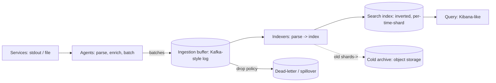

A log aggregation system (the ELK lineage: Elasticsearch, Logstash,
Kibana) is the [observability](/system-design/fundamentals/observability)
pillar with the hardest volume problem: logs are *unbounded, verbose,
and bursty* (a fleet at 10,000 logs/sec baseline emits 100,000/sec
the moment something goes wrong, *precisely when* you most need the
logs to survive), and the design is dominated by keeping the
ingestion pipeline alive through the flood while making the
resulting haystack searchable.

## Requirements

**Functional**

- Collect logs from every service and machine (structured or plain
  lines), with metadata (host, service, timestamp) attached.
- Store, search (full-text: "find all checkout errors mentioning
  order 47"), and display (live tail, histograms, dashboards).
- Retention: days of hot search, months of cold archive.

**Non-functional**

- **Ingest survives the flood**: a 10x burst must not take the
  pipeline down (the opposite failure, *dropping the burst silently*,
  is the [backpressure](/system-design/fundamentals/backpressure-and-flow-control)
  page's classic trap: logs during an incident are the most valuable
  logs).
- **Search across billions of lines in seconds**: the
  "find-order-47" query is the product.
- **Ordering and completeness within reason**: logs arrive
  out-of-order (clock skew, retries), and the system must *sort* by
  event time, not arrival time, and tolerate gaps.
- Retention economics: logs are the biggest volume in
  [observability](/system-design/fundamentals/observability), so
  the tiering is a design decision, not a cleanup script.

## The architecture: ship, buffer, index, search

The four stages, each existing for one reason:

**Agents** (the edge: Fluent Bit, Filebeat): local processes reading
stdout/files, *batching* (the network efficiency: 100 lines per
request, not 100 requests), enriching (the
[trace-id](/system-design/fundamentals/observability) injection,
host metadata), and answering the *local-drop question* (an agent
whose shipper is down: buffer to disk, then drop *oldest*, the
[logging framework](/system-design/lld/logging-framework)'s bounded
ring again, because an agent that fills its own disk takes the host
down with it).

**The ingestion buffer** (the design's load-bearing wall): a
[log-style message broker](/system-design/hld/distributed-message-queue)
between shipping and indexing, and it is *not* an optimization: it
decouples the fleet's write rate from the indexers' read rate (a
10x burst fills the buffer, the indexers drain at their own pace,
nothing is lost), it lets indexers *replay* (a bad deploy that
mis-parses: fix, re-consume from the offset: the
[event-sourcing](/system-design/fundamentals/event-sourcing-and-cqrs)
payoff applied to ingestion), and its
[retention](/system-design/hld/distributed-message-queue) is the
pipeline's *de-facto* buffer window. The drop policy at the buffer
(dead-letter, spillover to cold storage rather than deletion) is the
honest design decision the naive pipeline skips, and the answer to
"the burst during the incident" is *spillover, not silence*.

**Indexers**: parse (grok/regex/structured-JSON), normalize
(timestamps to UTC, the [ordering](/system-design/fundamentals/clock-synchronization-and-logical-time)
hazard: event-time vs ship-time, and sorting by the former), and
write to the search index. The parse stage is where
[schema discipline](/system-design/fundamentals/serialization-and-schema-evolution)
bites: structured logging (JSON fields, the
[framework](/system-design/lld/logging-framework) page's extension)
means cheap parsing and *queryable fields*, and free-text means the
[tokenizer](/system-design/fundamentals/search-and-inverted-index)
does the work, at a real CPU cost per line.

**The search index**: the [inverted index](/system-design/fundamentals/search-and-inverted-index)
over the tokenized lines, *time-sharded* (an index per day: the
epochal design decision, because time is the universal filter and
the shard key, and a "today's logs" query touches one shard), with
the shards themselves replicated, and **cold tiers** (old shards
sealed, compressed, moved to [object storage](/system-design/fundamentals/object-storage),
searchable on demand at a latency cost: the retention economics).

## The hard problems, each named

**The flood.** The baseline is 10k lines/sec, the burst is 100k,
and the burst *correlates with the incident you need the logs for*.
The design's answer, stacked: agents buffer locally (the first
shock absorber), the broker absorbs the rate mismatch (the main
one), indexers scale horizontally (the drain), and the *drop policy*
is explicit at each layer (agent: drop oldest; broker: spillover to
cold, never silent delete; indexer: the dead-letter queue for
unparseable lines, counted, not vanished). Every one of those
decisions is a [backpressure](/system-design/fundamentals/backpressure-and-flow-control)
answer, and the system that states its drop policy at each layer is
the design that survives its worst day.

**Cardinality, the log edition.** The
[metrics page](/system-design/hld/metrics-monitoring-system) warned
about label cardinality; the log index's version is *field
cardinality*: every distinct value of a field (order id, session
id, stack-trace line) is an index entry, and a billion logs with a
billion order ids is an index the size of the logs. The standard
discipline: index the *fields you query* (order id: yes; the full
message: tokenized, not keyword-indexed), and the
[multi-field mapping](https://www.elastic.co/guide/en/elasticsearch/reference/current/multi-fields.html)
(text for search, keyword for exact-match, nothing for unbounded
ids unless someone pays for it) is where the discipline lives.

**The ordering problem.** Logs arrive out of order (agent retries,
clock skew, indexer lag), and the search contract is "sorted by
event time", so the indexers assign event-time (parse it, don't
trust arrival time) and the *search* sorts, which means the index
must accept out-of-order writes (the time-shard by *event time*
handles it: a late line lands in yesterday's shard, which is why
shards have a soft-close window, the
[watermark](/system-design/fundamentals/stream-vs-batch-processing)
discipline at index-shard scale).

**Cost.** The honest economics: logs are the fleet's biggest
observability volume, so the tiering (hot: days, warm: compressed
weeks, cold: [object storage](/system-design/fundamentals/object-storage)
months) is a product decision, and "what do we actually search" (the
last 24 hours: almost everything; the last year: rarely, by filter)
is the design conversation that saves most of the money.

## Capacity sketch

The arithmetic that shapes it: 10k lines/sec baseline * 30 days
retention is ~26B lines (at ~200 bytes + indexing overhead, the hot
tier is ~10-15 TB, the cold tier a quarter of that compressed), the
burst drains at the indexer fleet's rate (say 5x baseline: the
broker's depth grows during the burst, which is the
[queue-depth metric](/system-design/hld/distributed-job-scheduler)
to alert on), and the search target is "filtered query over 24h in
2-3 seconds", which the time-shard + inverted-index combination
delivers if the cardinality discipline held.

## Related concepts

- [Observability](/system-design/fundamentals/observability) is the
  concepts page (the three pillars, what logs are *for*).
- [Search & Inverted Index](/system-design/fundamentals/search-and-inverted-index)
  is the engine under the search tier.
- [Design a Distributed Message Queue](/system-design/hld/distributed-message-queue)
  is the broker that the ingestion buffer is built on.
- [Design a Metrics & Monitoring System](/system-design/hld/metrics-monitoring-system)
  is the structured-sibling of this design (same shape, different
  corpus).
- [Design a Logging Framework](/system-design/lld/logging-framework)
  is the client-side half (where the lines come from, and why
  structured beats free-text).
