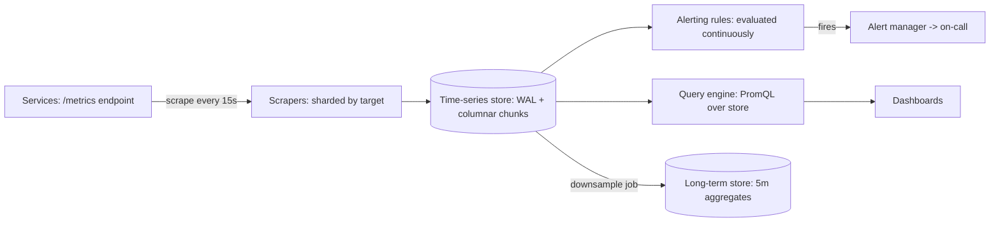

The [observability page](/system-design/fundamentals/observability)
covers metrics as one of the three pillars (with logs and traces) and
the measurement discipline (percentiles, the golden signals). This
page is the HLD of the *system that stores and serves metrics*, and
its design is dominated by one asymmetry: **writes are constant and
massive, reads are rare and desperate.** A fleet emits millions of
data points per second forever, and a human looks at dashboards
occasionally, until something breaks, at which point *every* read is
an emergency. The whole architecture serves that asymmetry.

## Requirements

**Functional**

- Collect metrics from services and infrastructure (a metric: a
  named series of timestamped values, with labels).
- Query: aggregate over time ranges and label filters
  ("p99 latency of the checkout path, last hour, by region").
- Alert on expressions (thresholds, rates of change, SLO burn).
- Retention: hot for days, downsampled for a year.

**Non-functional**

- **Write path must never drop the fleet's data silently**: scraping
  at fleet scale with a bounded, shed-able pipeline.
- **Read path must answer an emergency query in seconds**: the
  dashboard-under-incident experience is the product.
- **Cardinality is the enemy** (the
  [fundamentals page](/system-design/fundamentals/observability)'s
  warning: every distinct label combination is a stored series, and
  `user_id` as a label is death): the design must *enforce* cardinality
  budgets, not merely suffer them.
- Retention economics: raw samples for 15 days, 5-minute aggregates
  for a year, which is the standard trade.

## The data model: labels make it a time series

A metric sample is (name, labels, timestamp, value), and the
**labels** are what turn scalar monitoring into a dimensional model:
`http_latency{name="checkout", region="us-east", status="200"}`
is one series among thousands, and queries slice and dice across
those dimensions. The model is a sparse, append-only,
[name+labels] -> time -> value structure, and the cardinality
question (distinct label combinations) is the *size* of the model:
a million series * 15 days * one sample per 15 seconds is 1.2
billion points, which is the honest scale this design serves.

## The write path: pull, shard, chunk

The **pull model** (Prometheus's choice, and the design decision
that shapes everything): the monitoring system *scrapes* each target's
`/metrics` endpoint on an interval, rather than services pushing
data to it. The trade, honestly stated: pull makes the fleet's
inventory the scrape config (a discovery mechanism, which is why
service discovery is part of every pull-based monitor), gives
back-pressure for free (the scraper's own pace bounds ingestion:
a slow scraper is *visibly* behind, not silently queueing at the
fleet), and makes targets stateless (an endpoint anyone can scrape).
Push (the agent-based alternative: a daemon in every machine
shipping metrics) inverts every one of those trades, and the choice
is per-fleet-homogeneity rather than a law.

The scrapers are **sharded by target** (each scraper owns a slice of
the fleet, the [consistent hashing](/system-design/fundamentals/consistent-hashing)
placement over targets), and they write to the store through a
write-ahead log (the
[durability](/system-design/lld/bank-ledger-system) discipline:
append locally, replicate the WAL, index in the background), because
a scrape fleet losing 15 seconds of data is acceptable but a store
that loses silently is not.

The store's layout is **columnar chunks per series**: each series
compressed with delta-and-delta encoding (timestamps differ by a
constant, values change slowly: the classic time-series compression
that makes 15 days of 15-second samples fit in kilobytes), chunks
indexed by (series, time range), and the *index* (the
label -> series mapping, the inverted index over label values) is
the store's real complexity: it answers "which series match
`region="us-east" AND name="checkout"`" in milliseconds, which is
[the search page's](/system-design/fundamentals/search-and-inverted-index)
posting-list structure, verbatim, over a different corpus.

## The read path: the emergency query

The query engine's job (PromQL, the descendant of
[metric algebra](/system-design/fundamentals/observability)): parse
a range expression into (series selector, aggregation function,
time window), fetch the matching chunks (the index does the
selection: milliseconds), and fold. The honest design decisions:

- **Aggregation is the point**: a query over a thousand series
  returns a few numbers, and the fold is proportional to the data
  scanned (millions of points), which is why the *read path's* cost
  is data-scanned, not series-matched, and why downsampling is the
  retention answer: a year of history at 5-minute aggregates scans
  1/20th the points.
- **The read must degrade gracefully under a big query**: a naive
  engine scans the whole store for a month-range query and stalls
  the fleet's dashboards (the classic "one giant query takes down
  the monitoring" incident), so cancellation timeouts, per-query
  byte caps, and query admission control (the
  [backpressure](/system-design/fundamentals/backpressure-and-flow-control)
  discipline applied to reads) are part of the design, not
  optimizations of it.
- **Caching the common queries** (the same dashboard, refreshed
  every 10 seconds, by 200 on-call engineers): the
  [cache](/system-design/fundamentals/caching) pattern with short
  TTLs, keyed by the query text.

## Alerting: rules over the query engine

Alerts are *continuous queries* (an expression, evaluated on every
new scrape: the same engine, run on a schedule), with the alerting
semantics layered on top: **for** clauses (the condition must hold
for N minutes: the [flapping threshold](/system-design/hld/load-balancer-system)
discipline applied to paging), **inhibition** (a big alert suppresses
its noisy children: "the cluster is down" suppresses "the cluster is
down" * x 50 services), and the **grouping/routing** that turns
"thousands of firing series" into "one page per symptom", the
[notification system](/system-design/hld/notification-system)'s
digest and quiet-hours machinery applied to alerts. The alert
manager is a small state machine (pending -> firing -> resolved,
with the `for`-timer and the dedupe key), and it is deliberately
separate from the evaluation engine, because the evaluation is
stateless and the alert state is not.

The **SLO burn** alert ([the reliability page](/system-design/fundamentals/reliability-engineering))
is the flagship expression: budget-consumed-per-hour as a rate over
the SLI, which is the same query engine pointed at a
[policy](/system-design/fundamentals/reliability-engineering)
rather than a threshold.

## Capacity sketch

The arithmetic: a 10,000-target fleet, scraped every 15 seconds,
with 2,000 series per target is 1.3M series and ~90k points/second
of ingestion (a single store node's WAL handles this: the write
path is not the challenge). The *index* is 1.3M series of labels,
which is the memory story, and the *cardinality hazard* is the
standing threat: a label with a million values (a user id) is a
million series per metric, which is why the ingestion path enforces
per-metric cardinality limits (reject, or aggregate, at the door:
the honest answer that the [fundamentals page](/system-design/fundamentals/observability)
warned about).

## Related concepts

- [Observability](/system-design/fundamentals/observability) is the
  concepts page (the model, percentiles, cardinality economics).
- [Design a Log Aggregation System](/system-design/hld/log-aggregation-system)
  is the unstructured-data sibling of this design.
- [Search & Inverted Index](/system-design/fundamentals/search-and-inverted-index)
  is the posting-list structure the series index uses.
- [Reliability Engineering](/system-design/fundamentals/reliability-engineering)
  is what the alerting expressions are *for*.
- [Caching](/system-design/fundamentals/caching) is the read-path
  layer the dashboards lean on.
