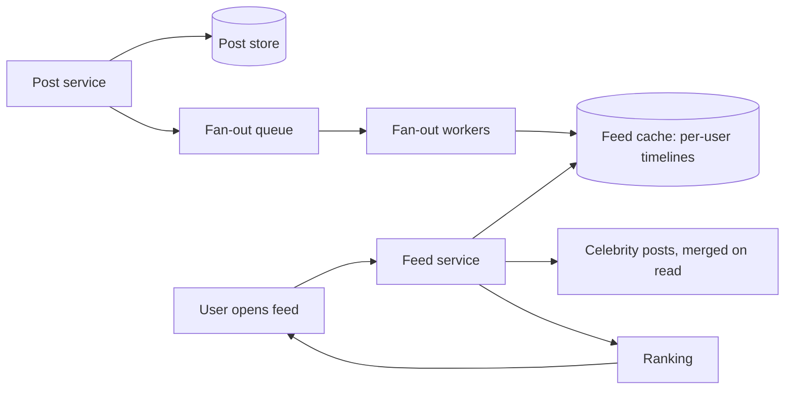

A news feed is a list of posts from the accounts a user follows, ordered by
some recency-and-relevance signal, and updated as new posts arrive. The
surface is familiar (Twitter, Instagram, LinkedIn, Reddit) and the
requirements sound simple, which is the trap. The reason feeds are a
classic interview is that a single decision underneath the product, **when
do you assemble a user's feed**, forks the entire architecture, and
everything else (storage, caching, ranking, scaling) is downstream of that
fork.

## Requirements

**Functional**

- A user follows other users; the feed shows their posts.
- The feed is ordered (roughly reverse-chronological, or ranked).
- New posts appear in followers' feeds "soon".
- Optional: pagination / infinite scroll, likes and comments counts.

**Non-functional**

- **Read-heavy, extremely so.** Users open the feed far more often than
  they post, so the read path is where all the scale lives. Assume a
  read:write ratio in the hundreds or thousands to one.
- **Low latency**: the feed is the app's home screen, so it must render
  fast (target a few hundred milliseconds for the first page).
- **Eventual consistency is fine.** A post appearing in a follower's feed
  a few seconds late is invisible to users, which is a gift: it means the
  hard consistency problems are avoidable.
- **Skewed load.** A celebrity with 100M followers breaks every naive
  assumption; the design must survive the difference between a user with
  50 followers and one with 100M.

## The core decision: fan-out on write vs. on read

Every feed design answers one question: when a user posts, do you push the
post into every follower's feed (fan-out on write), or do you gather the
relevant posts when a follower opens their feed (fan-out on read)?

**Fan-out on write** (push). When someone posts, write the post into a
precomputed feed list for each follower. Reads are then trivially fast: a
user's feed is already built, so opening the app is one lookup. The cost
is writes: a post to 100M followers is 100M writes, and a celebrity post
becomes a fan-out storm. Write amplification is the price of read speed.

**Fan-out on read** (pull). Store posts by author. When a user opens their
feed, fetch the recent posts of everyone they follow and merge. Writes are
cheap (one write per post), but reads are expensive: fetching from 500
followed accounts and merging them on every open, which is the opposite
trade.

The production answer is **a hybrid**, and the reasoning is the whole
lesson. Fan-out on write for the vast majority of users, whose follower
counts are small, because it makes the common case fast. For the small
minority of accounts with enormous follower counts (celebrities), skip the
fan-out and let their posts be *merged in at read time*. This bounds write
amplification (no 100M-write storms) while keeping reads fast for almost
everyone, and it is exactly the "handle the tail separately" move that
shows up in every high-scale design.

## The architecture

**Post store**: posts keyed by author and time, append-only. This is the
source of truth and the read-side fallback for the celebrity merge.

**Fan-out pipeline**: a [queue](/system-design/fundamentals/message-queues-and-pubsub)
between "post created" and "fan-out complete" is what makes write
amplification survivable: the poster does not wait for 10,000 timeline
writes, and the pipeline can be retried and scaled independently. Workers
read the follower list and append the post ID to each follower's timeline.
Note the pipelines stores *IDs*, not post contents: the timeline is a list
of references, and content is fetched separately (which keeps the cache
small and makes an edit to a post reflect everywhere).

**Feed cache**: the precomputed timelines, held in a
[distributed cache](/system-design/fundamentals/caching) or a wide-column
store, since the access pattern is "append to a list, read the top N". This
is where the read scale is absorbed.

**Ranking**: pure reverse-chronological is the simplest ordering, but real
feeds rank by predicted relevance, which is a separate service that takes
the candidate IDs and produces an order. The key insight for the interview:
ranking is a *reordering* step over candidates, so it does not change the
candidate-generation design (fan-out) at all, which is why you can design
the feed first and add ranking later.

## The hard parts

**The celebrity problem**, covered above: hybrid fan-out is the answer, and
the threshold ("fan out on write below X followers") is a tunable that
trades read cost for write cost.

**Feed consistency on the user's own posts.** A user who posts should see
their own post immediately, even though their followers' fan-out is
asynchronous. The standard fix is read-your-own-writes: merge the user's own
recent posts into their feed at read time, since they are guaranteed to be
in the post store already.

**Deletion and edits.** A post that is deleted must disappear from millions
of timelines. Because timelines store IDs, not content, a read that
encounters a deleted ID simply skips it (the content fetch fails), which
turns a fan-out-scale deletion into a per-read filter. This is the strongest
argument for storing IDs.

**Backfill when someone follows a new account.** Do you retroactively fill
their feed with the new follow's past posts? Usually not: feeds are
"recent posts", and the follow affects future posts. Stating this avoids an
expensive backfill design.

## Capacity sketch

Assume 200M daily users, 100M open the app 10 times a day, 20 posts/second
average (peak 10x). Feed reads: ~1 billion/day, i.e. ~12,000/second average,
peaking at 100,000/second. The precomputed-timeline cache is what makes
12,000 reads/second tractable: each read is a top-N lookup, not a merge.
Fan-out writes: 20 posts/second times average follower count (say 200) is
~4,000 timeline appends/second average, spiking with celebrity posts, which
the queue absorbs.

## Related concepts

- [Caching](/system-design/fundamentals/caching) is the mechanism behind
  the precomputed timelines and its stampede risks.
- [Message Queues & Pub/Sub](/system-design/fundamentals/message-queues-and-pubsub)
  is the fan-out pipeline's transport.
- [Scalability](/system-design/fundamentals/scalability) frames the
  read-heavy scale-out.
- [Design a Chat Application](/system-design/hld/chat-application) makes
  the same fan-out decision with a real-time latency budget.
