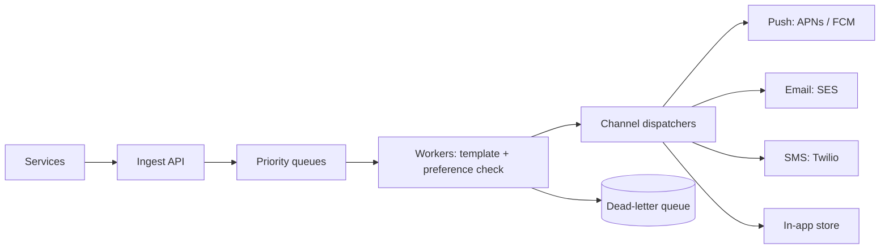

A notification system takes events (someone liked your post, your order
shipped, your bill is due) and delivers them to users across channels:
push (mobile), email, SMS, and in-app. It looks like a queue with a fan-out,
and the naive version is exactly that. The reason it is a serious design
problem is that notifications are the one feature where a bug is visible to
the user *and* hard to undo: a duplicate push at 3 AM, a missing password-
reset email, or a mass send to users who opted out are all incidents. The
design is therefore dominated not by throughput but by **reliability and
restraint**.

## Requirements

**Functional**

- Accept events from other services and deliver notifications to users.
- Multiple channels (push, email, SMS, in-app), each with its own provider.
- User preferences: opt in/out per channel and per category, quiet hours.
- Templating: render content per channel and per locale.
- Optional: scheduling (send at 9 AM local), digests (batch low-priority).

**Non-functional**

- **Reliability**: no lost notifications for high-priority events
  (security alerts, OTPs); no duplicates, ideally.
- **Timeliness**: transactional notifications (OTP, password reset) are
  latency-sensitive (seconds); marketing blasts are not.
- **Respect the user**: rate-limit per user, honor preferences, and never
  wake someone at 3 AM with a "someone liked your post".
- **Spike tolerance**: one viral event can enqueue millions of
  notifications at once.

## The pipeline

Walk the load-bearing stages:

**Ingest API** validates the event, assigns it an ID, and enqueues it. The
ID is what makes the rest of the pipeline idempotent: if a service
accidentally sends the same event twice, the ID lets the system drop the
duplicate.

**Priority queues**, not one queue. An OTP must not sit behind a million
marketing emails. High-priority and low-priority queues (or a priority
mechanism within the queue) keep transactional notifications fast during
bulk sends, and this is the single most important structural decision: the
moment marketing and transactional share a FIFO queue, a blast delays
password resets.

**Workers** do the expensive, per-notification work: look up the user's
preferences, check quiet hours, render the template for the channel and
locale, and decide whether to send at all. This is where **restraint**
lives: the preference check and the rate limit happen here, and dropping a
notification (because the user opted out or is being spammed) is a
first-class outcome, not an error.

**Dispatchers** talk to the external providers, one per channel. They
isolate provider-specific quirks (APNs payload limits, SMS encoding, email
DKIM) and absorb provider outages.

## The hard parts

**Exactly-once is a fiction, so design for at-least-once plus
deduplication.** [Queues deliver at-least-once](/system-design/fundamentals/idempotency-and-exactly-once),
so a worker can crash after sending but before acknowledging, and the
notification is retried. The fix is a deduplication key per (user, event,
channel) recorded before dispatch, so the retry sees it was already sent.
Without this, a crash storm becomes a duplicate-notification storm, which
is precisely the incident users remember.

**Provider failures and retries with backoff.** APNs and SMS gateways go
down. Dispatchers must retry with exponential backoff, and after N attempts
route to a **dead-letter queue** for investigation, rather than retrying
forever and clogging the pipeline. The dead-letter queue is the difference
between "we lost some notifications and can replay them" and "we silently
dropped them".

**User preferences and quiet hours are the real spec.** The notification
pipeline is easy; the *policy* is hard. Per-channel, per-category opt-outs;
quiet hours in the user's timezone; a per-user rate cap ("at most 5
notifications per hour"); and a digest mode for low-priority categories.
The scheduler must therefore know each user's timezone, and "send at 9 AM"
becomes "enqueue with a not-before timestamp" that the workers respect.

**Fan-out for large audiences.** A "new episode of a show you follow"
event may target millions of users. This is the
[feed](/system-design/hld/news-feed) fan-out problem in a different
clothes: expand the audience into per-user notifications asynchronously,
ideally reusing the same fan-out machinery, and never expand synchronously
in the ingest path.

## Capacity sketch

Assume 50M notifications/day: ~600/second average, peaking at 10,000/second
during a viral moment. The queue absorbs the peak (its depth is the buffer);
workers scale horizontally to drain it. Storage: notification history for
the in-app channel is the largest footprint (~50M/day, retained 90 days).
Providers have their own rate limits, so dispatchers throttle per provider,
which is why the pipeline must be able to *slow down* without losing work:
another argument for the queue between workers and providers.

## Related concepts

- [Message Queues & Pub/Sub](/system-design/fundamentals/message-queues-and-pubsub)
  is the transport, and its at-least-once default shapes the dedup design.
- [Idempotency & Exactly-Once Delivery](/system-design/fundamentals/idempotency-and-exactly-once)
  is what prevents duplicate sends on retry.
- [Backpressure & Flow Control](/system-design/fundamentals/backpressure-and-flow-control)
  covers what happens when providers or workers fall behind.
- [Design a News Feed](/system-design/hld/news-feed) shares the large-audience
  fan-out problem.
