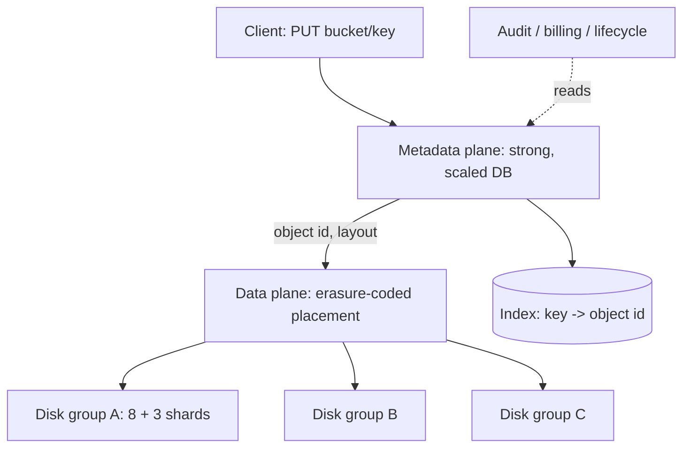

The [fundamentals page](/system-design/fundamentals/object-storage)
covers the object-storage *model* (flat namespace, immutable
objects, pre-signed URLs, where it fits). This page is the HLD of
building an S3-shaped service, and the product it sells is a
promise, not a feature: **11 nines of durability** (a 99.999999999%
chance an object survives a year), which is a *design arithmetic*
problem, not a "be careful" problem. The design has two planes (the
metadata plane that answers "what objects exist", the data plane
that holds the bytes), and the durability promise is engineered in
the data plane's layout.

## Requirements

**Functional**

- Buckets and objects (`bucket/key`), the flat namespace.
- Put/get/delete, list-by-prefix, and metadata (size, timestamps,
  user headers).
- Versioning (keep old versions on overwrite) and lifecycle rules
  (expire, archive, by prefix and age).

**Non-functional**

- **11 nines of durability**: the arithmetic promise, engineered.
- **Availability in the nines too** (99.9x%): an outage is a
  degraded product, but *lost* bytes are a breach of contract, which
  is why durability is the harder number.
- **Unbounded scale**: keys per bucket past billions, objects past
  terabytes, no sharding conversation exposed to the customer.
- **Latency**: tens of milliseconds per operation, flat (no degradation
  with key count), which constrains the metadata plane hardest.

## The architecture: two planes, deliberately asymmetric

The **metadata plane** (the index: `key -> object id -> layout,
version history`) is a *strongly consistent, transactional*
database tier, sharded by bucket+key hash (the
[consistent hashing](/system-design/fundamentals/consistent-hashing)
placement that makes "one bucket, ten billion keys" a per-shard
question). It is the plane that answers LIST (prefix scans: the
sharded ordered index), the plane that owns version chains, and the
plane that *rejects or admits* every operation: the strong choice,
because a metadata inconsistency (two objects with one key) is
unrecoverable, exactly the
[CAP](/system-design/fundamentals/cap-theorem-and-consistency-models)
reasoning that puts this plane on one consistent database per shard
rather than an eventually-consistent store.

The **data plane** (the bytes) is deliberately dumber: given an
object id and a layout, it stores and retrieves shards, and it has
no index to keep consistent. The asymmetry is the design: metadata
is small and needs consistency (pay for a real database); bytes are
huge and need durability (pay for replication math), and forcing one
plane to do both jobs is the classic mistake this architecture
avoids.

## The durability arithmetic: erasure coding

The 11-nines math, done out loud (it is the interview's payoff):
replication of 3 gives durability of about
`1 - p^3` per year (p = annual disk-loss rate, ~1%: so ~eight nines
*per object*, and the aggregate over billions of objects is where
the promise gets tight), at a **200% storage overhead** for
2 replicas... rather, 3 copies = 200% overhead. The better trade:

**Erasure coding** (Reed-Solomon): split the object into k data
shards, compute m parity shards (any k of the k + m shards
reconstruct the object), and scatter the shards across *distinct
failure domains* (distinct disks, racks, or buildings). RS(8, 5):
13 shards on 13 disks, any 5 can die, 50% overhead instead of 200%,
and the yearly probability of losing 6+ of 13 independent disks is
roughly p^6 territory: **many more nines than replication, at a
third of the cost**, which is the entire reason S3's durability
promise is economically possible. The costs that make it a *data
plane* technology: reconstruction is compute-heavy (a lost shard
means reading the survivors and re-encoding: minutes, not
milliseconds), so erasure coding lives on cold objects and
replication (3x, on distinct domains) lives on the hot tier, with
**replication on write, erasure-coded in the background** as the
standard lifecycle.

The failure-domain discipline is the other half of the arithmetic:
6 shards on one rack is one rack failure away from data loss, so
the placement engine spreads shards across
[distinct domains](/system-design/fundamentals/availability-and-reliability)
(the "correlated failure" discipline: the same lesson the nines page
teaches, applied to placement), and the **scrubber** (the background
audit that reads every shard and verifies checksums) is what turns
"replicated" into "actually recoverable" (a silently-corrupted
replica is a lost object that has not announced itself: scrub
before the second failure takes the domain down).

## Versioning and delete markers

The versioning design, small but genuinely clever: **a delete is not
a delete**. In a versioned bucket, `DELETE bucket/key` *inserts a
delete marker* (a new version whose content is "this key is gone"),
and GETs traverse the version chain (a delete marker at the head
means not-found), while the old versions live on until lifecycle
expires them. Overwrite is the same move (a new version object, the
old one retained). The payoff is the product's famous properties:
accidental deletes are *undoes* (remove the marker: the old head
returns), and legal-hold ("this object may not vanish for 7 years")
is a lifecycle rule rather than a bolt-on. The metadata plane owns
the whole machinery (the version chain is its index structure),
which is why versioning and the strong metadata plane are one design
decision, not two.

The **lifecycle rules** (expire after N days, transition to colder
tiers, delete-marker cleanup) are the [retention policy](/system-design/fundamentals/message-queues-and-pubsub)
of the storage world: a background evaluator over the metadata
plane, driving data-plane operations (drop shards, re-tier), and
the design answer to "storage bill vs. retention policy" being a
per-bucket customer decision.

## The list operation, and the metadata plane's hardest problem

LIST-by-prefix at billions of keys is the metadata plane's
signature challenge: it must be *ordered* (lexicographic: the S3
contract), *paginated* (a continuation token, not an offset, because
the keyspace is changing under the listing), and *shard-stable*
(a prefix lives on the shard that owns the hash range... no:
ordered listing cannot hash-partition, which is why real object
stores partition by **key range**, not hash: range partitioning
gives prefix locality, at the price of hot-key skew, the trade this
design must state out loud). The listing contract (lexicographic
order, continuation tokens, no total count) is the honest product
shape for "consistent scan over a mutating keyspace", and the
**eventual consistency of list-after-write** (the
[fundamentals page](/system-design/fundamentals/object-storage)
flagged it: a just-written key may not appear in an immediately
following LIST) is the one visible artifact of the two-plane
split's asynchrony.

## Capacity sketch

The scale story: metadata (say 1 KB per object, keys in the
billions) is terabytes, strongly consistent, range-sharded: the
database tier's problem. Bytes are exabytes, erasure-coded, spread
across thousands of disks: the placement engine's problem, sized by
[erasure overhead](https://en.wikipedia.org/wiki/Erasure_code) not
by object count. The crossover to state: the tiers (hot: replicated
SSD; warm: erasure-coded disk; cold: erasure-coded tape or archive
grade) are where the latency promise and the durability promise
meet the economics, and *tiering is the product's cost story*,
which is why lifecycle is a first-class API and not an ops secret.

## Related concepts

- [Object Storage](/system-design/fundamentals/object-storage) is
  the model page (keys, immutability, the limits).
- [Availability & Reliability](/system-design/fundamentals/availability-and-reliability)
  is the correlated-failure and nines arithmetic the placement engine
  applies.
- [Design a CDN](/system-design/hld/cdn-service) is the tier in
  front of this one (edge: the object store is the CDN's origin).
- [Event Sourcing & CQRS](/system-design/fundamentals/event-sourcing-and-cqrs)
  is the same "never update, always append" idea at application
  architecture scale.
- [Design a Distributed File Storage System](/system-design/hld/distributed-file-storage)
  is the POSIX-shaped sibling (files vs. objects).
