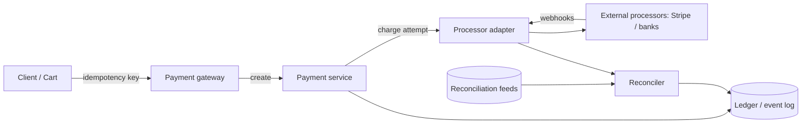

A payment system is the canonical "correctness over everything" design
problem. Most HLDs can absorb a little staleness or a lost message; a
payment system cannot lose money, cannot double-charge a customer, and
cannot show a balance that was never true. The interesting parts of the
design are therefore not throughput or latency but **guarantees**: what
happens when the network dies mid-charge, when a client retries, when a
processor debits and never reports back. Every component here exists to
answer one of those questions.

## Requirements

**Functional**

- Create a payment (card, wallet, or bank) for an amount.
- Charge: move money from the customer to the merchant, and record it.
- Refund: reverse a charge (fully or partially).
- Idempotent operations: the same request twice must not charge twice.
- Reconciliation: an external record of what should have moved, checked
  against what did.

**Non-functional**

- **Correctness over availability**: a payment that is uncertain should be
  *refused or parked*, never guessed. Downtime on the write path is
  acceptable; silent money loss is not.
- **Auditability**: every state change is recorded, immutable, and
  replayable. Financial systems keep ledgers, not just current state.
- **Latency is secondary**: a charge taking 800ms is fine; 200ms with a
  chance of double-charging is not.
- Regulatory: PCI-DSS for card data (which mostly means *not storing*
  it), plus retention and dispute windows measured in years.

## The core shape: a state machine, a ledger, and an idempotency layer

The components and their reasons:

**Gateway / API layer** holds the idempotency keys (see
[idempotency](/system-design/fundamentals/idempotency-and-exactly-once)):
each client operation carries a unique key, and the first response is
stored against it so a retry replays the stored answer instead of
executing twice. This is the single most important client-facing
guarantee, and it is the reason "I clicked pay twice" does not charge
twice.

**Payment service** is a **state machine over each payment**:
`created -> pending -> authorized -> captured -> refunded`,
with `failed` and `cancelled` off the happy path. Every transition is
explicit, guarded, and recorded, because the entire question "what
happened to this money" is answered by the state plus the event history.
Money bugs are almost always state-machine bugs: a capture racing a
refund, a retry landing on a half-finished charge.

**The ledger** is append-only. Charges, refunds, and fees are events,
and balances are derived (a running total per account), never mutated in
place. This is
[event sourcing](/system-design/fundamentals/event-sourcing-and-cqrs)
applied to money, and it is not an optional elegance: an audit or a
dispute requires reconstructing exactly what happened, in order, years
later, which a mutable "current balance" column cannot do.

**Processor adapters** isolate each external PSP (Stripe, Adyen, banks)
behind one interface, because the gateway's job is partly to be the
translation layer: each processor has its own idempotency semantics,
retries, and webhook formats, and the adapters normalize them so the
payment service deals with one contract.

## The hard problems

**Exactly-once charging across a network.** The flow is:
insert a `pending` row -> call the processor -> record success/failure.
The network can die between *any* two of these steps, so each payment
needs a **recovery path**: an asynchronous job that finds rows stuck in
`pending` past a timeout and asks the processor "what happened to charge
attempt X" (a status call keyed by an *attempt id*, so retries create
new attempt ids rather than reusing a dead one). What the system must
never do is guess: uncertain means *park and ask*, never *retry blind*,
because a blind retry after a network timeout is exactly how a
double-charge happens.

**Partial failures and the two-sided move.** Charging a customer and
crediting a merchant are two updates that must both happen, which is a
[distributed transaction](/system-design/fundamentals/distributed-transactions)
against your own accounts. The standard answer inside one company is a
single ACID transaction in the ledger database (both legs are local rows,
so plain transactional semantics suffice), which is a large part of why
real payment systems keep the ledger in one strongly consistent database
rather than spreading it across services.

**Reconciliation: the safety net.** Everything above can still drift:
processors report late, webhooks are dropped, bugs exist. The
**reconciler** is a batch job that compares the PSP's daily settlement
reports against the ledger, line by line, and flags mismatches for human
review. This is the system admitting that exactly-once is not achievable
end-to-end and building *detection* instead: money systems are built so
that any divergence is *found*, not so that it cannot exist.

**Refunds and disputes.** A refund is a new event (not a mutation of the
charge), subject to the same idempotency, and *disputes* ("chargeback")
arrive from the card network months later, which is why the ledger is
append-only with years of retention: the dispute window defines the
retention policy.

## Capacity sketch

Payments are low-volume per user but bursty (sales, holidays): plan for
10x on peak days. A mature gateway might see thousands of TPS globally,
which is small for infrastructure; the load is in the *long tail* of
state: millions of payments per day, each a state machine with years-long
retention, and a reconciliation job comparing hundreds of millions of
rows nightly. The hard scaling axis is storage and audit, not TPS.

## The interview arc

1. The state machine: enumerate the states and the guarded transitions.
2. Idempotency at the client, and attempt ids against the processor.
3. The append-only ledger and derived balances.
4. The recovery path for stuck payments, and why "park and ask" beats
   "retry".
5. Reconciliation as the admission that end-to-end exactly-once is a
   fiction, and the reason the system is still trustworthy.

## Related concepts

- [Idempotency & Exactly-Once Delivery](/system-design/fundamentals/idempotency-and-exactly-once)
  is the guarantee this entire design orbits.
- [Distributed Transactions](/system-design/fundamentals/distributed-transactions)
  covers the two-legged transfer problem and the outbox.
- [Event Sourcing & CQRS](/system-design/fundamentals/event-sourcing-and-cqrs)
  is the ledger's storage model.
- [CAP Theorem & Consistency Models](/system-design/fundamentals/cap-theorem-and-consistency-models)
  explains why the ledger stays on one strong database.
- [Design a Bank / Ledger System](/system-design/lld/bank-ledger-system)
  is the same append-only ledger as a code-level design.
