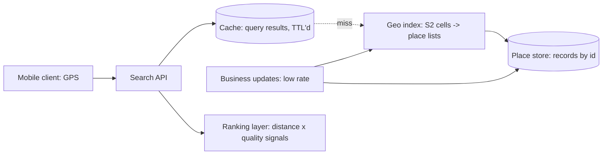

A proximity service ("find coffee shops within 2 km", Yelp/Places
without the bookings) is the
[geospatial indexing](/system-design/fundamentals/geospatial-indexing)
pattern's cleanest HLD: it is
[the ride-sharing design](/system-design/hld/ride-sharing-app) with
the matching, trips, and GPS firehose removed, leaving the two
problems that remain interesting at scale: **nearby search over
billions of mostly-static points** (a business does not move: the
hot-index problem is inverted, read-heavy and precomputable), and
**the read-path engineering that makes "around me" a sub-100ms
answer**. It is worth designing explicitly because it is the
*default* geospatial HLD, with the harder systems layered on top.

## Requirements

**Functional**

- Query: "places of category C within radius R of point (x, y)",
  ranked (distance, rating), paginated.
- Place records: name, category, location, hours, attributes.
- Updates: businesses open/close/move (low rate, not a firehose).
- Optional: check the user's own location-history features
  ("search this area"), price/rating filters.

**Non-functional**

- **Read latency ~50-100ms**: the "around me" query is a mobile
  client's default screen, issued constantly, and it must feel
  instant.
- **Read-heavy, read-heavy, read-heavy**: reads are 10^4-10^5x
  writes (a business record is written when it changes, read every
  search near it), which shapes *everything*: precompute freely,
  cache aggressively.
- **Ranking quality**: the *nearest* coffee shop is often not the
  *answer* (closed, one star, no photos), so ranking is part of the
  read path.
- **Scale**: billions of places, the world, unevenly distributed
  (the density problem: Manhattan and rural Kansas in one index).

## The architecture



The design's three layers, each existing for one reason:

**The geo index** is [the fundamentals page's](/system-design/fundamentals/geospatial-indexing)
machinery, made read-heavy: places indexed by **S2 cell** (the
[geospatial page](/system-design/fundamentals/geospatial-indexing)'s
argument: adjustable-size cells, the sphere handled honestly), each
cell holding the list of its places, and the query is "the covering
cells for the radius, the union of their lists, filter by exact
distance". The read-heavy reframe vs the ride-sharing design:
**the index is built offline and updated incrementally** (a
business opening is a low-rate event, an append to a cell's list),
not maintained out of a GPS stream, which is why the whole
"location firehose" half of that design disappears here.

**The cache** is the [CDN](/system-design/fundamentals/caching)
discipline applied to queries: "coffee within 500m of this cell" is
a result thousands of people ask per hour, and its TTL is the
*staleness tolerance of place data* (minutes: businesses do not
move), which is enormous by cache standards. The cache key is the
*(cell, category, filter-tuple)*: not the user's GPS (the
personalization, if any, is the ranking layer's job), which is
exactly what makes the hit rate high.

**The ranking layer** is the interesting read-path problem: the
geo answer is a *candidate set* (the cell lists), and the product
answer is ranked (distance, rating, review count, popularity,
open-now), which is a small
[scoring](/system-design/hld/recommendation-system) pass over
hundreds of candidates: the same shape as the
[autocomplete](/system-design/hld/search-autocomplete) design's
"rank the candidate set, cheaply, on the way out", and the reason
the *index answers where* and the *ranker answers what's good* is
a separation of concerns worth stating.

## The query path, step by step

```cpp
// The core: cover the circle with cells, fetch, filter, rank.
std::vector<Place> searchNearby(double lat, double lng, double radiusMeters,
                                 const Category& category, int limit) {
    // 1. Cover: the S2 library computes the minimal cell set covering
    //    the radius (a ring of cells, at a level chosen so the covering
    //    is ~4-10 cells: the level is the radius's function).
    std::vector<CellId> covering = coverCircle(lat, lng, radiusMeters);

    // 2. Fetch: each cell's list, from cache or index (the join).
    std::vector<PlaceId> candidates;
    for (CellId cell : covering) {
        candidates.append(cacheOrFetch(cell, category));
    }

    // 3. Filter: exact distance (the cells over-approximate the circle:
    //    corners of the covering are outside the radius).
    std::vector<Place> inRange;
    for (PlaceId id : candidates) {
        Place place = placeStore.get(id);
        if (haversineMeters(lat, lng, place.lat, place.lng) <= radiusMeters) {
            inRange.push_back(place);
        }
    }

    // 4. Rank: distance is one signal, not the whole answer.
    std::sort(inRange.begin(), inRange.end(), [&](const Place& a, const Place& b) {
        return score(lat, lng, a) > score(lat, lng, b);   // composite score
    });
    inRange.resize(std::min(limit, inRange.size()));
    return inRange;
}
```

The two-step [filter-then-refine](/system-design/fundamentals/geospatial-indexing)
discipline (cells for the coarse fetch, exact distance for the
final filter) is the same as the fundamentals page teaches, with
the read-heavy addition: *the cell lists are precomputed,
cached, and the cache key is the cell itself*, which is the design
difference from the ride-sharing version (where the index is
built from a stream and the cache is write-through).

## The write path, and the density problem

Business updates (a place opens, moves, closes) are the low-rate
side: an [append-only](/system-design/fundamentals/event-sourcing-and-cqrs)
record (history matters: what did the listing say in 2023?), the
index updated incrementally (the place's cell list), the
[cache](/system-design/fundamentals/caching) invalidated by
*(cell, category)* (the standard cache-key granularity: a change
to one place invalidates a cell, not the world).

The **density problem** (Manhattan vs Kansas) is the index's real
design tension: a cell level small enough for dense-city lists
(Manhattan at a fine level: hundreds of places, the covering is
precise) makes rural cells empty and the covering
over-fragmented, and a level coarse enough for rural coverage makes
Manhattan's lists enormous. The S2 answer is **variable levels**
(the index holds a tree: subdivide where dense, stay coarse where
sparse), and the query's covering routine walks the tree to the
right granularity: the same adaptive-density argument as the
[quadtree](/system-design/fundamentals/geospatial-indexing), which
is why the fundamentals page presents both as the same idea.

## Capacity sketch

The arithmetic: a billion places, a mobile client's query load at
peak ~100k queries/sec fleet-wide, each answered from a
*(covering cells, cached lists)* hit (the cache absorbs the read
traffic: the place store sees ~1% of queries), the index is a
billion entries in cells (a distributed store, the cell lists
sharded by [cell id](/system-design/fundamentals/consistent-hashing)),
and the writes are thousands per second *globally* (businesses
change slowly): the read-write ratio is the story, and every design
decision above exploits it.

## Related concepts

- [Geospatial Indexing](/system-design/fundamentals/geospatial-indexing)
  is the machinery (S2, covering, filter-then-refine) in depth.
- [Design a Ride-Sharing App](/system-design/hld/ride-sharing-app)
  is the design with the matching and the moving-object firehose
  added.
- [Caching](/system-design/fundamentals/caching) is the cell-list
  tier, and the staleness-tolerance argument.
- [Design a Search Autocomplete](/system-design/hld/search-autocomplete)
  is the same "candidate set, then cheap ranking" shape.
- [Design a Recommendation System](/system-design/hld/recommendation-system)
  is where the ranking signals grow up.
