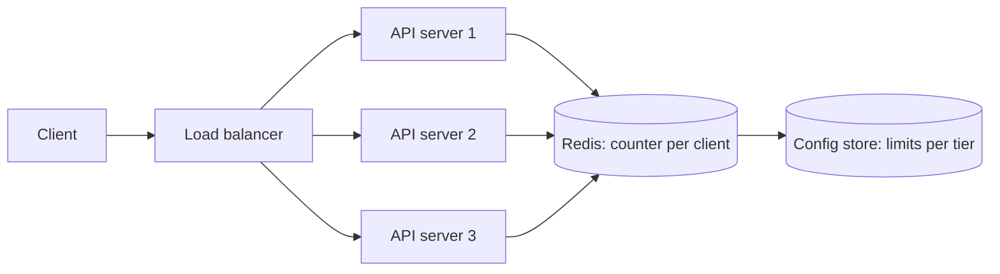

The [code-level design](/system-design/lld/rate-limiter-lld) put a token
bucket in a class and proved it O(1). The system-level question is shorter
to state and much harder to answer: when you have 40 API servers behind a
[load balancer](/system-design/fundamentals/load-balancing), each holding
its own bucket, is the *system* enforcing "100 requests per second per
client"? No: each server enforces 100, so the client that lands evenly
across all 40 gets 4,000. The rule you configured is not the rule you're
enforcing, and that gap is the entire design problem.

This is one of the best interview problems in the catalog precisely
because it looks like an infrastructure question and is actually a
[consistency](/system-design/fundamentals/cap-theorem-and-consistency-models)
question: *where does the truth about "how many requests has this client
made" live, and what is it allowed to cost to consult it?*

## Requirements

**Functional**

- `isAllowed(clientId, endpoint) -> allow/deny` (and typically
  response headers: remaining budget, reset time).
- Configurable limits per client, per endpoint, per tier; limits change
  without redeploying.
- Optional: a manual override (ban / whitelist a client).

**Non-functional**

- **Low latency**: the check is on the critical path of *every* request,
  so its budget is a few milliseconds total, network included. This
  constraint eliminates more designs than any other.
- **Availability**: a rate limiter that is down means either "everything
  is rejected" (fail-closed: the site is down) or "everything is allowed"
  (fail-open: the protection is off). The choice is a requirement, not an
  implementation detail, and must be stated explicitly.
- **Correctness within tolerance**: some over-admission under failure is
  usually acceptable (see the trade below); *under*-admission of
  legitimate traffic is a bug.
- **Multi-region**: is the limit global or per-region? A global limit
  across regions requires cross-region coordination on the hot path,
  which nobody does; per-region limits are the standard answer, stated
  explicitly.

## The design space, in order of what you'd actually build

**Local limits, divided.** Each server holds an in-memory bucket and
enforces `totalLimit / serverCount`. No coordination, nanosecond checks,
nothing new to operate. Two costs: the limit is only correct if traffic
spreads evenly (it doesn't, especially for a hot client pinned to one
server by [consistent hashing](/system-design/fundamentals/consistent-hashing)),
and a server going down changes the arithmetic for everyone. This is
almost always *part* of the final design, never all of it.

**A shared store (Redis), checked on the hot path.** The honest design.
Every request consults one authoritative counter per client; the
limit is exact, and any server enforces the same rule.

The trick is that the *entire decision* must be one atomic operation,
because a check-then-increment across two round trips is the same race
as the single-server version, just slower. The standard implementation is
a Lua script (Redis executes it atomically): read the key, apply the
window/token logic, write back, return allow/deny plus remaining, in one
server-side unit. Redis isn't doing anything exotic here; the Lua script
is just "the whole algorithm, run as one indivisible step".

The cost is the round trip: ~1ms intra-region, on every request, and
Redis becomes both a bottleneck and a single point of failure. Which
leads to the refinement:

**Local + global, hybrid.** The production answer. Each server keeps a
fast local bucket for most of the decision (say, 90% of the client's
share, in memory) and consults the shared store only near the boundary, or
on a sync interval, or only for expensive endpoints. The common case is
local and fast; the boundary case is coordinated and exact. This is the
same shape as the LLD's sharded limiters, plus a coordination layer, and
it's the design to reach for when "1ms per request" is too much but
"exact" is still required.

**Push limits, don't pull them.** The remaining cost is *configuration*:
limits per client/tier live in a config store and are *pushed* to
servers (a pub/sub channel), not fetched per request. Now limit changes
are live in seconds without any hot-path cost.

## The numbers

A sizing pass to make the trade concrete:

- 40 API servers, 10,000 requests/second total, per-client limits of
  100/s.
- Shared store: one Redis node handles ~100k simple operations/second;
  10k/second of atomic scripts is comfortable *for Redis*, but every
  request now pays +1ms p50 and a dependency on Redis being up.
- Fail-open design: Redis down means 40 servers each enforcing
  `100/40` locally, an effective limit of ~100/s *if traffic spreads
  evenly*: degraded, approximately correct, and available. This is the
  standard explicit choice: **rate limiting degrades gracefully, it does
  not take the site down with it.**

## The failure modes worth designing for

- **Redis down**: fail-open (serve, with local approximate limits) is the
  near-universal choice, with an alert, because fail-closed is an
  outage-by-design. But *say the choice out loud*: "the limiter fails
  open" is a sentence security review needs to hear.
- **Hot keys**: one client at high rate means one counter hammered 10k
  times a second. Redis handles it, but the *client* on one connection
  doesn't, and the local+global split fixes it.
- **Clock skew**: window logic uses server time; the store's clock and
  the API servers' clocks disagreeing by a second shifts every window.
  Use the store's own time in the scripts, and read
  [clock synchronization](/system-design/fundamentals/clock-synchronization-and-logical-time)
  when someone pushes on it.
- **Replay and spoofing**: a rate limiter keyed by client ID assumes the
  ID is trustworthy; keyed by IP, it punishes NATs and breaks under
  spoofing. The keying decision is a security decision, and belongs with
  [auth](/system-design/fundamentals/auth-basics).

## The interview arc

This problem rewards a specific trajectory, because the interviewer is
usually watching for *when* you notice the consistency problem:

1. Naive: local buckets. (Someone will ask what the effective limit is
   with 40 servers.)
2. Correct: shared store, atomic scripts, on the hot path. (Someone will
   ask about the latency and the failure mode.)
3. Production: hybrid local+global, pushed config, explicit fail-open,
   per-region limits, metrics on everything.

Each step is the last one answering a question the previous one raised,
which is the shape of a good design conversation, and the reason this
problem is a better interview than it looks.

## Related concepts

- [Rate Limiting](/system-design/fundamentals/rate-limiting) covers the
  algorithms and the client protocol in depth.
- [Design a Rate Limiter (Code-Level)](/system-design/lld/rate-limiter-lld)
  is the single-server version, including the thread-safety that this
  design inherits.
- [Caching](/system-design/fundamentals/caching) and
  [Consistent Hashing](/system-design/fundamentals/consistent-hashing)
  cover the hot-path and distribution machinery this design leans on.
- [CAP Theorem & Consistency Models](/system-design/fundamentals/cap-theorem-and-consistency-models)
  is what "exact vs. available" is really asking, and this problem is
  where it stops being theoretical.
