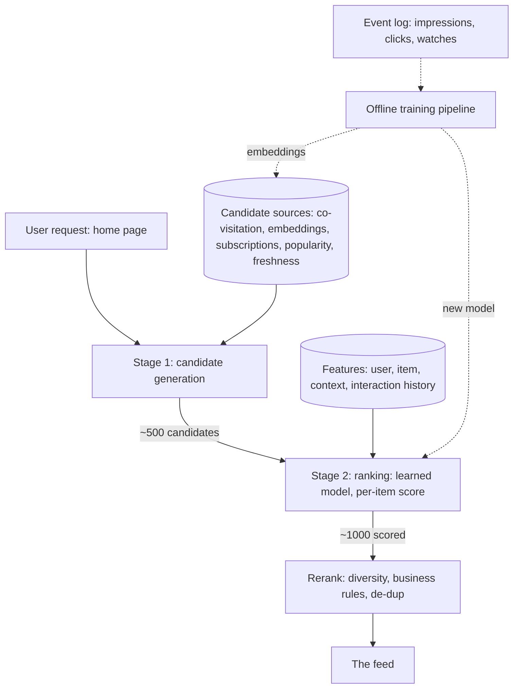

A recommendation system ("you might like", the home feed of every
modern product) is the [news feed](/system-design/hld/news-feed)'s
intellectual successor: the fan-out machinery is *not* the hard part
here (recommendations are generated per user, not per post), and
the design's center is the **two-stage pipeline** that makes
personalized selection tractable at all: **candidate generation**
(a few hundred plausible items out of billions, cheaply) followed
by **ranking** (the fine-grained ordering of those hundreds,
expensively), plus the **feature infrastructure** that feeds both
stages and the **training pipeline** that keeps the ranker honest.
Every serious recommender (YouTube, Netflix, TikTok) is this
two-stage shape, and the shape exists because of an arithmetic
argument: a learned model scoring a billion items per request is
impossible, and a billion-item *filter* plus a model scoring 500 is
not.

## Requirements

**Functional**

- Per-user recommendations: "items this user might engage with",
  ranked, personalized home pages.
- Freshness: new items surface quickly, stale items rotate out.
- Diversity/exploration: not ten near-identical items ("filter
  bubbles" is a product requirement, not a moral observation:
  the *same-item* problem is an engagement problem too).
- Explanation surfaces ("because you watched X") where the product
  wants them.

**Non-functional**

- **Serving latency: tens to ~200ms**: the home page's budget,
  shared with everything else on it.
- **Scale**: billions of items, hundreds of millions of users, the
  [news feed](/system-design/hld/news-feed)-class fleet.
- **Correctness of the *pipeline*** (not of any single answer):
  the metrics that matter (engagement, diversity, coverage) are
  fleet-level, so the system is designed around *experimentation*:
  [A/B](/system-design/fundamentals/rate-limiting)-shaped rollout is
  a first-class requirement.
- **The cold start**: a new user, a new item, both without history,
  must get reasonable answers.

## The architecture: the two stages, honestly sized

## Stage 1: candidate generation, the cheap recall

The candidate generator's job is **recall** (everything the user
would care about must be *somewhere* in the few hundred), not
precision (the order does not matter yet: the ranker fixes order),
and the honest design is *multiple cheap sources merged*:

- **Collaborative signals** (the classic "people who watched X
  watched"): co-visitation counts from the
  [event log](/system-design/fundamentals/event-sourcing-and-cqrs)
  (the item-item adjacency mined offline: "candidates who look like
  what you engaged with"), precomputed and keyed by item.
- **[Embedding](/system-design/fundamentals/search-and-inverted-index)
  retrieval** (the modern core): items (and users) as vectors, and
  candidates are the *nearest neighbors* of the user's history
  vector, an [ANN](/system-design/fundamentals/geospatial-indexing)-shaped
  search over the embedding index (HNSW-style: the "near" question
  in meaning-space instead of geography), which is where the
  ML-era recommender lives.
- **Structured sources**: subscriptions (the definite hits: the
  channels you follow), popularity (trending: the fallback for cold
  and anonymous users), freshness (new items *must* get surface
  exposure or the system never learns if they are good: exploration
  as a source, which is the [bandit](https://en.wikipedia.org/wiki/Multi-armed_bandit)
  argument wearing an engineering hat).

Each source returns 50-200 candidates, the union is ~500, and the
merger is a union plus a light filter (seen-recently, blocked,
[availability](/system-design/fundamentals/multi-tenancy-and-data-residency)):
the sources are deliberately *redundant* (the same item arriving from
two sources is a signal), and the generator's quality bar is
"don't miss", not "don't over-include".

## Stage 2: ranking, the expensive precision

The ranker is a **learned model** (the gradient-boosted trees to
neural nets lineage: whatever the current fashion, the *shape* is
stable) scoring each candidate against the **feature vector**:
user features (history, demographics, session context), item
features (category, quality signals, freshness), and *interaction*
features (how this user engaged with this item's *category*: the
personalization lives here). The model was trained offline on the
event log (watch time, clicks, skips: the impression -> engagement
pairs, joined [stream-vs-batch](/system-design/fundamentals/stream-vs-batch-processing)
style into training sets), and the serving path is a *forward
pass*: ~500 candidates, ~microseconds each, which is the
arithmetic that makes the whole two-stage design work.

The [observability](/system-design/fundamentals/observability)
discipline for the ranker is the design's quiet hard part:
**offline metrics do not predict online engagement** (the
overfit-to-the-past problem: training on yesterday's clicks
recommends yesterday's items), so the *experimentation* machinery
(shadow deployments, [A/B](/system-design/fundamentals/reliability-engineering)
traffic splits, the offline/online gap metrics) is part of the
system, not an add-on, and "how do you know the new model is
better" is the interview's senior probe.

## The reranker, and the non-ML constraints

The final stage applies the *product* over the ranked list:
**diversity** (not five items from one category: the
de-duplication of *near*-identical candidates, the same-item
problem), **business rules** (sponsored placement, availability,
regional rules: the policy layer the
[feed](/system-design/hld/news-feed) design also has), and
**explanation hooks** (the "because you watched" surfaces: the
candidate *source* is the explanation, which is why sources are
labeled). The reranker is deliberately rule-based and
interpretable, because the learned stages (candidates, ranker) are
*not* auditable in the way policy needs to be: the separation of
"learned quality" and "legible policy" is a design principle, not an
implementation detail.

## The feedback loop, and its traps

The event log (impressions with positions, engagement, dwell) is
the system's oxygen, and the traps are worth naming because each
is a classic:

- **The feedback loop** (the model recommends, users click the
  recommendation, the next model trains on those clicks: the system
  reinforces itself), which is why the *exploration* sources
  (freshness, bandit-style probing of un-scored items) are
  load-bearing: the loop needs new information to avoid collapsing
  into self-confirmation.
- **The impression bias** (the position-9 item was never going to
  be clicked: training on raw clicks over-recommends whatever the
  *previous* ranker favored, the [SLO](/system-design/fundamentals/reliability-engineering)
  discipline's cousin: normalize by *what was shown*), which is
  why the event log's *impression* side (what was served, at what
  position, with what probability) is as carefully logged as the
  engagement side.
- **The delay** (a watch happens days after the impression: the
  join of impression to engagement is a [windowed
  stream](/system-design/fundamentals/stream-vs-batch-processing)
  problem, and mis-joined pairs poison training), which is why the
  [pipeline](/system-design/hld/log-aggregation-system) machinery
  exists: the log's correctness *is* the model's correctness.

## Capacity sketch

The arithmetic that justifies the shape: 100M users, ~50 pages of
recommendations a day = 5B requests, each at ~200ms: the candidate
stage is a few index lookups per request (the embedding index:
[ANN](/system-design/fundamentals/search-and-inverted-index)-class,
cached aggressively), the ranker is ~500 forward passes per
request (the model fleet: the same
[GPU-tier](/system-design/fundamentals/capacity-planning-and-estimation)
shape as autocomplete's trie: precompute where possible, serve
cheap), and the training pipeline is a nightly/continuous
[batch](/system-design/fundamentals/olap-vs-oltp) job over the
event log (the warehouse tier: where the features and training sets
live). The per-user *serving* is stateless (everything per-request
is a lookup: the personal state is precomputed), which is what lets
this fleet scale like the [feed](/system-design/hld/news-feed)
fleet: horizontal, cache-heavy, no per-user stickiness.

## Related concepts

- [Design a News Feed](/system-design/hld/news-feed) is the
  delivery-machinery sibling (fan-out, the precomputed-vs-on-read
  trade).
- [Search & Inverted Index](/system-design/fundamentals/search-and-inverted-index)
  is the embedding/ANN machinery stage 1 rides.
- [OLAP vs. OLTP](/system-design/fundamentals/olap-vs-oltp) is the
  training-pipeline's storage tier.
- [Stream vs. Batch](/system-design/fundamentals/stream-vs-batch-processing)
  is the offline-training/online-serving split, formalized.
- [Observability](/system-design/fundamentals/observability) and
  [Reliability Engineering](/system-design/fundamentals/reliability-engineering)
  are the experimentation discipline (the offline/online gap, the
  A/B machinery).
