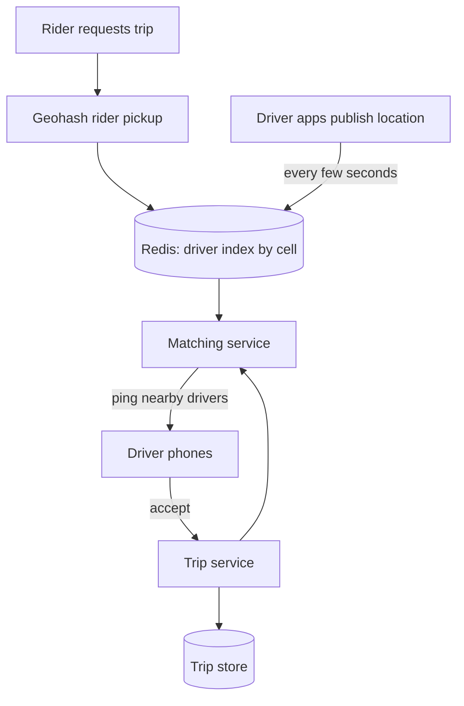

Uber, Lyft, Ola: the product is "tap a button, a car arrives", and the
system design behind it is dominated by one technical question, **how to
find the nearest available drivers to a rider, continuously, over a city's
worth of moving objects**, with everything else (matching, trips, pricing)
built on top of that answer. It is the canonical
[geospatial indexing](/system-design/fundamentals/geospatial-indexing)
problem, and it is where the interview spends its time.

## Requirements

**Functional**

- Riders request a trip from origin to destination.
- Nearby drivers (a few minutes away) are matched to the request.
- Both parties track the trip in real time (location updates, ETA).
- Pricing, computed from distance, time, and demand.
- Trip history, receipts, ratings.

**Non-functional**

- **Matching latency**: from "request" to "drivers being pinged" should
  be single-digit seconds. Nobody waits 30 seconds to find out a car is
  coming.
- **Location write volume is the load**: every active driver and rider
  publishes a location update every few seconds, so a city at rush hour is
  a firehose of position writes *per user*, not just per request.
- **Availability degrades gracefully**: matching should keep working in a
  degraded mode (larger search radius, slower matching) rather than being
  entirely down.
- **Consistency is eventually permissive**: a rider seeing a driver's
  location a few seconds stale is fine; the money and trip state must be
  exactly consistent.

## The core: nearby search over moving objects

The naive implementation, "store every driver's (lat, lng) in a table and
run `WHERE distance < 5km`", fails for a reason worth articulating: the
distance computation is per-pair, so a city scan is
`drivers x active riders` per second, and it cannot use an index on
anything that matters. The fix is to **quantize space into cells** so that
"nearby" becomes an index lookup, which is what
[geospatial indexing](/system-design/fundamentals/geospatial-indexing)
is:

- **Geohash**: interleave the bits of latitude and longitude into a single
  number where *longer shared prefixes mean physically closer points*.
  Nearby search becomes: geohash the rider, look up the driver cell and
  its 8 neighbors (the neighbors cover the boundary), done in O(1)-ish
  per cell.
- **Quadtree / S2**: a hierarchical grid that subdivides adaptively:
  dense downtown is many small cells, rural areas are one big one. Same
  lookup shape (cell + neighbors), better memory balance.

The **driver location pipeline** is the other half: drivers publish
positions every ~4 seconds, which lands in a
[queue](/system-design/fundamentals/message-queues-and-pubsub) and
updates two stores. A **hot store** (Redis) holds the current position
per cell for matching, because matching needs *now*, in milliseconds. A
**trip store** (a database) holds the authoritative trip state, because
money needs *forever*. Those are different questions with different
stores, and conflating them is the classic mistake: writing every
location update to the money database turns a 4-second firehose into a
database killer for zero benefit.

## Matching: the part that is a product, not an algorithm

Given the candidate set, matching is a policy layer, and the interview
grades the trade-offs rather than the code:

- **Broadcast**: ping every nearby driver simultaneously; first accept
  wins. Simple, fast, and brutally unfair (drivers race, and the closest
  car is not necessarily the fastest thumb).
- **Sequential offer**: offer to the nearest driver, wait a few seconds,
  then the next. Better fairness and utilization, worse rider latency on
  busy streets.
- **Batch / pooled matching**: collect riders and drivers over a 5-10
  second window and solve a small assignment problem (minimize total
  pickup distance), which is meaningfully better utilization at the cost
  of that batching delay. This is where
  [greedy vs optimal](/dsa/patterns/greedy-algorithms) shows up as a
  real systems question: broadcast is greedy matching, batch is
  near-optimal, and the choice is a latency/efficiency dial.

Surge pricing sits on top as a demand/supply signal per cell: count
riders versus drivers per geohash bucket, publish a multiplier, and use
it to *shape demand* (higher price defers riders) as much as to pay
drivers.

## The hard parts

**Every driver's phone is a flaky sensor.** GPS jumps, tunnels, dead
batteries, and revoked permissions all produce garbage updates, so the
ingestion path needs filtering (impossible speeds, teleports across the
city) and a driver *session* that expires after silence, treating
"no update for 60 seconds" as "driver is gone" rather than
"driver is parked downtown".

**The matching state machine**: `requested -> offered -> accepted ->
arriving -> in_trip -> completed`, with timeouts and cancels from both
sides at every stage. This is the same explicit-transition discipline as
the [payment system](/system-design/hld/payment-system)'s states: money
and trip state must never be ambiguous, and the race conditions (rider
cancels while driver accepts) are exactly the bugs this layer exists to
prevent.

**Trips are the durable part.** Once matched, the trip is a normal
transactional record: route, fare, timestamps, receipts. Location updates
flow to the hot store for live tracking; only the *events* (pickup
happened, trip ended) land in the trip store, which is the split that
keeps the write volume survivable.

## Capacity sketch

One city at rush hour: 50,000 active drivers publishing every 4 seconds
is ~12,500 writes/second just for locations, which is a firehose that
must never touch the money database. Matching at 100 requests/second,
each a handful of cell lookups, is small. The scaling story is *sharding
by city* (matches, trips, and the location index per city, since nothing
about a Mumbai trip affects London), plus replicas for the hot store,
which is a cache and can be rebuilt from driver apps if lost.

## Related concepts

- [Geospatial Indexing](/system-design/fundamentals/geospatial-indexing)
  is the core technique, in depth.
- [Design a Proximity Service](/system-design/hld/proximity-service) is
  the same nearby-search core without the trips.
- [Message Queues & Pub/Sub](/system-design/fundamentals/message-queues-and-pubsub)
  absorbs the location firehose.
- [Caching](/system-design/fundamentals/caching) is the hot store's
  role, and its loss is survivable by design.
- [Greedy Algorithms](/dsa/patterns/greedy-algorithms) is the matching
  policy question in algorithm clothes.
