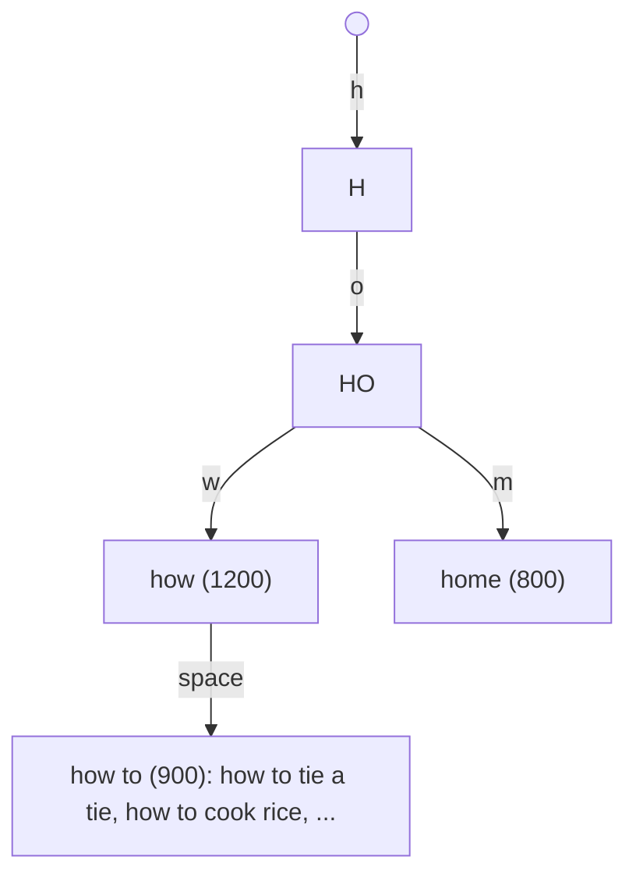
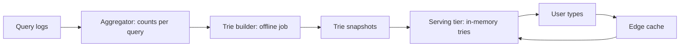

Type "how to" into a search box and suggestions appear before you finish
the thought. This feature is called autocomplete (or typeahead), and its
defining constraint is not relevance but **latency**: the suggestions must
arrive within the few tens of milliseconds between keystrokes, or they feel
laggy and users stop trusting them. That constraint reshapes the entire
design. A recommendation system can spend 200ms ranking; autocomplete
cannot spend 20ms deciding, which is why it leans on a prefix structure
(a [trie](/dsa/patterns/trie-prefix-tree)) and heavy caching rather than a
sophisticated model on the hot path.

## Requirements

**Functional**

- Given a prefix, return the top few completions (say 5-10), ranked by
  popularity.
- Update suggestions as real-world queries shift (trending topics).
- Optional: personalization, typo tolerance, per-locale suggestions.

**Non-functional**

- **Latency**: the hard requirement. Target well under 100ms
  end-to-end, ideally tens of milliseconds, because the request fires on
  every keystroke (or is debounced, but the budget is still tight).
- **Read-heavy**: every keystroke is a query. Reads dwarf writes by orders
  of magnitude.
- **Staleness is tolerable.** Suggestions lagging by minutes or hours
  behind real trends is invisible to users, which is a gift: it means the
  expensive ranking work can happen offline.

## The core structure: a prefix trie with precomputed top-K

The naive approach, scan all past queries for those with the prefix and
sort by count, is O(number of queries) per keystroke, which is far too
slow. The design inverts it: precompute the answer *at every prefix*.

Build a [trie](/dsa/patterns/trie-prefix-tree) over the query corpus, and
at each node store the **top K completions** of the prefix that node
represents (K = 10, say). Then a query is: walk the prefix's characters to
its node, and read off the stored top K. That is O(length of prefix), a
handful of pointer hops, regardless of how many queries exist.

The trade is memory and update cost for read speed: storing top-K at every
node means the trie is much larger than the raw corpus, and it must be
*rebuilt* when counts change, because a query that becomes popular must
bubble up into the top-K lists of all its prefixes. This is why the trie is
built offline, not updated in place.

## The architecture

**Aggregation** counts queries from logs over a window (last day, last
week), producing a weighted corpus. Recency matters: a query that surged
today should outrank one that was popular last year, so the aggregator uses
a time-decayed count, not a lifetime total.

**Offline trie build** constructs the trie with top-K lists and produces a
snapshot. Because the serving tier needs the whole structure in memory,
the snapshot is a serialized trie that servers load at startup.

**Serving tier** holds the tries in memory and answers prefix lookups in
microseconds. There is no database call on the hot path: the structure is
in memory, which is the only way to hit the latency budget.

**Edge caching** is the final layer: the top prefixes ("a", "th", "how")
are requested constantly, so caching their results at the
[CDN](/system-design/fundamentals/cdn) or a [cache](/system-design/fundamentals/caching)
absorbs most of the load before it reaches the serving tier.

## The hard parts

**Freshness vs. the offline build.** The trie is a snapshot, so a breaking
news query ("earthquake") cannot wait for the nightly rebuild. The standard
fix is a **two-tier** answer: the stable trie for the long tail, plus a
small real-time layer for trending queries (a few thousand entries,
updated every minute from a streaming aggregator), merged at read time.
Trending queries are the ones users most notice missing, so they get the
fast path; everything else tolerates the batch delay.

**Ranking beyond raw popularity.** Raw counts suggest whatever is popular
globally, which is often not what *this* user wants. Personalization
(blend the global trie with the user's own history), freshness boosts, and
diversity (don't return ten variants of the same query) are ranking
refinements layered on top. Crucially, all of them happen *after* the
prefix lookup, on a candidate set of a few dozen, so they stay cheap.

**Multi-region and sharding.** The trie is per-language and per-region
(different locales have different popular queries), so the serving tier is
sharded by locale, with each shard holding a full trie for its language.
Within a language, the whole trie fits in one server's memory for
reasonable corpus sizes, so there is little intra-language sharding; the
scale is handled by replicating the same trie across servers behind a
[load balancer](/system-design/fundamentals/load-balancing).

**Typo tolerance** is deliberately *not* on the hot path. Fuzzy matching is
expensive; it is handled by a separate, slower suggestion path (or the full
search engine's spelling correction) rather than by the prefix trie, so
that the common case stays fast.

## Capacity sketch

Assume 10,000 prefix requests/second. The trie for a language fits in a
few gigabytes (with top-K lists), so a handful of in-memory servers behind
a load balancer handle it, and edge caching cuts the origin traffic by an
order of magnitude for the popular prefixes. The offline build runs hourly
or daily over the query logs, which are the only large data store; the
serving path touches no database at all.

## Related concepts

- [Trie (Prefix Tree)](/dsa/patterns/trie-prefix-tree) is the data
  structure at the heart of the design.
- [Caching](/system-design/fundamentals/caching) and
  [Content Delivery Networks](/system-design/fundamentals/cdn) absorb the
  read load for popular prefixes.
- [Search & Inverted Index](/system-design/fundamentals/search-and-inverted-index)
  is the full-search counterpart; autocomplete is the prefix shortcut
  before the real query is even run.
- [Load Balancing](/system-design/fundamentals/load-balancing) distributes
  the stateless serving tier.
