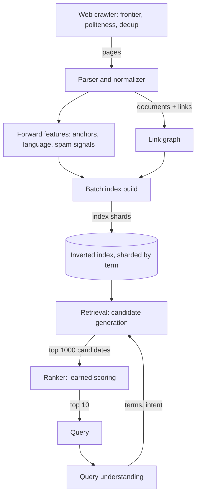

A search engine is three systems wearing one logo: a **crawler** that
discovers the corpus, an **indexing pipeline** that turns billions of
documents into a structure a query can probe, and a **serving stack**
that answers arbitrary queries in a few hundred milliseconds. Any one of
them is a substantial design; the reason they are one interview question
is the coupling, because the index format is decided by what ranking
needs, the ranking features are decided by what the corpus contains, and
the whole pipeline is refreshed on a schedule set by how stale users
will tolerate results being.

This page is the end-to-end assembly. The crawler alone is its own
[case study](/system-design/hld/web-crawler), and the index structure is
a [fundamentals topic](/system-design/fundamentals/search-and-inverted-index);
here they plug together with the ranking and serving layers they exist
to serve.

## Requirements

**Functional**

- Crawl the web continuously; refresh pages on a schedule.
- Index the corpus: text, metadata, and the link structure between pages.
- Answer free-text queries with a ranked list of the best-matching
  pages, in order of relevance to *this* query.

**Non-functional**

- **Query latency**: tens to hundreds of milliseconds end to end. The
  [latency budget](/system-design/fundamentals/latency-vs-throughput)
  rules out touching anything disk-bound or single-machine at query
  time.
- **Index freshness**: a changed or new page appears within hours to
  days, not weeks.
- **Scale**: tens of billions of documents, tens of thousands of queries
  per second.
- **Quality as a feature**: relevance is the product. A fast engine that
  returns junk loses to a slow one that does not.

## The architecture

Two halves, cleanly separated by time: the **offline** half (crawl to
built index, measured in days for a full refresh, hours for
incremental), and the **online** half (query to answer, measured in
milliseconds). The index is the interface between them.

## The offline half: corpus to index

The crawler produces a stream of documents; each passes through
parsing (HTML to text plus structure), language detection, spam and
[duplicate filtering](/system-design/hld/web-crawler) (a search index
full of mirrors is a search engine that answers with the same page ten
times), and feature extraction: title, headings, anchor text pointing
*at* the page, freshness signals.

Two artifacts come out of this stage. The **index**, built in the batch
style of a [stream vs. batch](/system-design/fundamentals/stream-vs-batch-processing)
pipeline: a MapReduce pass builds per-term postings lists, and the
finished index is flipped into serving. And the **link graph**, the
web's citation structure, which feeds the query-independent half of
ranking: PageRank-style scores measuring a page's importance, computed
by iterative passes over the whole graph, exactly the kind of
whole-corpus computation that belongs offline.

The index is then **sharded**. The naive split (documents across
machines) forces every query to touch every machine, so real engines
split by *term*: a shard owns the postings lists for a slice of the
vocabulary, and each query's rare terms identify the small set of
shards that hold the candidates. Terms are
[hashed](/system-design/fundamentals/partitioning-and-sharding) so
popular and rare terms spread evenly, and postings for a hot term are
replicated [across nodes](/system-design/fundamentals/consistent-hashing)
so no single machine becomes the query path for "weather".

## The online half: query to answer

**Query understanding** runs first and cheaply: tokenization,
spell-correction, and intent signals (is "jaguar" a car, a cat, or an
OS?) from the query's own words. Modest models, because they sit at the
front of the latency budget.

**Retrieval (candidate generation)** is the funnel's wide end: find the
few thousand documents that contain the query terms, using the inverted
index's structure to intersect postings lists and prune with early
termination (documents that cannot possibly make the top 1000 are
dropped mid-intersection). This stage is
[boolean and lexical](/system-design/fundamentals/search-and-inverted-index):
fast, dumb, and high-recall. It must not miss good documents, because
nothing downstream can resurrect one it never fetched.

**Ranking** is where most of the quality lives, and it is a *machine
learning system* riding on a search system: a learned model scores the
thousand candidates on hundreds of features, textual (term frequency,
proximity, title matches), document-level (PageRank, freshness, spam
score), and query-document interactions. Modern systems add a
[semantic layer](/ai-ml/systems/semantic-vector-search): embeddings that
match "used car" to "pre-owned vehicle", blended with or feeding the
lexical scores, the same hybrid-retrieval question the
[RAG](/ai-ml/systems/rag) pipeline answers in a smaller arena. The
output is ten blue links, ranked.

The stage structure exists for latency: cheap pruning before expensive
scoring, so per-query cost is dominated by thousands of cheap scores
and dozens of expensive ones, not billions of anything. That funnel is
the search engine's version of
[backpressure](/system-design/fundamentals/backpressure-and-flow-control):
work shed early, so the tail stays fast.

## Capacity sketch

The arithmetic that shapes it: 20 billion documents at an average
postings footprint of ~1 KB per document across all terms is ~20 TB of
index text, compressed to a few TB and spread over hundreds of shard
replicas, with the hot term set cached in RAM. At 50,000 queries per
second and 300 ms each, the fleet runs a few hundred concurrent
candidate generations per shard replica; retrieval dominates, so shards
are sized so their postings for a typical query fit in memory. The
crawler feeding this is the [web crawler](/system-design/hld/web-crawler)
capacity problem (hundreds of pages per second fleet-wide, politely),
and the offline build, run continuously in increments, is a
streaming-join workload whose output is a fresh index flip every few
hours. The full refresh loop runs at
[batch](/system-design/fundamentals/stream-vs-batch-processing) cadence
(days), while index deltas stream (hours): the two-tier freshness
design that keeps "the index" one logical artifact but many physical
vintages.

## Trade-offs

- **Shard by term vs. by document**: term sharding bounds per-query
  fan-out but complicates multi-term intersection; document sharding
  keeps a document whole but fans every query out everywhere. Real
  engines shard by term and replicate for the hot terms.
- **Lexical vs. semantic retrieval**: exact-term matching is precise,
  cheap, and blind to meaning; embeddings capture meaning but miss
  exact strings and add an ANN index to the serving path. The honest
  answer is the hybrid, with its cost: two retrieval systems to
  maintain, one ranking layer to blend.
- **Freshness vs. stability**: rebuilding fast means the corpus churns
  and quality measurement gets noisy; rebuilding slowly means users
  find yesterday's news. The two-tier pipeline is the compromise.
- **Query-time vs. index-time work**: anything computed at index time
  (PageRank, spam scores) is paid once and amortized over queries;
  anything computed at query time is paid on the latency budget. Move
  work offline until quality forces it online.

## Related concepts

- [Search & Inverted Index](/system-design/fundamentals/search-and-inverted-index)
  is the data structure at the center of this design.
- [Design a Web Crawler](/system-design/hld/web-crawler) is the offline
  half's first stage, in full.
- [Design a Search Autocomplete](/system-design/hld/search-autocomplete)
  is the query-side companion that shares the query-understanding layer.
- [Latency vs. Throughput](/system-design/fundamentals/latency-vs-throughput)
  is the budget the funnel spends.
- [Design a Semantic / Vector Search](/ai-ml/systems/semantic-vector-search)
  covers the embedding-based half of modern hybrid retrieval.
- [Stream vs. Batch Processing](/system-design/fundamentals/stream-vs-batch-processing)
  is the freshness architecture of the build pipeline.
