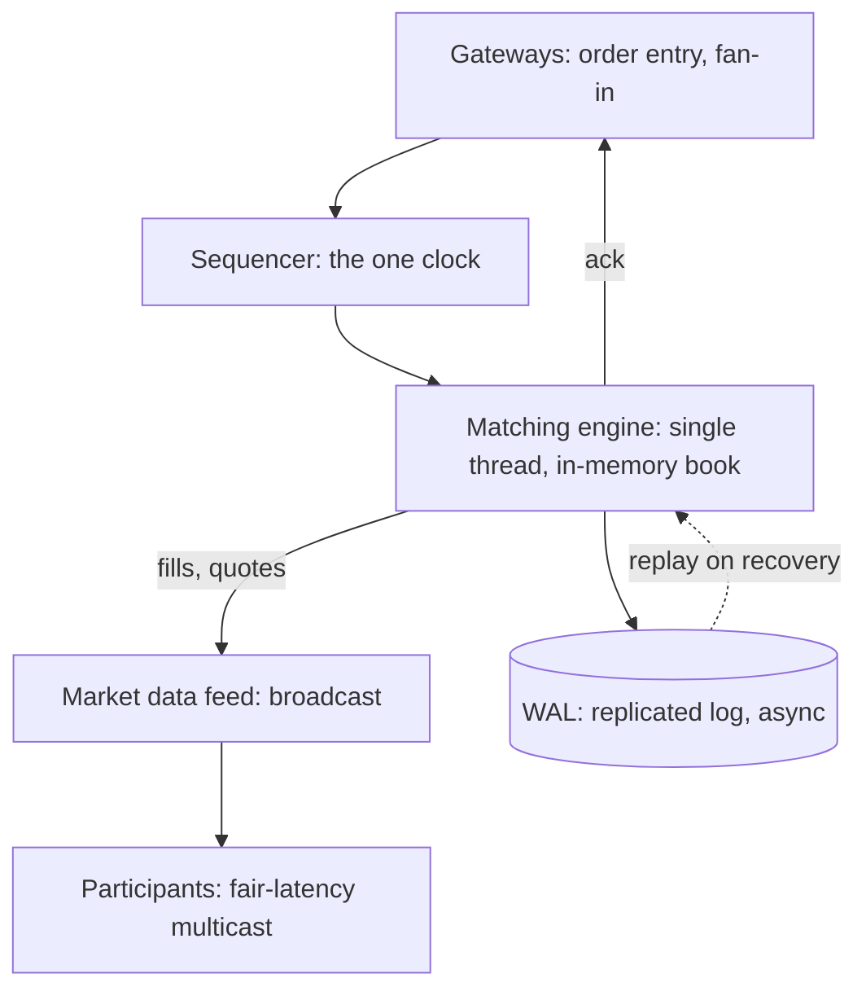

A stock exchange is the canonical *hard* systems interview: not
because the components are exotic, but because the requirements
collide head-on. The **matching engine** (pair buyers with sellers)
must be *fair, ordered, and fast-microseconds*, which pulls the
design toward a single-threaded, in-memory, deterministic core.
The **book** (the state of all outstanding orders) must be
*durable and auditable*, which pulls toward
[append-only storage](/system-design/lld/bank-ledger-system). And
**regulatory fairness** (everyone sees the same data at the same
time, no one trades ahead of anyone) pulls toward broadcast
determinism. The design is the art of refusing to let the
durability requirement slow the matching path.

## Requirements

**Functional**

- Order entry: limit orders (buy/sell at price-or-better), market
  orders, cancel/modify.
- Matching: continuous auction (incoming orders pair with resting
  orders by price-time priority).
- Market data: broadcast trades and quotes (the
  [feed](/system-design/hld/news-feed) of the trading world).
- Reference prices: opening/closing auctions, circuit breakers.

**Non-functional**

- **Latency: microseconds for a match** (the competitive product:
  firms pay fortunes to be one microsecond earlier, and the
  exchange's own processing time is the floor under them).
- **Total ordering: every event, one global sequence** (the
  fairness requirement: "who saw it first" must be decidable, and
  the sequence *is* the decision).
- **Durability: an acknowledged order survives anything** (an
  exchange that loses a fill is a scandal, not an incident).
- **Auditability**: every event retained, replayable, for years
  (regulators).

The three-corners tension, stated once more because it *is* the
design: fast says in-memory single-thread; durable says replicated
writes; fair says deterministic broadcast. The resolution: **a
single-threaded deterministic core, with everything slow pushed
outside it.**

## The architecture: the core, the skirts



- **Gateways** terminate participants' connections
  ([the LB's](/system-design/hld/load-balancer-system) data plane,
  but *fan-in*: many sessions, one sequencer), normalize orders, and
  do *nothing* else: no validation beyond the cheap, no business
  logic, because every microsecond here is latency.
- **The sequencer** is the exchange's
  [clock](/system-design/fundamentals/clock-synchronization-and-logical-time):
  the *single* place that assigns the global order (sequence
  numbers over the event stream), and its existence is what makes
  "fair" mechanical rather than aspirational: every event has a
  number, the number is the truth of "who was first", and no
  wall-clock ever enters the decision (the
  [logical-time](/system-design/fundamentals/clock-synchronization-and-logical-time)
  discipline at its purest).
- **The matching engine** is one thread, one in-memory book,
  deterministic: *no locks* (nothing to contend with), *no I/O on
  the hot path* (the [WAL](#durability) is asynchronous, or better,
  memory-mapped), no surprises. The whole performance discipline is
  "keep the core minimal", and the standard engineering (kernel
  bypass, [huge pages](https://en.wikipedia.org/wiki/Page_(computer_memory)#Huge_pages),
  CPU pinning, cache-line alignment of the book structures) is in
  service of that one thread never stalling.

## The order book: the data structure under the engine

The book (per symbol: all resting orders) is two sorted structures
(bids descending, asks ascending: the best at the head), and the
matching loop is the textbook
[priority-queue](/dsa/patterns/heaps-and-priority-queues) walk: an
incoming buy at price P pops matching asks while their price is at
or below P, filling each, until the book's best ask exceeds P (the
order rests) or the incoming order is filled.

```cpp
struct Order {
    uint64_t id;                       // sequence-assigned: identity
    bool side;                         // buy / sell
    uint64_t price;                    // integer ticks: never floats
    uint64_t quantity;
    uint64_t arrivalSequence;         // price-TIME priority: the tiebreak
};

// The book per price level: a FIFO of orders (time priority).
//   bids: price DESC, then arrivalSequence ASC
//   asks: price ASC,  then arrivalSequence ASC
class OrderBook {
public:
    // Incoming order: match against the opposite side, then rest.
    std::vector<Fill> incoming(const Order& order);
private:
    std::map<uint64_t, std::deque<Order>, std::greater<>> bids_;
    std::map<uint64_t, std::deque<Order>> asks_;
};
```

The **price-time priority** rule (best price first, *then* first
arrival) is the fairness invariant that makes the book a pair of
price-sorted FIFOs, and the `arrivalSequence` (the sequencer's
number, not a
[wall clock](/system-design/fundamentals/clock-synchronization-and-logical-time))
is what makes the tiebreak provable. The map-per-price-level
structure (not a heap) is deliberate: cancels (the common
high-frequency operation) must be O(log n) against a heap's O(n),
and the price-level *FIFO* is what time-priority means structurally.

## Fairness and the market-data broadcast

The matching engine's *outputs* (fills, the new best bid/ask)
broadcast to every participant, and the fairness requirement is
that **no one trades on a price before others can see it**: the
broadcast is sequenced with the same clock as the matching (the
market-data stream *is* a view of the event log: event N, then
everyone sees event N), and the "fair-latency" engineering
(colocated multicast, the same wire length to every rack, the
[fan-out](/system-design/hld/news-feed) with the throughput and the
determinism but none of the staleness tolerance) is what the
product's "no informational advantage" promise means physically.

The **colocation** story (participants paying to put their servers
meters from the exchange) is not an exotic addition: it is the
market's answer to the fact that *light-speed latency to the
exchange is the scarce resource*, and the exchange's design
(equal-length cables, one broadcast medium) is the fairness
discipline applied to physics. An interview answer that names this
("the exchange's job includes making the speed-of-light fair") has
understood the problem.

## Durability: the WAL, and the recovery that must be boring

The book is in-memory and the event log is the truth:
**write-ahead logging** (the
[ATM](/system-design/lld/atm) and [ledger](/system-design/lld/bank-ledger-system)
discipline at microsecond scale): every order entry, fill, cancel,
and modification is appended (asynchronously: the sequencer's
numbers make the log replayable *deterministically*) before the
matching engine's state is considered authoritative, and
**replicated** (the [message queue](/system-design/hld/distributed-message-queue)'s
ISR quorum: an acknowledged order is on f+1 nodes before the
participant's ack).

The recovery path is the design's quiet masterpiece: a failed engine
rebuilds its entire book state by *replaying the log* (the
[event-sourcing](/system-design/fundamentals/event-sourcing-and-cqrs)
payoff, at hard-realtime scale), and the replay is *bit-identical*
to the original execution because the engine is deterministic
(same input sequence, same output: the property that makes the
whole architecture auditable *and* recoverable from one mechanism).
"Replay must converge to the same book" is the sentence that ties
the single-threadedness (no races), the sequencer (one order), and
the WAL (the source of truth) together.

## The auction and circuit-breaker layers

The **opening/closing auctions** (batch matching: all orders
collected, one price that maximizes crossed quantity, one clearing
print) are a different engine (a periodic batch, not continuous),
and the **circuit breakers** (halt the symbol on excessive moves)
are a *policy engine* over the price stream: rules evaluated
per-print, trading suspended by state transition, which is the
[rate limiter](/system-design/lld/rate-limiter-lld)'s fail-closed
discipline applied to the market's own stability. Both live
*outside* the hot core (a policy engine reading the stream, not
inside the matching loop), the same "keep the core minimal" as
every layer above.

## Capacity sketch

The numbers that shape it: a modern exchange matches at
*sub-millisecond core latency* (the gateway-to-fill budget, of
which the engine's book walk is microseconds), sustains
*millions of orders per second* per symbol (the book's price-level
structure and the cache-line engineering), and the market-data
broadcast is the fleet's real bandwidth (every fill and quote, to
every participant: gigabits of multicast, the product's actual
egress bill). The **durability budget** is the asynchronous-WAL
ack (a fraction of the latency budget: the sequenced-log ack, not
a synchronous disk sync per order, which is the
[payment system](/system-design/hld/payment-system)'s "uncertain
means parked, never guessed" trade running at a hundred times the
rate).

## Related concepts

- [Design a Bank / Ledger System](/system-design/lld/bank-ledger-system)
  is the append-only, conservation-invariant discipline the fills
  obey (every trade debits one account and credits another).
- [Design a Distributed Message Queue](/system-design/hld/distributed-message-queue)
  is the sequenced-log and replication machinery the WAL rides.
- [Clock Synchronization & Logical Time](/system-design/fundamentals/clock-synchronization-and-logical-time)
  is why sequence numbers, never timestamps, decide priority.
- [Heaps / Priority Queues](/dsa/patterns/heaps-and-priority-queues)
  is the priority structure family the book's price-levels belong
  to.
- [Design a Load Balancer](/system-design/hld/load-balancer-system)
  is the gateway layer's architecture (connection handling, the
  two-plane split).
