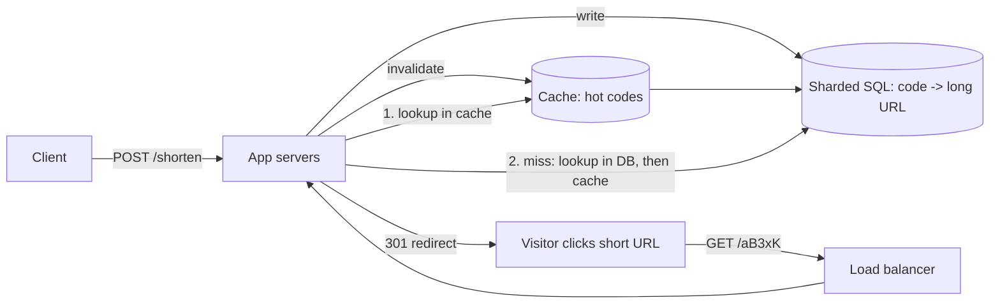

Every system design interview starts somewhere, and TinyURL is the classic
first problem because it sounds trivially small and expands in every
direction once you take it seriously. The short version: make a long URL
tiny, and when someone clicks the tiny URL, send them to the original.
Everything interesting lives in the numbers.

## Requirements

**Functional**

1. `shorten(longUrl)` returns a short URL like `https://short.io/aB3xK`.
2. `resolve(code)` redirects visitors to the original long URL.
3. Links never expire (or state clearly: they expire after N years).
4. Optionally: analytics on clicks, custom aliases
   (`https://short.io/my-wedding-site`).

**Non-functional**

- **Latency**: the redirect is on every click's critical path, so resolve
  must be fast. Target low tens of milliseconds; a redirect that takes half a
  second is materially worse than the long URL it replaced.
- **Read/write ratio**: dramatically read-heavy. Estimate 100:1 or even
  1000:1 redirects per new shortening.
- **Availability**: for a link service, availability *is* the product.
  Dead links are worse than slow links: the write side can be briefly
  down, but a link that goes dark breaks everything that ever embedded it.
- **Consistency**: it's fine if a new link takes a second to become
  globally resolvable (eventual), but once created, a link must redirect
  *forever* to the same place. Strong consistency on the read path, weak on
  the write path.

## Back-of-envelope sizing

Say the service starts small: 100 million new URLs per month.

- **Writes**: 100M / month ≈ 40/sec average, call it 100/sec at peak
  (write spikes when a popular site starts auto-shortening links in bulk).
- **Reads**: at 100:1 that's 10,000 redirects/sec, and peaks 10x that.
- **Storage**: with a 10-year retention, ~12 billion records. A
  short-code row is tiny (code + URL ≈ 500 bytes with metadata): ~6 TB.
  Comfortably one database cluster's worth, sharded for availability rather
  than necessity.
- **Code length**: base62 (a-z, A-Z, 0-9) gives 62^7 ≈ 3.5 trillion codes
  in 7 characters. We will never run out; 7 chars is the standard choice.

## The core design choice: how to generate codes

This is the interview's centerpiece. Three real options:

**Hash the URL and truncate.** MD5 the long URL, take the first 7 base62
characters. Simple, but two URLs can collide on the same prefix, so you
must handle collisions anyway (re-hash with a counter, check uniqueness),
which drags the "hash, no coordination" advantage into the mud.

**Random generation with a uniqueness check.** Generate 7 random
characters and insert; on collision, retry. With 62^7 codes, collisions are
practically nonexistent until billions of URLs. This is what most real
services do, and the database's unique constraint on the code is the safety
net. Simple, collision-tolerant, no coordination, and no predictability
(which is also a mild security property: you can't enumerate links).

**Counter-based.** Keep a global counter, increment it, encode the number
in base62. Guaranteed unique and short codes stay compact. Costs: it's a
single serialization point (a "global counter" service, or a block of
numbers pre-allocated per app server), and codes are *sequential*, so
anyone can walk your entire link graph by incrementing a code. The
block-allocation version is worth knowing: each app server takes a batch
of 10,000 counter values from a coordinator, then hands them out locally,
amortizing the coordination.

The answer that scores well is a genuine comparison and a choice with
reasons, not a recital. Random-with-check is the default recommendation:
cheap, uniform length, no external coordination, and the retry path is
rare enough to ignore in latency budgeting.

## The architecture

**Write path**: app server generates a random code, inserts
`(code, long_url, created_at, owner)` into the database, and pushes the
code into the cache proactively (since a brand-new link is likely to be
clicked immediately by its creator).

**Read path** is where the design earns its keep. The read path is a
textbook [cache-aside](/system-design/fundamentals/caching): check the
cache, on a miss read the database and populate the cache. Because the
traffic is extremely skewed (a small fraction of links get almost all the
clicks), the cache hit rate will be very high. A cache node holding the
top million links in memory turns 10,000 DB reads/sec into a few dozen.

## The redirect: 301 vs. 302

A tiny decision that interviewers probe. A **301 (permanent)** tells the
browser to cache the redirect locally and stop asking; it shifts load off
your servers but *also stops your analytics*, since the browser never comes
back. A **302 (temporary)** makes the browser ask again every time, so you
can count clicks and change destinations, at the price of serving every
request. The answer is a product question: if click analytics is a feature,
302 everywhere and let the cache tier absorb the load; if links are pure
convenience, 301 and save the infrastructure.

## Data model and storage choice

A single table: `short_codes(code PK, long_url, owner_id, created_at,
expires_at)`. It's a pure key-value lookup by code, which means the sharding
strategy is easy: [hash the code](/system-design/fundamentals/consistent-hashing)
across shards, with each lookup touching exactly one shard.

The technology answer follows the access pattern: this is key-addressed
data with no joins, so a key-value store (DynamoDB) or a simple sharded SQL
table both work well. If you choose SQL, you keep the door open for
analytics joins later (clicks joined to owners).

## Failure modes and the questions they earn

- **Cache stampede on a viral link**: one link gets a million clicks per
  hour after being quiet for a year. Fix: jittered TTLs and a single-flight
  (one request repopulates, the rest wait) on the miss path.
- **Bad links**: the service is an open redirector by design
  (`short.io/xyz` can point anywhere), which phishers love. Mitigate:
  scan for known-malicious destinations, rate-limit creation per IP,
  offer domain-level blocklists.
- **Load on the creator**: if a link's owner deletes their account, do
  the links die? State the policy explicitly rather than discovering it in
  production.

## Capacity summary

| Component | Scale | Notes |
| --- | --- | --- |
| App servers | ~10 for 10k RPS | Stateless, trivially scaled behind a [load balancer](/system-design/fundamentals/load-balancing) |
| Cache | Top ~1M links | A few GB of RAM |
| Database | ~6 TB / 10 yr | Sharded for availability; writes are only ~100/sec |

The pattern to recognize: this "simple" system is the atomic HLD template
read-heavy + cache + KV store, with one genuinely interesting decision (code
generation). Chat applications, news feeds, and rate limiters all reuse the
same skeleton with different details.

## Related concepts

- [Caching](/system-design/fundamentals/caching) is the backbone of the read
  path and its failure modes are this system's failure modes.
- [Database Fundamentals](/system-design/fundamentals/database-fundamentals)
  for the sharding and replication of the code table.
- [Load Balancing](/system-design/fundamentals/load-balancing) for the
  stateless app tier.
- [Scalability](/system-design/fundamentals/scalability) for the overall
  ladder this design walks.
