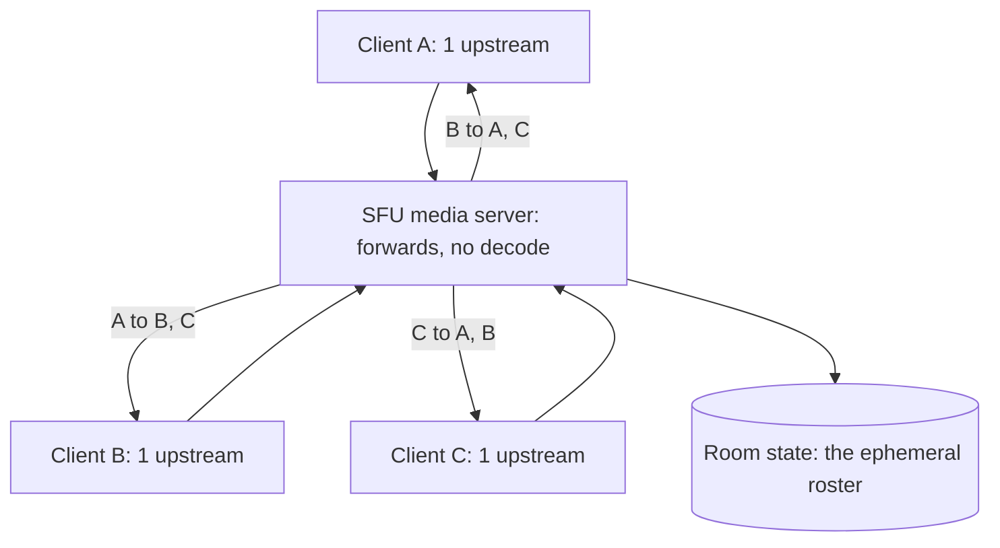

Zoom in design terms is the [chat](/system-design/hld/chat-application)'s
infrastructure plus one brutally different payload: **real-time
audio and video**, where the requirements conflict in a way text
never does. Chat can be delivered late; **a video frame delivered
late is worthless** (it is a *stale* frame: nobody wants last
second's face). Chat must be reliable; **real-time media must be
timely** (retransmitting a lost frame is pointless: send the next
one). The whole design is the discipline of treating media as a
*real-time, loss-tolerant* stream while treating signaling
(join/leave/mute) as *reliable state*, and never letting one
transport's requirements contaminate the other's.

## Requirements

**Functional**

- Meetings (rooms): join/leave, audio/video, screen share, chat,
  mute, host controls.
- Many participants (4-500), each sending and receiving everyone
  else's streams.
- Reconnect-and-resume (network changes mid-meeting).
- Recording, transcription (the async product on top).

**Non-functional**

- **Latency budget: ~150-400ms mouth-to-ear** (beyond that,
  conversation breaks down: humans start talking over each other),
  which is *the* constraint, and it rules out almost every
  "reliable delivery" machinery.
- **Graceful degradation**: a bad network lowers quality (fewer
  fps, lower resolution), never freezes the meeting.
- **Scale by simultaneous rooms**: 10,000 concurrent meetings of 10
  is 100k media streams, each one-hop-relayed.
- **Security**: end-to-end where possible
  ([encryption](/system-design/fundamentals/security-fundamentals)),
  per-room admission.

## The signaling plane: the chat design, in miniature

Joining a meeting, the roster (who is here), mute/host state,
chat, and the invitations: this is
[reliable, ordered, small-state messaging](/system-design/hld/chat-application)
(the room as a presence group, the state machine of
join/mute/leave), and the standard machinery applies: WebSocket or
long-poll, room-scoped state, the roster fanned out on change. The
signaling plane is also where the meeting's *security* lives
(room admission, the key exchange for the media), and the design's
first separation: **signaling is stateful and reliable, media is
stateless and best-effort**, and the two planes never share a
transport.

## The media plane: why the SFU, not the mesh

N participants, each sending audio/video: the naive
**peer-to-peer mesh** has each client uploading N-1 streams
(send your video to everyone directly), which at 8 people is 7
upstream encodes per client and quadratic total traffic, and dies
at ~4-5 participants (a phone cannot encode 7 streams). The
production answer is the **SFU (selective forwarding unit)**: each
client sends *one* upstream (its own stream) to a server, and the
SFU forwards each participant's stream to each other participant.

The SFU's trade, stated honestly: each client's *upload* is O(1)
(one stream) and its *download* is O(N) (everyone's streams: fine,
downstream is the fat pipe), the server's bandwidth is O(N²) per
room (the fan-out: 10-person room = 90 forwarded streams), and the
server *never decodes the media* (it forwards
[encrypted](/system-design/fundamentals/security-fundamentals)
RTP packets: the CPU cost is routing, not transcoding, which is
the SFU's entire scalability story). The alternative (the **MCU**:
server mixes everyone into one composited stream) pays transcode
CPU for O(N) client bandwidth, and the modern answer is SFU
(YouTube's
[WebRTC SFU](https://webrtcglossary.com/sfu/) lineage:
mediasoup, Jitsi, LiveKit) with simulcast layered on.

**Simulcast** (the key quality trick): each client encodes *the
same video at 2-3 quality levels* (1080p, 360p, 180p: three
upstreams), and the SFU *chooses per-receiver* which layer to
forward (the strong network gets 1080p, the weak one gets 180p),
which converts "one bad participant drags the room down" into
per-receiver degradation. The bandwidth cost is per-sender, the
benefit is per-receiver, and it is the standard answer to the
heterogeneous-network room.

## The media transport: RTP over UDP, and the honest unreliability

The media runs on **RTP/RTCP over UDP**
([the networking page](/system-design/fundamentals/networking-basics)'s
"lose it rather than wait for it" transport), and the design's
real-time discipline:

- **No retransmission of old frames** (mostly): the codec's next
  frame is the fresher truth, so a lost packet is *concealed*
  (the decoder interpolates), not repaired. The exception window
  (retransmit if the packet would still be *timely*) is the
  [nack](https://webrtcglossary.com/nack/) machinery, bounded by
  the latency budget.
- **Congestion control that degrades**: the sender's bitrate adapts
  (the bandwidth estimate over loss/latency signals: GCC's
  lineage), *lowering quality* instead of queuing, the
  [backpressure](/system-design/fundamentals/backpressure-and-flow-control)
  answer applied to media (drop fidelity, not timeliness: the
  exact opposite of file transfer's trade).
- **Jitter buffering, small**: a 20-60ms buffer smooths network
  jitter, and *every millisecond of buffer is latency*, so the
  buffer is the deliberate trade the whole meeting makes
  (interactive: small buffer, low quality ceiling;
  broadcast: big buffer, high quality).

## The room's ephemeral state, and the reconnect

A meeting's state (roster, who is muted, active speaker, screen
share) is **ephemeral, small, and room-scoped**, which shapes its
storage: the room's state lives in memory on the SFU/signaling
tier, with a TTL-based lifecycle (the meeting exists while anyone
is in it, plus a grace period: the [presence](/system-design/hld/chat-application)
heartbeat discipline), and nothing about a meeting is durable
except the recording (the async product: a media
[pipeline](/system-design/hld/video-streaming-service)'s ingest
side, writing to [object storage](/system-design/fundamentals/object-storage)).

The **reconnect** (network change, elevator, kitchen): the client
re-joins the signaling room (state resync: the roster answer), the
media plane re-establishes (the ICE restart: new candidates, same
room), and the *meeting continues* because the room is the source
of truth and the media is stateless. This is the design's payoff:
nothing about a dropped connection is *lost*, because nothing
about the media was ever durable.

## Capacity and the media economics

The arithmetic: 100k concurrent *meetings* of 10 (a million
participants) at ~2 Mbps per stream is ~10 Tbps of forwarded media
(the SFU fleet's egress bill: media is ~1000x the signaling, the
[CDN](/system-design/hld/video-streaming-service)'s economics
without the CDN's cacheability, because media is *live*), and the
fleet scales by room-sharding (each meeting on one SFU or one
region: [the locality](/system-design/fundamentals/scalability)
argument that a meeting is a natural shard). The SFU is
CPU-light/bandwidth-heavy (no decode), so the fleet is sized by
egress and port count, which is why conferencing infrastructure
bills look like [CDN](/system-design/hld/cdn-service) bills with
zero cache hit rate.

## Related concepts

- [Design a Chat Application](/system-design/hld/chat-application)
  is the signaling plane, verbatim (roster, presence, the room's
  fan-out).
- [Networking Basics](/system-design/fundamentals/networking-basics)
  is the transport decision (UDP vs TCP: lose it rather than wait).
- [Design a Video Streaming Service](/system-design/hld/video-streaming-service)
  is the async-media sibling (encode pipelines, CDNs, quality
  ladders: where "late is fine" replaces "timely or nothing").
- [Backpressure & Flow Control](/system-design/fundamentals/backpressure-and-flow-control)
  is the degradation discipline (drop fidelity, not timeliness).
- [Security Fundamentals](/system-design/fundamentals/security-fundamentals)
  for the media-plane encryption and key exchange.
