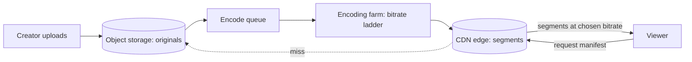

"Design YouTube" or "Design Netflix" sounds like an enormous product
problem, and the product surface *is* large (search, recommendations,
accounts, comments). But the part that makes it a *systems* question, and
the part every interview focuses on, is the **video pipeline**: how one
uploaded file becomes something a phone in a moving car plays smoothly,
which decomposes into two halves with opposite personalities. The
**ingest and encode** half is throughput-bound batch work. The
**delivery** half is [CDN](/system-design/fundamentals/cdn) latency
engineering, and it is where almost every byte of the system's traffic
flows.

## Requirements

**Functional**

- Upload a video; publish it; others stream it.
- Playback adapts to the viewer's bandwidth (adaptive bitrate).
- Seek anywhere in the video without downloading it all.
- Optional: live streaming, subtitles, thumbnails.

**Non-functional**

- **Bandwidth is the system**: video is 100-1000x the bytes of every
  other content type, so the design is dominated by moving bytes off
  your origin and to the edge.
- **Playback start latency**: time-to-first-frame should be ~1-2 seconds,
  because that is where viewers abandon.
- **Throughput over consistency**: a view counter a minute stale is
  invisible; a video that does not play is not.
- **Encoding is expensive and slow**: transcoding a video costs more
  compute than serving thousands of views of it, so the two workloads
  are entirely different systems.

## The pipeline

**Upload** lands the original file in
[object storage](/system-design/fundamentals/object-storage) (S3-style),
which is the right home for immutable blobs. The upload itself is
multipart and resumable, because a 4 GB file over flaky home internet
cannot be one HTTP request.

**Encoding** turns that one file into a **ladder of renditions**: the
same video at 240p, 360p, 480p, 720p, 1080p, 4K, each in several codecs
(H.264 for compatibility, AV1/HEVC for bandwidth efficiency), each
segmented into small chunks (a few seconds each). This is offline batch
work, spread across a farm of machines with
[queues](/system-design/fundamentals/message-queues-and-pubsub) between
the stages, and it is *expensive*: a popular upload may spend more compute
being encoded than any single machine sees in a day of serving. The
segmentation is the load-bearing detail for delivery: short chunks let
the player switch bitrates between segments, and let the CDN cache at a
fine grain.

**Delivery** is where [adaptive bitrate streaming](https://en.wikipedia.org/wiki/Adaptive_bitrate_streaming)
lives. The player requests a **manifest** (HLS/DASH: a list of available
bitrates and the segment URLs for each), measures its own throughput as
it fetches segments, and moves up or down the ladder as bandwidth allows.
The system's role is mostly to make every segment an edge-cached URL: the
origin should see the first request per segment per region and nothing
else, because a single viral video's traffic would otherwise be terabits
per second through one datacenter.

The cache hit rates are the design's arithmetic moment: popular content is
served ~100% from the edge; the long tail (videos with 12 views) misses
and pays an origin fetch. Real systems treat those differently, and
"what's your hit rate, and what does the tail cost" is a question worth
asking yourself.

## The hard parts

**Encoding costs scale with views, not uploads.** Encoding one video
once is fine; the ladder is expensive per upload. The optimization
interviewers look for is *lazy encoding*: only encode the renditions
that get watched (upload in the best available quality, encode 480p on
demand when someone actually requests it), because most videos have no
audience at all and pre-encoding a full ladder for every upload is
paying compute for nothing.

**Seeking** is why segments exist: a manifest with per-segment URLs lets
the player jump to any timestamp by fetching the segment covering it,
rather than streaming the whole file to reach minute 40. Seeking is
essentially free on the delivery path, and expensive only in the naive
"one big file" design, which is the primary reason chunked delivery
replaced progressive download.

**Live streaming** changes ingest but not delivery: the encoder segments
*as the event happens* (near-real-time ladder production), the manifest
is a sliding window, and latency is bounded by segment length, so live
is a few seconds to a minute behind reality, which is the trade between
segment size and encode delay.

**Everything else** (search, recommendations, comments, counts) is
ordinary product infrastructure that rides alongside, and its design is
not video-specific: recommendations are
[their own system](/system-design/hld/recommendation-system), search is
[inverted index](/system-design/fundamentals/search-and-inverted-index)
territory, and view counting is a [queue](/system-design/fundamentals/message-queues-and-pubsub)
plus batch aggregation, because counting every view transactionally at
CDN volume would collapse any database.

## Capacity sketch

Back-of-envelope, because the ratios are the point: 100M views/day at an
average 500 MB per view (TV-quality, mixed durations) is 50 PB/day of
egress, ~580 GB/s, which *no origin fleet could serve*: this is the
arithmetic that proves the CDN is not an optimization but the architecture.
The encode farm, by contrast, is sized by uploads: 100k uploads/day at a
few CPU-hours each is a manageable, slowable batch workload. The asymmetry
is the design's whole story.

## Related concepts

- [Content Delivery Networks](/system-design/fundamentals/cdn) is the
  delivery half of this design, in depth.
- [Object Storage](/system-design/fundamentals/object-storage) is where
  originals and segments live.
- [Message Queues & Pub/Sub](/system-design/fundamentals/message-queues-and-pubsub)
  drives the encode pipeline.
- [Design an E-commerce / Flash Sale](/system-design/hld/e-commerce-flash-sale)
  shares the "absorb the spike away from the database" instinct.
