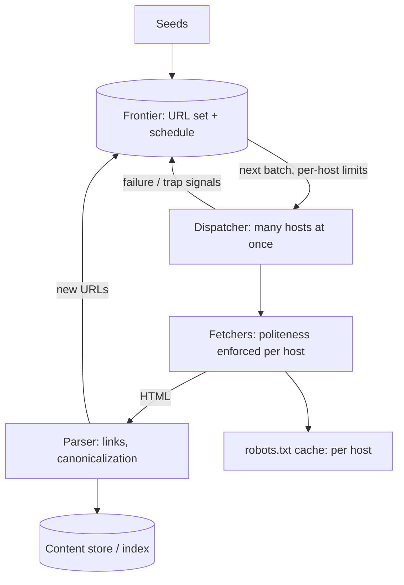

A web crawler sounds like a loop ("fetch a URL, parse the links,
repeat"), and the loop is the *easy* part. The design is dominated by
two problems that loop creates and the naive version ignores:
**politeness** (you are a guest on someone else's server, and an
impolite crawler is a [DDoS](/system-design/fundamentals/rate-limiting)
with a business justification) and **the frontier** (which of the
tens of billions of known URLs to fetch *next*, a scheduling problem
where "everything" is not an answer). Everything else (parsing,
dedup, content handling) is engineering in service of those two.

## Requirements

**Functional**

- Start from seed URLs; fetch pages; extract links; discover new
  pages; keep a copy (or an index of the copy).
- Re-crawl on a schedule (pages change: freshness by type).
- Respect `robots.txt` (per-host crawl rules) and rate limits.
- Filter: no infinite loops, no duplicate fetches, no spam traps.

**Non-functional**

- **Politeness is a hard constraint**: per-host concurrency of 1 and
  per-host request intervals (seconds, not milliseconds), enforced
  by the scheduler, not by hope.
- **The frontier is the memory**: billions of URLs must be tracked
  (seen, pending, scheduled-next-at), which is a storage design, not
  a list.
- **Throughput is fleet-wide, not per-host**: parallelism comes from
  *many hosts*, fetched concurrently, each politely.
- **Robustness against the adversarial web**: traps (calendar pages
  that generate infinite URLs), redirects, cloaking, and the
  crawler's own bugs must not poison the frontier.

## The architecture



## The frontier: the scheduler that decides everything

The frontier is the design's heart, and it is a **priority queue over
URLs**, where the priority is *when to fetch next* (per-URL, by type
and history: a news homepage every 10 minutes, a blog post monthly)
plus a **host-level politess queue** (each host has its own FIFO with
a minimum interval: crawl.example.com gets one request every N
seconds, period, regardless of how many of its URLs are due).

```cpp
struct FrontierEntry {
    std::string url;                 // canonicalized: the identity
    std::string host;
    std::chrono::system_clock::time_point nextAllowedTime;   // politeness
    double priority;                // freshness-driven: when due
};

// The dispatcher: many hosts in parallel, one request at a time
// per host, each waiting its interval.
class Dispatcher {
public:
    // Pick from the highest-priority hosts that are READY (past
    // their nextAllowedTime), never two concurrent from one host.
    std::vector<FetchTask> nextBatch(int count);
private:
    std::unordered_map<std::string, HostQueue> perHost_;   // politeness
    PriorityQueue<FrontierEntry> global_;                  // scheduling
};
```

The **per-host queue discipline** is what makes politeness real:
the dispatcher's parallelism is *across* hosts (thousands of hosts,
each at one concurrent request and seconds of interval: the fleet
still fetches thousands of pages per second, politely), and the
per-host interval is *adaptive* (response time and
[robots](https://en.wikipedia.org/wiki/Robots_exclusion_standard)‘s
`Crawl-delay` set it: a slow shared host gets minutes, a fast CDN
gets sub-second), which is the crawler's version of the
[load balancer's](/system-design/hld/load-balancer-system) health
loop: react to the signal, don't hammer by default.

**Canonicalization** (the URL identity problem) is the frontier's
correctness anchor: `http://example.com/a/../b`, `EXAMPLE.com/b`,
`example.com/b?utm_source=x` are the *same page*, and without
normalization (lowercase host, resolve `..`, strip tracking
parameters) the frontier fills with aliases and the crawler fetches
the same page a thousand times. Every "duplicate content" bug in a
crawler is a canonicalization gap, and the
[hash-based](/dsa/patterns/hash-based-structures) URL identity
(normalized URL -> content fingerprint) is the machinery that
catches what canonicalization misses.

## Politeness and the robots contract

**`robots.txt`** per host (the site's crawl rules: disallowed
paths, crawl-delay, the contract of polite crawling) is fetched
once per host and cached (with an expiry: the
[cache](/system-design/fundamentals/caching) discipline, and the
*failure mode* is fail-open-to-conservative: a robots.txt we cannot
fetch means *ask less*, not "assume allowed"), and its rules are
enforced at the dispatcher (a disallowed URL is never fetched, which
is a frontier filter, not a fetch-and-apologize).

The traps the contract does not cover (the crawler's survival
skills): **infinite URL spaces** (calendars: `?year=1900..2100`,
next-page-till-heat-death: a page budget per host and per path-prefix,
with the
[heuristic](/dsa/patterns/greedy-algorithms) that a URL whose
parameters grow without bound is generated, not linked), **cloaking**
(serving different content to crawlers than users: detected by
cross-checking, responded to by *trusting neither*), and the
**spider trap of our own making** (session-id URLs: every fetch
generates a *new* URL, which canonicalization must strip, or the
frontier doubles every fetch).

## Freshness: when to re-crawl

The scheduling policy (which URLs are *due*) is the frontier's other
half, and the honest design is per-type policy: static content
(monthly), listings (daily), news (minutes), with
[change-frequency learning](https://en.wikipedia.org/wiki/Sitemap)
(the sitemap protocol's explicit hints, plus the observed rate: a
page that has not changed in 5 crawls gets de-prioritized). The
trade is *coverage vs freshness vs politeness*: the fleet could
fetch every page daily (the fleet is fast, the hosts will not
survive it), so the budget per host (per day) is the product
decision the scheduler encodes, which is the
[capacity planning](/system-design/fundamentals/capacity-planning-and-estimation)
habit applied to someone else's servers.

## The pipeline around the loop

The rest of the design, briefly, each piece in its place:
**fetchers** (the HTTP layer: redirects, timeouts, content
negotiation, and the *failure accounting* that feeds politeness
adaptation: the [host health](/system-design/hld/load-balancer-system)
discipline, again), **parsers** (link extraction, and the
canonicalization pass, running at
[ingestion-pipeline](/system-design/hld/log-aggregation-system)
scale: a [queue](/system-design/fundamentals/message-queues-and-pubsub)
between fetch and parse for the burst tolerance), **content
handling** (the store: raw pages to
[object storage](/system-design/fundamentals/object-storage), the
index (the search engine's own
[inverted index](/system-design/fundamentals/search-and-inverted-index))
fed by the pipeline, and the
[duplicate detection](/dsa/patterns/hash-based-structures) (content
fingerprint: exact-dup by hash, near-dup by
[simhash](https://en.wikipedia.org/wiki/SimHash)) that keeps the
index from being a spam mirror.

## Capacity sketch

The arithmetic that shapes it: "crawl the web" past a billion pages
on a monthly cycle is ~400 pages/second fleet-wide (a modest
number!), which is *thousands of hosts in flight* at per-host
politeness intervals (the parallelism comes from breadth), the
frontier is a billion URLs with next-fetch times (a few hundred GB
of scheduling state: the real storage), and the fetched content
(~1 MB average, compressed, deduplicated) is ~a petabyte-class
object store with an index that dwarfs it, which is why "the
crawler" and "the search engine" are one system in every real
deployment.

## Related concepts

- [Rate Limiting](/system-design/fundamentals/rate-limiting) is the
  politeness discipline the dispatcher implements (as a guest, on
  behalf of the host).
- [Search & Inverted Index](/system-design/fundamentals/search-and-inverted-index)
  is the destination the crawl feeds.
- [Design a Search Autocomplete](/system-design/hld/search-autocomplete)
  is the query-side sibling (the trie vs the index).
- [Message Queues & Pub/Sub](/system-design/fundamentals/message-queues-and-pubsub)
  is the fetch-to-parse pipeline's buffer.
- [Object Storage](/system-design/fundamentals/object-storage) is
  where the crawled corpus lives.
