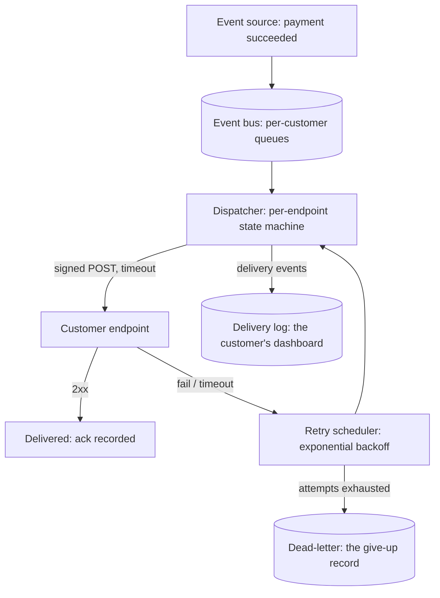

A webhook system ("call *our* customer's HTTP endpoint when *this*
happens", the Stripe/GitHub/Shopify primitive that half the modern
API economy runs on) is the [queue](/system-design/fundamentals/message-queues-and-pubsub)
page's delivery problem turned *inside-out*: the consumer is not
inside your infrastructure, it is an **arbitrary, flaky,
adversarially-configured HTTP endpoint that someone else controls**,
and the design's whole subject is delivering to it *reliably* when
every individual delivery can fail in every way a network can fail.
It is the best HLD for teaching what "reliable delivery" actually
costs, because the naive answers all fail in ways the recipient
engineer can feel.

## Requirements

**Functional**

- Event subscriptions: customers register endpoint URLs (per event
  type, per environment), with signing secrets.
- Delivery: when an event occurs, POST it to the registered
  endpoint, with a signature, expecting an acknowledgment.
- Retry policy: failed deliveries retry (schedule, backoff, give up).
- Management API: list deliveries, resend manually, pause the
  endpoint, inspect the payload.

**Non-functional**

- **Delivery guarantee: at-least-once, with teeth** (the delivery
  will be attempted, retries survive process crashes, "gave up" is
  a recorded state, not a silent drop), and
  [ordering is per-subscription, best-effort](#the-ordering-question)
  (the customer's endpoint, not our preference, decides what it
  can tolerate).
- **Absorb the customer's failures**: an endpoint that is down
  (hours), that 500s forever, that responds in 30 seconds, that
  panics and sets up a loop (our webhook calls their endpoint calls
  our API which fires the webhook), must not harm *our* pipeline or
  *other* customers.
- **The customer's security**: payloads may carry sensitive data
  (the [payment](/system-design/hld/payment-system) events), so
  signing (authenticity), TLS, and per-customer isolation are
  load-bearing, not nice-to-haves.
- **Observability**: both sides need to see delivery state (the
  customer's dashboard: "your endpoint failed 40 times, here is the
  log entry"), because *silent* failure is the support-ticket
  generator this design exists to prevent.

## The architecture

The **per-endpoint state machine** (the design's spine, and the
same shape as the [job scheduler's](/system-design/hld/distributed-job-scheduler)
per-trigger states): a delivery is `pending -> in-flight ->
delivered | retrying(scheduled-at, attempts) -> dead`, with the
transitions guarded exactly as any
[lifecycle](/system-design/lld/movie-ticket-booking) design: a
delivery picked up by a worker *leases* its in-flight state
(the [lease and heartbeat](/system-design/hld/distributed-job-scheduler)
discipline: a crashed worker's in-flight delivery expires and is
retried, which is where at-least-once's duplication comes from),
and the ack-versus-unknown ambiguity (the customer's endpoint
*processed it* but the 200 response was lost: the retry delivers
again: [the idempotency page](/system-design/fundamentals/idempotency-and-exactly-once)'s
eternal "unknown is not no") is *the customer's* problem to make
idempotent, which is why every webhook payload carries an event
id and every webhook doc page says "deduplicate by id".

## The delivery protocol, decision by decision

**The attempt**: POST the payload with a signature
(HMAC over body + timestamp: the
[auth](/system-design/fundamentals/auth-basics) pattern applied to
machine-to-machine, with a timestamp to defeat replay), a strict
timeout (the [latency](/system-design/fundamentals/latency-vs-throughput)
discipline: a webhook worker is a scarce slot, and a 30-second
hang is a slot stolen, so ~5-10 seconds), and idempotent-by-event-id
semantics *documented* (the endpoint's contract).

**The retry**: exponential backoff with jitter
([the rate limiter](/system-design/fundamentals/rate-limiting)'s
client-side discipline, for the same reason: a synchronized cohort
of retries is a self-inflicted burst), over a schedule
(Stripe-style: minutes-to-days), with **attempt-count persistence**
before the next attempt (the
[write-ahead](/system-design/lld/bank-ledger-system) discipline:
the retry decision is durable, so a crash mid-backoff resumes
rather than restarts), and a **give-up threshold** (the dead
letter: N attempts, then the endpoint is marked failing and the
customer is notified, because *retrying forever into a broken
endpoint* is both unbounded load and a lie about delivery).

**The ordering question**: events for one subscription occur in
order (payment.created before payment.succeeded), and *concurrent
delivery attempts can reorder them* (a failed attempt of event 1
retries after a successful attempt of event 2: the endpoint sees
them backwards). The honest designs:

- **Per-subscription serial delivery** (one attempt at a time, in
  order: the [partition-per-key](/system-design/hld/distributed-message-queue)
  discipline), which preserves order at the cost of one slow event
  blocking the subscription's queue (the head-of-line trade).
- **Delivered-at-least-once, order-not-guaranteed** with a
  timestamp/sequence header the endpoint *can* use to detect
  reordering (the customer's vote: the modern default, and the
  honest doc page), with the
  [delayed-retry](/system-design/fundamentals/backpressure-and-flow-control)
  skew as the accepted cost.

**The poison and the loop**: the endpoint that 500s forever is
*poison* (the [dead-letter](/system-design/hld/distributed-message-queue)
answer, above), and the endpoint that calls *our* API in its
handler synchronously and triggers the same event is a **loop**
(re-entrancy guards: per-subscription in-flight depth, and the
"we will not call you about the event your call caused" rule),
which the naive dispatcher discovers in production, at 3 AM, as a
self-amplifying traffic storm.

## The customer's experience, designed

The product half (the part that makes or breaks a webhook system in
practice): **the delivery dashboard** (the event log: what we
sent, when, what the endpoint said: the
[observability](/system-design/fundamentals/observability) surface
for the *customer*), **manual resend** (the "replay this one, from
the dashboard" button: the [event sourcing](/system-design/fundamentals/event-sourcing-and-cqrs)
payoff, trivially, because the delivery log is the source of
truth), **test events and local dev tooling** (the ecosystem's
smoke-test), and **per-environment endpoints** (test/prod: the
*most common* misconfiguration there is, worth designing as a
first-class concept).

## Capacity sketch

The arithmetic: a large SaaS fires ~10k events/sec peak, fanned out
to an average of ~2 subscriptions each = ~20k delivery
attempts/sec, each a *scarce-slot* HTTP call with a timeout: a
medium worker fleet (the [job scheduler](/system-design/hld/distributed-job-scheduler)'s
sizing math, with the backoff queue absorbing the
endpoint-failure bursts), and the delivery log (every attempt, every
response code, every payload hash: the audit and replay surface)
at ~10 GB/day-class storage, which is the
[log-tier](/system-design/hld/log-aggregation-system)'s economics.
The retry tail (the endpoints that fail for hours) is the
[backpressure](/system-design/fundamentals/backpressure-and-flow-control)
story: the retry queues *grow* during a customer outage, drain at
their backoff pace, and the *give-up threshold* is the policy that
keeps the tail bounded.

## Related concepts

- [Message Queues & Pub/Sub](/system-design/fundamentals/message-queues-and-pubsub)
  is the transport semantics this design delivers over.
- [Idempotency & Exactly-Once Delivery](/system-design/fundamentals/idempotency-and-exactly-once)
  is the guarantee, priced: at-least-once, dedup at the endpoint.
- [Design a Distributed Job Scheduler](/system-design/hld/distributed-job-scheduler)
  is the same lease/retry/give-up machinery for jobs instead of
  deliveries.
- [Design a Notification System](/system-design/hld/notification-system)
  is the push-variant sibling (mobile/email endpoints instead of
  HTTP).
- [API Design](/system-design/fundamentals/api-design) is the
  contract discipline (the endpoint's, and ours).
- [Event Sourcing & CQRS](/system-design/fundamentals/event-sourcing-and-cqrs)
  is the delivery-log-as-truth architecture.
