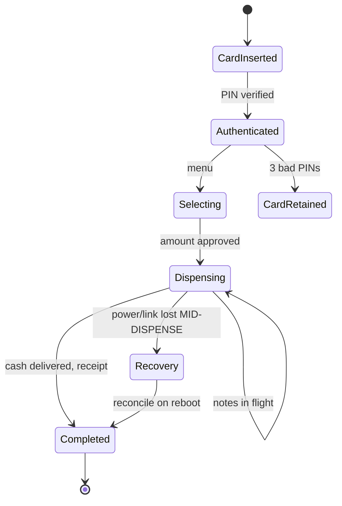
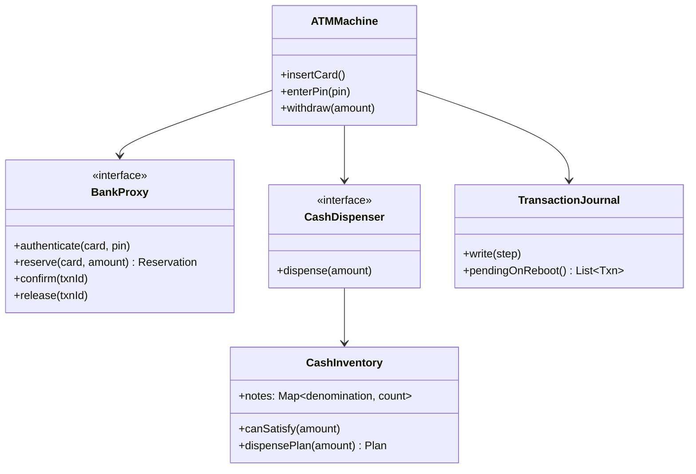

An ATM is the LLD where "state machine" means something harder than
[the vending machine's](/system-design/lld/vending-machine) purchase
lifecycle, because the machine is *physical*: cash sits in cassettes,
cards get swallowed, notes jam, and the power can fail between
"debit the account" and "hand over the money". The design's honest
subject is **which parts are hardware behind an interface, and which
operations must be atomic when the physical world can die halfway
through them**.

## Requirements

- Card + PIN authentication, account balance inquiry, withdrawal,
  deposit (cash or check).
- Per-ATM cash inventory, with dispensing (which notes, in which
  order) and the low-cash condition.
- The bank connection may be flaky: the ATM must be correct when the
  link dies mid-transaction.
- Limits: per-transaction and per-day withdrawal caps.

## The modeling decisions

**Hardware behind interfaces.** The card reader, cash dispenser,
deposit scanner, receipt printer, and the network link to the bank are
*devices*, and the design treats each as an interface (`ICardReader`,
`ICashDispenser`) with a stub implementation for the interview. This
is not ceremony: it is what makes the design testable (a fake
dispenser in tests) and honest (the ATM's *policy* is designed, the
*mechanism* is named), the same seam the
[logging framework](/system-design/lld/logging-framework) draws
between appender and layout.

**The transaction state machine, designed for the crash.** The
withdrawal is the interesting path, and its states exist because each
one is a moment the power can cut:



The crucial invariant, and the design's real content: **the debit and
the dispense must be recoverable as a unit.** The naive sequence
("ask the bank, get cash, hand it over") leaves two catastrophic
windows: debited-but-not-dispensed (the customer's money is gone, no
cash: a complaint) and dispensed-but-not-debited (cash out, no debit:
the bank's loss). The standard answers, and the interview grades
knowing *both*:

- **Reserve-then-dispense**: the bank *reserves* (holds) the amount
  first (the [ticket booking](/system-design/lld/movie-ticket-booking)
  hold pattern, exactly), the ATM dispenses, then confirms; a
  reservation that is never confirmed expires (a TTL), so a dead ATM
  leaks a hold rather than money. The failure mode "reserved, died,
  never dispensed" self-heals on expiry.
- **A pending-transaction journal on the ATM**: each step of the
  withdraw (requested, reserved, dispensed, confirmed) is a durable
  write *locally*, so a rebooted ATM knows exactly where it was and
  either completes or explicitly rolls back (asks the bank to void
  the reservation), which is the
  [outbox/recovery](/system-design/fundamentals/distributed-transactions)
  discipline in miniature: never guess, park-and-reconcile.

## The class model



`BankProxy` as an interface is the "flaky network" seam: the ATM is
designed against an interface with explicit failure modes (timeouts
return *unknown*, not false), which is the
[idempotency](/system-design/fundamentals/idempotency-and-exactly-once)
page's "unknown is not failure" discipline, and the single most
commonly missed point of this whole problem.

## The C++ sketch, centered on the withdrawal

```cpp
struct Reservation {
    std::string txnId;
    long long cents;
    std::chrono::system_clock::time_point expiresAt;
};

class ATMMachine {
public:
    // Withdraw: the atomic-ish sequence with its recovery semantics.
    bool withdraw(long long amountCents) {
        journal_.write("requested");                  // step 1: intent
        auto reservation = bank_->reserve(card_, amountCents);   // step 2
        if (!reservation) {
            return false;                    // declined, no money moved
        }
        journal_.write("reserved");                   // step 3: hold placed
        auto plan = inventory_.dispensePlan(amountCents);
        if (!plan) {                                   // ATM is out of notes!
            bank_->release(*reservation);             // void the hold
            journal_.write("released-no-cash");
            return false;
        }
        dispenser_->dispense(plan);                   // step 4: physical
        journal_.write("dispensed");                  // step 5: cash out
        bank_->confirm(*reservation);                // step 6: commit debit
        journal_.write("confirmed");
        return true;
    }

private:
    Card card_;
    BankProxy* bank_;
    CashDispenser* dispenser_;
    CashInventory inventory_;
    TransactionJournal journal_;
};
```

Read the journal writes as the design's spine: every state the power
can interrupt is *durable before the next physical or financial step
happens*, so a reboot replays the journal and finds "reserved but
not dispensed" (release the hold: no harm) or "dispensed but not
confirmed" (ask the bank: did the confirm land? the
[exactly-once](/system-design/fundamentals/idempotency-and-exactly-once)
"unknown is not no" case, resolved by asking, keyed by the
reservation's txnId). That "durable-write between steps" rhythm is
precisely the [write-ahead log](https://en.wikipedia.org/wiki/Write-ahead_logging)
idea, and naming it out loud is the interview's payoff.

The **dispense plan** (which notes) is the [greedy](/dsa/patterns/greedy-algorithms)
denomination problem (largest-first works for real currencies),
`canSatisfy` checked *before* the reservation rather than after (or
the sequence releases it, as above), and the low-cash condition is
the [observability](/system-design/fundamentals/observability) call
the machine makes ("cash below threshold" is an operational alert).

## Variations worth knowing

- **Offline mode**: a per-day limit the ATM honors *without* the bank
  (the classic real-ATM feature), which is a risk budget the bank
  extends to the machine, and the reason the daily cap exists at all.
- **Cash recycling** (deposits refill the dispense cassettes) turns
  inventory into a two-way ledger, the
  [bank ledger](/system-design/lld/bank-ledger-system)'s conservation
  applied to paper.
- **The concurrency question** ("two cards, one machine") is mostly
  serialized by the hardware (one session at a time), but the
  *journal + bank* pair is exactly the
  [distributed transaction](/system-design/fundamentals/distributed-transactions)
  shape.

## Related C++ tools

- [Integer Overflow & Limits](/cpp/integer-overflow): where int runs out, and how this code stays inside it.
- [std::string](/cpp/string): substr, find, and the operations that copy.

## Related concepts

- [Design a Vending Machine](/system-design/lld/vending-machine) is
  the simpler sibling state machine (no money at stake, no network).
- [Design a Movie Ticket Booking](/system-design/lld/movie-ticket-booking)
  is the same hold/confirm pattern with seats instead of cash.
- [Design a Bank / Ledger System](/system-design/lld/bank-ledger-system)
  is the other side of the network link.
- [Idempotency & Exactly-Once Delivery](/system-design/fundamentals/idempotency-and-exactly-once)
  prices the "unknown" semantics this design depends on.
