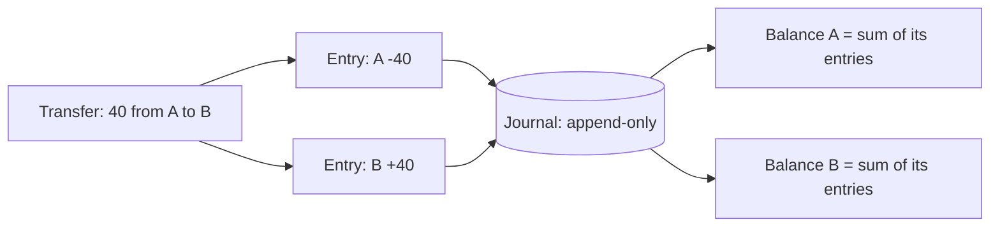
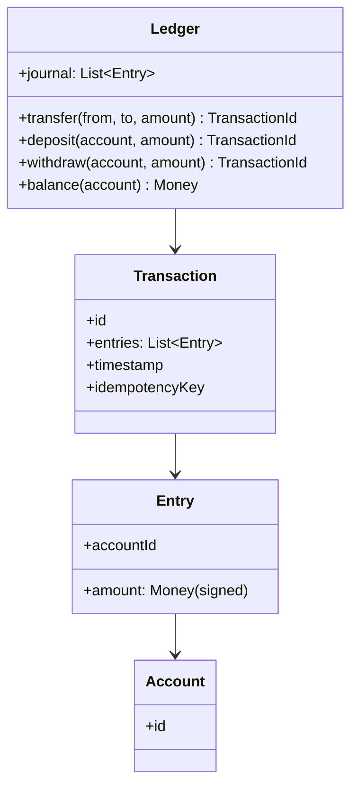

A bank ledger is the LLD where the domain rules *are* the architecture.
The entities (accounts, transfers) are trivial to model; what makes the
problem an interview is that the invariants are financial law: **the sum
of all balances must always equal the sum of all deposits, no transfer
may create or destroy money, and no balance may go negative**, all of
which must hold under concurrent transactions, crashes, and retries.
The design that satisfies those is not "an accounts table with a balance
column", and seeing why is the entire problem.

It is the code-level sibling of the
[payment system](/system-design/hld/payment-system) HLD (which adds
processors, webhooks, and reconciliation) and the purest expression of
[event sourcing](/system-design/fundamentals/event-sourcing-and-cqrs) on
this site.

## Step 1: requirements, stated as invariants

- Accounts with balances; deposits, withdrawals, and transfers between
  accounts.
- **Invariant 1 (conservation)**: every transaction's entries sum to zero.
  Money moves; it never appears or vanishes.
- **Invariant 2 (solvency)**: no account may go negative.
- **Invariant 3 (auditability)**: every balance is reconstructable from
  the transaction history, and history is immutable once recorded.
- Concurrency: two simultaneous transfers touching the same account must
  both be safe or one must fail cleanly, never interleave into a corrupt
  state.

The single sentence that shapes everything: **a balance is not stored
state, it is a derived total**. Once that is accepted, the invariants
become structural rather than policed, which is the design's whole
argument.

## Step 2: double-entry, the core idea

Every transaction is a set of **entries**, at least two, where the sum of
the signed amounts is exactly zero. A deposit of 100 into account A is
`A: +100` and `cash-desk: -100` (the money came from somewhere, and the
ledger records where). A transfer of 40 from A to B is
`A: -40, B: +40`. The "somewhere" entries are not bureaucracy: they are
what makes the total sum of the ledger provably zero at every moment,
which is exactly the invariant a bank audit checks.



**Journal**: the append-only table of entries, the source of truth, the
only thing that is written. **Balances**: derived totals, cached as
materialized views, recomputable from the journal at any time. That
split, and the sentence "we can rebuild every balance from the journal
alone", is what invariant 3 actually requires, and it is why a ledger
survives its own bugs: a corrupt cache is rebuilt, not trusted.

## Step 3: the class model



- **Entry** is the atom: an account and a signed amount, in cents (never
  a float, never a double: binary fractions cannot represent 0.10, and
  a ledger that loses a cent per thousand transactions is a scandal).
- **Transaction** groups entries and carries an idempotency key, which
  is what makes a client retry safe: the same key replays the recorded
  result instead of moving money twice, per
  [idempotency](/system-design/fundamentals/idempotency-and-exactly-once).
- **Account** is nearly empty, deliberately: the balance is derived, so
  the account is an identity plus metadata.

## Step 4: the C++ sketch

```cpp
using Cents = long long;

struct Entry {
    std::string accountId;
    Cents amount;                       // signed: positive = credit
};

struct Transaction {
    std::string id;
    std::string idempotencyKey;
    std::vector<Entry> entries;
    std::chrono::system_clock::time_point recordedAt;
};

class Ledger {
public:
    // Transfer with balance checks and atomicity.
    std::string transfer(const std::string& idempotencyKey,
                          const std::string& from,
                          const std::string& to, Cents amount) {
        if (amount <= 0) {
            throw std::invalid_argument("amount must be positive");
        }

        // Idempotent replay: same key, same recorded result.
        if (auto it = journalByKey_.find(idempotencyKey);
            it != journalByKey_.end()) {
            return it->second;          // already happened: return it
        }

        // Lock accounts in a canonical order (sorted by id) so two
        // transfers A->B and B->A can never deadlock.
        std::string first = std::min(from, to);
        std::string second = std::max(from, to);
        std::scoped_lock lockOne(mtxFor(first), mtxFor(second));

        if (balance(from) < amount) {
            throw std::runtime_error("insufficient funds");   // invariant 2
        }

        Transaction txn;
        txn.id = nextId();
        txn.idempotencyKey = idempotencyKey;
        txn.entries = {
            {from, -amount},           // conservation: entries sum to 0
            {to, +amount},
        };
        txn.recordedAt = std::chrono::system_clock::now();

        for (const auto& entry : txn.entries) {   // append-only: never edit
            journal_.push_back(entry);
            cachedBalance_[entry.accountId] += entry.amount;
        }
        journalByKey_[idempotencyKey] = txn.id;
        return txn.id;
    }

    Cents balance(const std::string& accountId) const {
        auto it = cachedBalance_.find(accountId);
        return it != cachedBalance_.end() ? it->second : 0;
    }

private:
    std::vector<Entry> journal_;         // append-only source of truth
    std::unordered_map<std::string, Cents> cachedBalance_;
    std::unordered_map<std::string, std::string> journalByKey_;
    // per-account mutexes, looked up by name:
    std::unordered_map<std::string, std::mutex> mtxFor_;
};
```

Three decisions carry the correctness:

**The check-then-write happens under both locks, in canonical order.**
The solvency check (`balance(from) < amount`) and the append are one
critical section over *both* accounts, so two concurrent transfers
touching the same account serialize: the second sees the first's result.
The canonical (sorted) lock order is the
[deadlock](/system-design/fundamentals/concurrency-and-parallelism)
prevention, exactly as in
[movie ticket booking](/system-design/lld/movie-ticket-booking), because
two transfers in opposite directions over the same pair is the standard
banking workload and the standard deadlock.

**The idempotency key is checked first, outside the locks.** A retried
transfer must be recognized before any balance is touched, which is the
one-line version of the entire
[idempotency](/system-design/fundamentals/idempotency-and-exactly-once)
argument: at-least-once delivery from the client means duplicates are
normal traffic, and the ledger's job is to absorb them.

**Balances are cached, and the cache is disposable.** The journal is the
truth; `cachedBalance_` exists so a balance query is O(1) instead of a
journal scan, and its corruption is repairable by replay, which is the
invariant 3 payoff. In the database version, the cache is a
materialized view or a `balance` column maintained transactionally with
the insert, and *that* coupling (insert + balance update in one ACID
transaction) is what keeps the two in agreement without distributed
anything.

## Variations

- **The database version**: journal and balance cache in one relational
  database, both updated in a single transaction, which is why real
  banking cores are one strongly consistent database rather than a
  spread of services: the invariants are local to one store
  ([CAP](/system-design/fundamentals/cap-theorem-and-consistency-models)
  made concrete).
- **Cross-account/cross-service transfers**: two banks, or two ledgers,
  is the [distributed transaction](/system-design/fundamentals/distributed-transactions)
  problem with a saga over compensating entries (a reversal is just
  another transaction: `A: +40, B: -40` appended, never a delete).
- **Point-in-time queries** ("balance as of March"): falls out of the
  journal for free, by summing entries before a timestamp, which is one
  of the strongest arguments for the append-only design.

## Related concepts

- [Idempotency & Exactly-Once Delivery](/system-design/fundamentals/idempotency-and-exactly-once)
  is the retry-safety layer every money path needs.
- [Event Sourcing & CQRS](/system-design/fundamentals/event-sourcing-and-cqrs)
  is the storage model this design instantiates.
- [Concurrency & Parallelism](/system-design/fundamentals/concurrency-and-parallelism)
  covers the lock-order and critical-section discipline.
- [Design a Payment System](/system-design/hld/payment-system) is the
  fleet-scale version, with processors and reconciliation added.
- [CAP Theorem & Consistency Models](/system-design/fundamentals/cap-theorem-and-consistency-models)
  explains why the core ledger stays strongly consistent.
