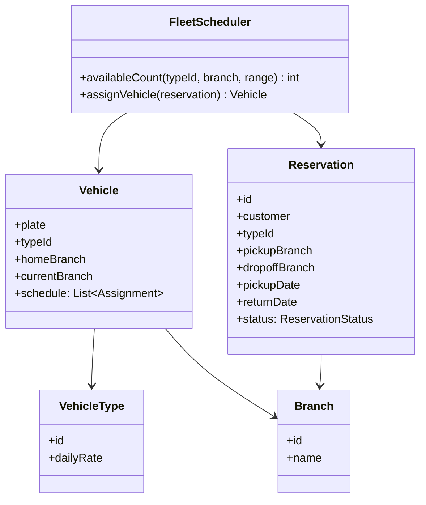

A car rental system is the [hotel](/system-design/lld/hotel-management-system)'s
twin with one twist that changes the design: **the inventory moves.**
A hotel room is room 402 forever; a rental car is returned to a
different branch, and every availability question is therefore
*per location over time*, which makes the fleet a
[scheduling](/system-design/lld/task-scheduler-lld) problem (each car
has a timeline of assignments) layered over an inventory problem
(each branch has a count per day).

## Requirements

- Branches (airports, city lots), a fleet of vehicles (type, plate,
  status), and customers.
- Reservations: a vehicle *type* (or a specific vehicle), a pickup
  branch, a date range, and a rate.
- Availability: which types are available *at this branch* for this
  range?
- The return: at the same or a different branch, on time or late,
  and the fleet's positions must be updated.
- Maintenance windows take a car out of the rentable pool.

The three modeling questions, in the order that matters:

- **Type-level or vehicle-level booking?** Customers reserve
  "an SUV, October 12-15 at Branch A" (type-level), the branch assigns
  a *specific* car at pickup, exactly as the hotel assigns the room
  at check-in. The twist: the assignment must consider *where the car
  will be*, which is the fleet-schedule question.
- **What does a car's calendar look like?** Each vehicle has a
  timeline (rentals, maintenance, transfers), and a branch's
  availability is the count of cars whose timeline shows them at that
  branch and unassigned. The car's *position* is part of its state,
  updated by every return.
- **What happens when a return is late?** The next reservation at that
  branch expects that car. The honest answer is a policy
  (overbook the branch, re-assign another same-type car, upgrade), and
  the design's job is to make the *conflict* detectable, not to
  prevent it (late returns are weather, not bugs).

## The class model



The **FleetScheduler** is the design's center, and its job is the
[availability fold](/system-design/lld/hotel-management-system)'s
cousin with a position clause: a branch's type-count on a given day
is the number of vehicles of that type whose schedule has them
*resting at that branch* that day (not assigned to a rental,
maintenance, or a transfer), which is a fold over vehicle timelines
rather than a fold over booking intervals.

## The scheduling fold, stated

```cpp
struct Assignment {                 // one block on one vehicle's calendar
    enum Kind { Rental, Maintenance, Transfer } kind;
    std::chrono::system_clock::time_point start;
    std::chrono::system_clock::time_point end;
    std::string branchId;           // where the vehicle sits after (or during)
};

struct Vehicle {
    std::string plate;
    std::string typeId;
    std::string currentBranch;
    std::vector<Assignment> schedule;
};

// A vehicle serves the reservation if it is the right type, and its
// calendar is free for the whole range, and it will BE at the pickup
// branch on the pickup day (the position clause).
bool vehicleServesReservation(
        const Vehicle& v,
        const std::string& typeId,
        const std::string& pickupBranch,
        std::chrono::system_clock::time_point start,
        std::chrono::system_clock::time_point end) {
    if (v.typeId != typeId) {
        return false;
    }
    // Position: walk the schedule up to 'start'; the branch after the
    // last assignment ending before 'start' (or the current branch if
    // none) is where the car will be.
    std::string position = v.currentBranch;
    for (const Assignment& a : v.schedule) {
        if (a.end <= start) {
            position = a.branchId;    // this assignment moved the car here
        }
    }
    if (position != pickupBranch) {
        return false;
    }
    // Calendar: no assignment overlaps [start, end).
    for (const Assignment& a : v.schedule) {
        if (a.start < end && start < a.end) {
            return false;             // the sweep-line overlap test
        }
    }
    return true;
}
```

The two clauses of `vehicleServesReservation` are the design: the
**calendar clause** is the standard [interval
overlap](/dsa/patterns/intervals-and-sweep-line) test
(`a.start < end && start < a.end`), and the **position clause** is
the fleet-specific part, answered by *folding the schedule forward*
to the pickup date (where will this car be, given what it is doing
before then?). That fold is what makes cross-branch returns
(a car rented in airport-A, returned downtown-B) *plannable*: the
downtown branch's future availability includes that car after its
dropoff assignment ends, which a static count-per-branch model
cannot see.

The late return, then, is a *schedule mutation* (the rental's end
extends past the next assignment's start), which is detectable by
re-running the calendar check for the overlapped reservation, and
the policy (re-assign, upgrade, apologize) runs on exactly the
vehicles the fold says are free: the conflict is a *computed* fact,
which is the design's payoff.

## The rest of the lifecycle, briefly

- **Reservation statuses**: `booked -> pickup -> rented -> returned`
  with `no-show` and `cancelled`, the same guarded transitions as the
  [hotel](/system-design/lld/hotel-management-system) (a no-show
  releases the type-level count, and the *assigned vehicle* is
  released at the same transition: both inventories move together,
  the [two-structures-stay-in-sync](/system-design/lld/lru-lfu-cache)
  discipline).
- **Pricing**: type rate * days, with the seasonal/promotional
  strategy layer, exactly the [parking
  lot](/system-design/lld/parking-lot) pricing move.
- **Maintenance**: an assignment kind on the same calendar (not a
  separate system), which is the design decision that makes "car
  unavailable for a rental because of a service window" *one* kind of
  fact rather than a parallel unavailable-flag that drifts.

## Variations worth knowing

- **Type-level overbooking** (the hotel's policy, sized by the fleet's
  no-show statistics), with the same explicit-integer honesty.
- **One-way pricing** (dropoff branch differs from pickup): the
  transfer cost is an assignment (a Transfer block on some vehicle's
  calendar, or a deadhead), which is why the Transfer kind exists in
  the enum above.
- **The retry/re-assign storm** (a big late-return day): the
  re-assignment pass over the branch's fleet is exactly
  [backtracking](/dsa/patterns/backtracking-and-pruning) over
  (reservation, vehicle) pairs with feasibility checks, the
  [elevator dispatch](/system-design/lld/elevator-system)'s
  strategy-pattern slot filled with a real optimizer.

## Related C++ tools

- [std::string](/cpp/string): substr, find, and the operations that copy.

## Related concepts

- [Design a Hotel Management System](/system-design/lld/hotel-management-system)
  is the static-location twin (the fold without the position clause).
- [Intervals & Sweep Line](/dsa/patterns/intervals-and-sweep-line) is
  the algorithmic core both folds instantiate.
- [Design a Task Scheduler](/system-design/lld/task-scheduler-lld) is
  the same calendar-plus-assignment machinery for jobs instead of cars.
- [Design a Parking Lot](/system-design/lld/parking-lot) is the
  same-day, fixed-place version.
