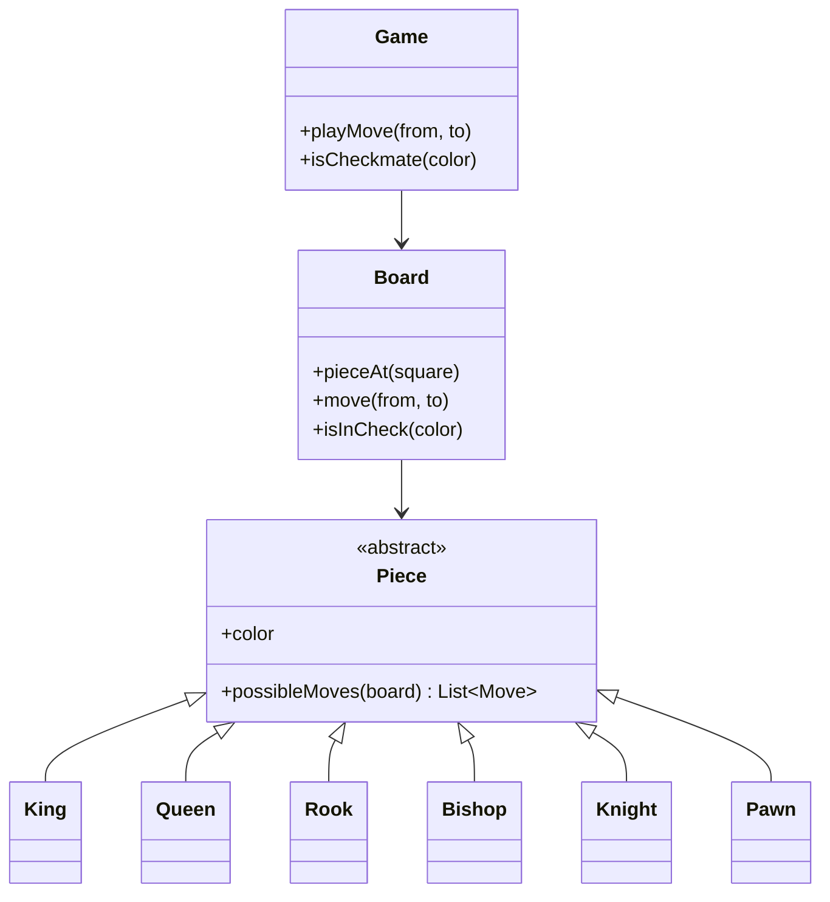

Chess is the LLD problem where the domain rules are the hard part. The
objects (a board, pieces, players) are straightforward; what makes it
interesting is that *move legality* is rich and varies per piece, and a
good design puts each rule in the place that owns it rather than in a
giant switch statement. The interviewer is watching how you distribute
responsibility: does the board validate moves, or do the pieces? The
answer, and the reason, is the design.

## Requirements

- An 8x8 board, two players, standard piece types (king, queen, rook,
  bishop, knight, pawn).
- Each piece has its own movement rules.
- A move is legal only if it follows the piece's rules *and* does not leave
  the mover's king in check.
- Track whose turn it is; detect check and checkmate.
- Optional: castling, en passant, promotion.

## Step 1: the board and the pieces

The natural model: a `Board` holding an 8x8 grid of cells, where each cell
is empty or holds a `Piece`. The design decision that matters is **where
move validation lives**. The tempting shortcut is a `Board::isValidMove`
with a big switch on piece type, which concentrates all the rules in one
place and grows a case per piece. The better design gives each piece its
own `possibleMoves(board)` method: a piece knows its own movement rules,
and the board only knows the geometry (what is at a square) and the
turn/check rules.



- **Piece** (abstract) holds color and declares `possibleMoves`. Each
  subclass implements its own movement. Adding a fairy-chess piece means
  one new subclass, no edits to existing code: the open/closed principle
  in its natural habitat.
- **Board** knows geometry and occupancy: `pieceAt`, and the path-clear
  checks that sliding pieces (rook, bishop, queen) need. It does not know
  *how* a knight moves; it only answers "what is between these squares".
- **Game** orchestrates: turn order, applying a move, and the check rules.

## Step 2: the C++ sketch

```cpp
enum class Color { White, Black };

struct Square {
    int row;
    int col;
};

class Board;

class Piece {
public:
    Piece(Color color, Square position) : color_(color), position_(position) {}
    virtual ~Piece() = default;

    virtual std::vector<Square> possibleMoves(const Board& board) const = 0;

    Color color() const { return color_; }
    Square position() const { return position_; }

protected:
    Color color_;
    Square position_;
};

class Knight : public Piece {
public:
    using Piece::Piece;
    std::vector<Square> possibleMoves(const Board& board) const override {
        static const int dr[] = {2, 2, -2, -2, 1, 1, -1, -1};
        static const int dc[] = {1, -1, 1, -1, 2, -2, 2, -2};
        std::vector<Square> moves;
        for (int i = 0; i < 8; ++i) {
            Square target{position_.row + dr[i], position_.col + dc[i]};
            if (board.inBounds(target) &&
                (board.empty(target) || board.pieceAt(target)->color() != color_)) {
                moves.push_back(target);   // knights jump: no path check
            }
        }
        return moves;
    }
};

class Rook : public Piece {
public:
    using Piece::Piece;
    std::vector<Square> possibleMoves(const Board& board) const override {
        std::vector<Square> moves;
        const int dirs[4][2] = {{1, 0}, {-1, 0}, {0, 1}, {0, -1}};
        for (auto& d : dirs) {
            Square target{position_.row + d[0], position_.col + d[1]};
            while (board.inBounds(target)) {
                if (board.empty(target)) {
                    moves.push_back(target);           // slide through empty
                } else {
                    if (board.pieceAt(target)->color() != color_) {
                        moves.push_back(target);       // capture, then stop
                    }
                    break;                             // blocked either way
                }
                target = {target.row + d[0], target.col + d[1]};
            }
        }
        return moves;
    }
};
```

Compare the two pieces, because the difference is the design lesson. The
knight enumerates eight offsets and takes any in-bounds, non-friendly
target: it jumps, so no path check. The rook walks four rays, adding empty
squares until it hits something: an enemy piece is a legal capture and then
stops, a friendly piece stops immediately. Every piece's rule is
self-contained, and the shared geometry (`inBounds`, `empty`, `pieceAt`)
lives on the board. A queen is a rook plus a bishop; a king is the eight
neighbors, and the same code with a distance limit.

## Step 3: the check rule (the subtle part)

A piece's `possibleMoves` gives *pseudo-legal* moves: they follow the
piece's movement rules but ignore whether they leave the mover's king in
check. Legality is a two-stage filter:

1. The piece's `possibleMoves` (pseudo-legal).
2. Filter: simulate the move, and reject it if the mover's king is then in
   check.

```cpp
bool Game::isLegalMove(const Move& move) {
    Piece* piece = board_.pieceAt(move.from);
    if (piece == nullptr || piece->color() != turn_) {
        return false;
    }
    auto pseudo = piece->possibleMoves(board_);
    if (std::find(pseudo.begin(), pseudo.end(), move.to) == pseudo.end()) {
        return false;
    }
    // Simulate: does this leave our king exposed?
    Board copy = board_;
    copy.move(move.from, move.to);
    return !copy.isInCheck(turn_);
}
```

The simulation (make a copy, apply the move, test for check) is the honest
way to handle the interdependency: a move's legality depends on the *whole
board state after the move*, which is exactly what a copy lets you test
without mutating the real board. It is a bit wasteful (copying the board
per candidate move) and that is fine for a design exercise; the alternative
is cleverer incremental check-detection, which is a correctness minefield.
Choosing the clear, slightly slower version is the right interview answer,
and saying why is worth points.

**Checkmate** is then: the current player is in check, and *no* legal move
removes the check. That is a loop over all pieces and all their moves,
calling `isLegalMove` for each, and returning false for checkmate if none
escapes. It falls out of the primitives above with no special-case logic.

## Known variations

- **Castling** needs extra state (whether the king and rook have moved) and
  a rule that the king does not pass through check. It is a king-and-rook
  move, so it lives in the king's move generation plus a flag.
- **En passant** needs the board to remember the previous move (a pawn's
  two-square advance), so the board carries a little history.
- **Promotion** turns a pawn reaching the last rank into another piece,
  which is a board operation, not a piece one.
- **Move notation and history** for undo: a list of moves with enough
  information to reverse them, which is the
  [command pattern](/system-design/lld/text-editor-undo-redo).

## Related C++ tools

- [std::vector](/cpp/vector): the dynamic array underneath almost every solution.

## Related concepts

- [Design a Text Editor (Undo/Redo)](/system-design/lld/text-editor-undo-redo)
  shares the "reversible operations" concern via the command pattern.
- [Design a Parking Lot](/system-design/lld/parking-lot) is the other
  classic LLD, focused on resource allocation instead of rules.
- [Matrix & Grid Algorithms](/dsa/patterns/matrix-and-grid-algorithms)
  covers the board-as-grid manipulation that underpins move generation.
