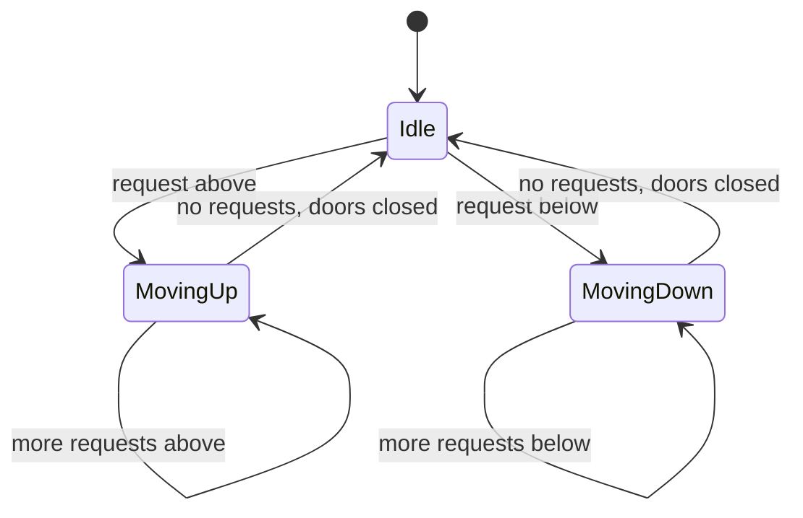
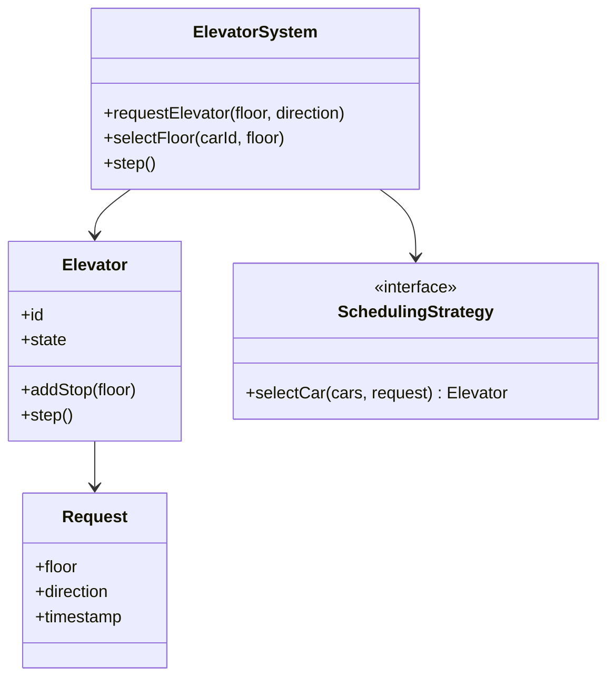

The elevator system is the LLD problem where the interesting part is not
the objects but the **policy**. The entities (a building, a bank of cars,
buttons, requests) are easy to model; the reason interviewers keep asking
it is that the *scheduling* algorithm, how a set of cars decides which
requests to answer and in what order, is a genuine design problem with
trade-offs, and the class structure exists mainly to make that algorithm
swappable.

## Step 1: requirements

Pin down the scope before designing:

- One building, multiple floors, a bank of elevators (cars).
- A rider calls an elevator from a floor, specifying a direction (up or
  down).
- A rider inside a car selects a destination floor.
- The system assigns requests to cars and moves them efficiently.
- Optional (state and discuss): capacity limits, maintenance mode,
  emergency handling, door timing.

A decision worth making explicit: is the "call" a request for *any* car
(direction-based, like most real buildings) or a request for *a specific*
car? Real systems use direction-based calls and let the dispatcher choose
the car, which is what makes scheduling a shared problem rather than a
per-car one.

## Step 2: the state machine

Each car is a state machine, and this is the part the design must get
right because the scheduling policy depends on knowing a car's state.



The car's state is `(direction, current floor, set of pending stops)`.
The two operational rules that real elevators follow and that the design
should encode:

- A car moving up serves all its pending stops above it, in ascending
  order, before reversing. It does not reverse for a request behind it
  while there are requests ahead. This is the **SCAN** (elevator) algorithm,
  and it is why an elevator "passes" your floor going the other way.
- A car only accepts a new request if serving it does not violate the
  current direction's ordering, or it can queue it for the reversal point.

## Step 3: the class model



- **Elevator** holds the car's state and its pending stops (a sorted set,
  because the SCAN algorithm processes floors in order). `step()` is one
  tick: move one floor toward the next stop, or open doors if arrived.
- **Request** is a value object: floor, direction, and a timestamp (used
  for fairness).
- **SchedulingStrategy** is the interface that makes the design extensible:
  the dispatcher's policy is a pluggable object, so the algorithm can change
  without touching the elevator or request code.
- **ElevatorSystem** is the facade and the dispatcher: it receives calls,
  picks a car, and advances time.

## Step 4: the C++ sketch

```cpp
enum class Direction { Idle, Up, Down };

class Elevator {
public:
    explicit Elevator(int id) : id_(id) {}

    void addStop(int floor) {
        stops_.insert(floor);              // sorted set: SCAN order is free
    }

    void step() {
        if (stops_.empty()) {
            direction_ = Direction::Idle;
            return;
        }
        int target = (direction_ == Direction::Down)
            ? *stops_.rbegin()             // highest stop going down
            : *stops_.begin();             // lowest stop going up
        if (currentFloor_ == target) {
            stops_.erase(currentFloor_);   // arrived: serve and drop the stop
        } else {
            currentFloor_ += (target > currentFloor_) ? 1 : -1;
        }
    }

    int id() const { return id_; }
    int currentFloor() const { return currentFloor_; }
    Direction direction() const { return direction_; }
    bool idle() const { return stops_.empty(); }

private:
    int id_;
    int currentFloor_ = 0;
    Direction direction_ = Direction::Idle;
    std::set<int> stops_;                  // pending stops, always ordered
};

class SchedulingStrategy {
public:
    virtual ~SchedulingStrategy() = default;
    virtual Elevator* selectCar(std::vector<Elevator>& cars,
                                const Request& request) = 0;
};

class NearestCar : public SchedulingStrategy {
public:
    Elevator* selectCar(std::vector<Elevator>& cars,
                        const Request& request) override {
        Elevator* best = nullptr;
        int bestDistance = std::numeric_limits<int>::max();
        for (Elevator& car : cars) {
            // Prefer an idle car, or one already moving the same way.
            bool headingSameWay =
                (request.direction == Direction::Up && car.direction() != Direction::Down) ||
                (request.direction == Direction::Down && car.direction() != Direction::Up);
            if (!car.idle() && !headingSameWay) {
                continue;
            }
            int distance = std::abs(car.currentFloor() - request.floor);
            if (distance < bestDistance) {
                bestDistance = distance;
                best = &car;
            }
        }
        return best != nullptr ? best : &cars.front();   // fallback
    }
};
```

The `std::set<int>` for stops is the quiet hero: because it is always
sorted, SCAN's "serve the next floor in the current direction" is
`*stops_.begin()` or `*stops_.rbegin()`, and checking whether a new request
lies ahead of the car is a set operation. Choosing a sorted container for
the pending stops removes an entire class of sorting bugs.

## The scheduling discussion (what's actually graded)

The interview lives in the strategy. The candidates:

- **FCFS** (first come, first served): simple, and terrible: cars
  thrash, and a request behind a car waits behind all requests ahead of it.
- **SSTF** (shortest seek time first): always serve the nearest request.
  Great for average wait, and prone to starvation: a far request can be
  perpetually deferred by a stream of nearer ones.
- **SCAN / LOOK** (the elevator algorithm): sweep in one direction,
  serving requests in order, then reverse. This is what real elevators do,
  because it bounds the worst-case wait and never starves a floor. LOOK is
  SCAN that reverses at the last request rather than the building's end.
- **Direction-based dispatching** across cars: a car already moving up is
  a better choice for an up request above it than an idle car below,
  because it will pass the floor anyway.

The design's job is to make these swappable (`SchedulingStrategy`) and to
explain the trade (average wait vs. worst-case wait vs. fairness), not to
pick a winner. That the policy is an interface, and the state it needs is
readable off the car, is the architectural point.

## Known variations

- **Multiple shafts / destination dispatch**: riders enter their
  destination at the lobby, and the system groups riders going to nearby
  floors into the same car. Better throughput, and the scheduling problem
  becomes a batching one.
- **Capacity and weight limits**: a car refuses new riders when full, which
  makes requests "unservable now" and requires re-queueing.
- **Maintenance and emergencies**: a car leaves the pool; requests must be
  reassigned, which is where the strategy interface pays off.

## Related C++ tools

- [std::map / std::set](/cpp/map): ordered keys with O(log n) lookups and lower_bound.
- [Integer Overflow & Limits](/cpp/integer-overflow): where int runs out, and how this code stays inside it.
- [Iterator Invalidation](/cpp/invalidation): which operations break iterators you are holding.

## Related concepts

- [Concurrency & Parallelism](/system-design/fundamentals/concurrency-and-parallelism)
  matters if the simulation runs on multiple threads: the car state is
  shared and must be synchronized.
- [Design a Parking Lot](/system-design/lld/parking-lot) is the sibling
  resource-allocation LLD, with allocation instead of scheduling.
- [Design a Task Scheduler (Code-Level)](/system-design/lld/task-scheduler-lld)
  is the same "policy as a strategy" shape for jobs instead of cars.
