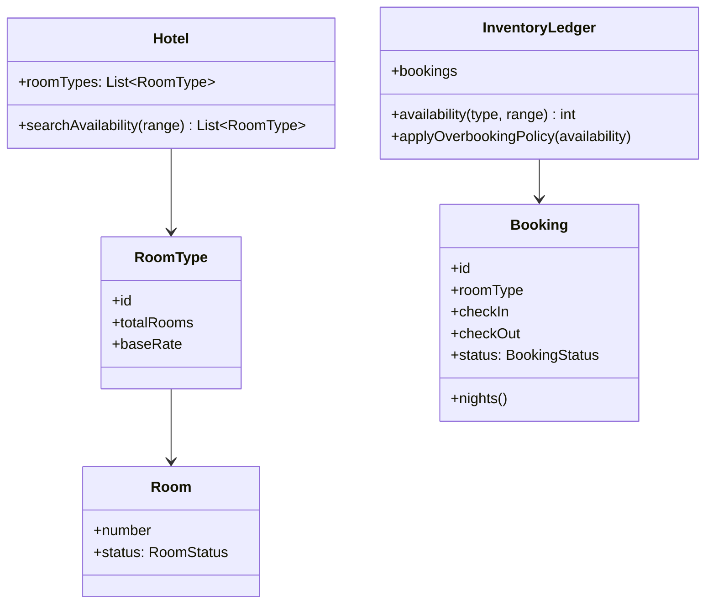

A hotel management system is the LLD where the resource is not an
object but a **date range**: a room is "occupied" from the 12th to the
15th, and every question (availability, pricing, check-in) is a
question about intervals of time. That makes it the applied sibling of
[the intervals pattern](/dsa/patterns/intervals-and-sweep-line) and the
[date-sensitive twin](/system-design/lld/movie-ticket-booking) of the
seat-holding problem, and the interview's real subject is whether you
treat time as the first-class dimension it is.

## Requirements

- Rooms (types, amenities) and guests.
- Bookings: a room type (or specific room), a date range, a rate,
  guarantee status.
- Availability search: which room types are free for a range?
- Check-in / check-out / cancellation, with policies (deposits,
  cancellation windows).
- Overbooking policy: hotels famously overbook (selling 105% of
  capacity on the expectation of no-shows), so "never overbook" is a
  *choice*, not a law of nature.

The questions that shape the design:

- **Book by room or by room type?** A guest books "a king room,
  March 12-15", not "room 402": the system assigns a specific room at
  check-in (front-desk assignment, the standard model), so bookings
  are against *type-level inventory* and availability is a count.
- **What does "available" mean?** For a range [a, b), a room type is
  available if bookings overlapping that range, per night, stay below
  the room count *for every night in the range*: the maximum
  concurrency over the range, which is precisely
  [the sweep-line](/dsa/patterns/intervals-and-sweep-line) counting
  question.
- **What is the overbooking policy?** An explicit, named limit
  (bookings per night vs physical rooms), because every honest hotel
  system has one.

## The class model



The load-bearing class is **InventoryLedger**, the one that answers
"how many king rooms are free March 12-15": it holds *bookings*
(intervals), not room-night booleans, and computes availability as a
fold over the range. Storing per-night availability (a big map of
room-night cells) is the naive alternative: it answers single queries
fast, but it makes the booking itself a multi-night transaction
("decrement every night in the range" is n writes that must be
atomic, the [movie ticket](/system-design/lld/movie-ticket-booking)
multi-seat problem all over again), whereas booking with intervals is
*one* insert, and availability is derived.

## The availability fold, stated as the sweep line

```cpp
struct Booking {
    std::string roomTypeId;
    std::chrono::system_clock::time_point checkIn;
    std::chrono::system_clock::time_point checkOut;   // exclusive end
    int status;        // 1 = active holding; 0 = cancelled
};

// Minimum availability across all nights in [start, end):
// the sweep-line "max concurrency over a range" fold.
int availabilityForRange(const std::vector<Booking>& bookings,
                         const std::string& roomTypeId,
                         int totalRooms,
                         std::chrono::system_clock::time_point start,
                         std::chrono::system_clock::time_point end,
                         int overbookingPercent) {
    // For each booking of this type overlapping [start, end):
    // clipped to the range, count occupancy per night, then take
    // the minimum over nights (a room must be free EVERY night).
    std::vector<int> perNight(nightsInRange(start, end), 0);
    for (const Booking& b : bookings) {
        if (b.roomTypeId != roomTypeId || b.status == 0) {
            continue;
        }
        if (b.checkOut <= start || b.checkIn >= end) {
            continue;             // no overlap with the requested range
        }
        int from = nightsBetween(start, std::max(b.checkIn, start));
        int to = nightsBetween(start, std::min(b.checkOut, end));
        for (int night = from; night < to; ++night) {
            ++perNight[night];    // this booking occupies this night
        }
    }
    int capacity = totalRooms * (100 + overbookingPercent) / 100;
    int minAvailable = capacity;
    for (int occupied : perNight) {
        minAvailable = std::min(minAvailable, capacity - occupied);
    }
    return minAvailable;          // the binding night decides
}
```

Read the invariant as the design's one sentence: **a booking occupies
each night in [checkIn, checkOut) as one unit of occupancy, and
availability for a range is the minimum over its nights**. The
minimum is what makes "free March 12-15" mean "free *every* night of
12-15", which is the detail the naive per-night-array designs get
subtly wrong (they answer "free on March 12" and "free on March 14"
separately, and the guest who books the range just stole the 13th).
The clipping (`std::max(b.checkIn, start)`) is the boundary discipline
from [merge intervals](/dsa/patterns/intervals-and-sweep-line/merge-intervals):
touching bookings (out on the 15th, in on the 15th) are compatible,
which half-open ranges `[checkIn, checkOut)` give for free.

The **overbooking policy** is one integer (a percent, applied to
capacity), *explicit and named*, because the alternative is the
policy living implicitly in some validation nobody can find, and
"walk the guest" incidents following. The policy is also why
availability is a computed value rather than a stored one: a policy
change re-prices every historical search consistently.

## Check-in and the room assignment

The booking-to-room assignment (at check-in) is the second lifecycle:
`booked -> checked-in (room N) -> checked-out`, with cancellations
releasing the interval. The interesting race is the standard one
([hotel booking](/system-design/lld/movie-ticket-booking)'s sibling):
two front-desk agents assigning different guests to room 402, which
the specific-room inventory (a per-room occupied set) serializes with
the same guarded transition (assign `Booked -> Assigned` under a lock
on the room), while the *type-level* inventory above stays count-based
and lock-free-ish (the availability check plus insert, in one
transaction, is the
[optimistic-vs-pessimistic](/system-design/fundamentals/concurrency-and-parallelism)
decision at small scale).

## Variations worth knowing

- **Rate plans**: seasonal/day-of-day/length-of-stay pricing, which
  is a [strategy](/system-design/lld/parking-lot) over (date,
  roomType) rather than a flat rate, and the hotel-revenue-management
  (dynamic pricing) problem when it grows up.
- **Room blocks and group inventory**: tour operators buying blocks
  of room-nights, which is inventory *ownership* rather than bookings,
  and a second ledger.
- **The extension this problem always asks**: "how does this change
  for a motel where guests pick specific rooms online?" - the answer
  is that specific-room booking makes per-room availability the
  primary (the [movie ticket](/system-design/lld/movie-ticket-booking)
  model), and the type-level fold becomes the search index rather
  than the source of truth.

## Related C++ tools

- [std::string](/cpp/string): substr, find, and the operations that copy.

## Related concepts

- [Intervals & Sweep Line](/dsa/patterns/intervals-and-sweep-line)
  is the algorithmic core this design instantiates (the fold is
  [meeting rooms II](/dsa/patterns/intervals-and-sweep-line/meeting-rooms-ii)'s
  counting, generalized to "every night").
- [Design a Movie Ticket Booking](/system-design/lld/movie-ticket-booking)
  is the fixed-seat version (specific resource per booking).
- [Design a Car Rental System](/system-design/lld/car-rental-system)
  is the same date-range inventory with a fleet instead of floors.
- [Design a Parking Lot](/system-design/lld/parking-lot) is the
  time-window sibling with pricing strategy front and center.
