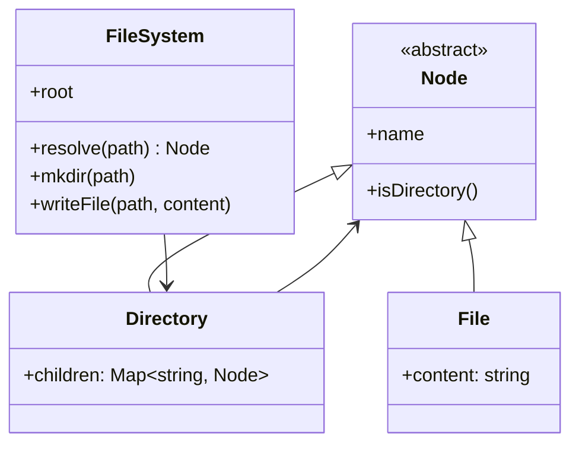

An in-memory file system (the "Design Twitter/LeetCode" style question,
and what every real file system's *userland half* actually is) is the
LLD where the **composite pattern** stops being a textbook entry and
starts being the load-bearing decision: files and directories are the
*same interface* with different behavior, a tree where every node
answers the same protocol, and everything else (paths, listing, moving,
deleting) falls out of that one choice.

The design's honest center: a file system is a **tree** plus a
**namespace** (the path language) plus **operations** (the protocol),
and the interview grades whether you see that the tree and the
namespace are separable concerns that happen to be combined.

## Requirements

- `ls(path)`: list a directory's entries (or a file's metadata).
- `mkdir(path)`: create a directory, with parent creation semantics.
- `addContentToFile(path, content)` /
  `readContentFromFile(path)`: the file operations.
- `mv` / `cp` / `rm`: tree surgery.

The two questions that shape everything:

- **File or directory: one interface or two?** One (composite) makes
  the tree uniform and traversal trivial; two (separate types) makes
  each node's behavior explicit and type-safe. The composite answer
  is the classic, and the honest trade is worth stating (uniform
  protocol versus type safety: a `readContent` on a directory is a
  *nonsense question* the composite cannot prevent statically).
- **What does a path mean?** `/a/b/c.txt` is a *lookup* (walk the tree)
  or an *address* (compute the node), and the answer determines the
  API's error model (missing parent vs missing leaf).

## The class model



The **Directory holds a map, not a list**: children keyed by name is
what makes `resolve` (the path walk) and `ls` (the listing) both
cheap, and the ordered map (a `std::map`, or a sorted insertion order
for listing determinism) answers `ls` sorted for free.

## The C++ sketch

```cpp
#include <map>
#include <memory>
#include <string>
#include <vector>

class Node {
public:
    explicit Node(std::string name) : name_(std::move(name)) {}
    virtual ~Node() = default;
    const std::string& name() const { return name_; }
    virtual bool isDirectory() const = 0;
private:
    std::string name_;
};

class File : public Node {
public:
    using Node::Node;
    bool isDirectory() const override { return false; }
    void append(const std::string& chunk) { content_ += chunk; }
    const std::string& content() const { return content_; }
private:
    std::string content_;
};

class Directory : public Node {
public:
    using Node::Node;
    bool isDirectory() const override { return true; }
    std::map<std::string, std::unique_ptr<Node>>& children() {
        return children_;               // ordered: ls comes out sorted
    }
    Node* find(const std::string& childName) {
        auto it = children_.find(childName);
        return it == children_.end() ? nullptr : it->second.get();
    }
private:
    std::map<std::string, std::unique_ptr<Node>> children_;
};

class FileSystem {
public:
    FileSystem() : root_(std::make_unique<Directory>("")) {}

    std::vector<std::string> ls(const std::string& path) {
        Node* node = resolve(path);
        if (node == nullptr) {
            return {};
        }
        if (!node->isDirectory()) {
            return {node->name()};       // ls on a file: the file itself
        }
        std::vector<std::string> names;
        for (const auto& [name, _] : static_cast<Directory*>(node)->children()) {
            names.push_back(name);      // ordered map: already sorted
        }
        return names;
    }

    void mkdir(const std::string& path) {
        Directory* parent = resolveParent(path);   // create-if-missing
        std::string leaf = leafName(path);
        if (parent->find(leaf) == nullptr) {
            parent->children()[leaf] =
                std::make_unique<Directory>(leaf);
        }
    }

    void writeFile(const std::string& path, const std::string& content) {
        Directory* parent = resolveParent(path);
        std::string leaf = leafName(path);
        Node* existing = parent->find(leaf);
        if (existing != nullptr && !existing->isDirectory()) {
            static_cast<File*>(existing)->append(content);   // append
        } else {
            parent->children()[leaf] = std::make_unique<File>(leaf);
            static_cast<File*>(parent->find(leaf))->append(content);
        }
    }

    std::string readFile(const std::string& path) {
        Node* node = resolve(path);
        return node != nullptr && !node->isDirectory()
            ? static_cast<File*>(node)->content()
            : "";
    }

private:
    Node* resolve(const std::string& path) {
        std::vector<std::string> parts = split(path);
        Node* current = root_.get();
        for (const std::string& part : parts) {
            if (!current->isDirectory()) {
                return nullptr;          // path goes through a file
            }
            current = static_cast<Directory*>(current)->find(part);
            if (current == nullptr) {
                return nullptr;
            }
        }
        return current;
    }

    std::unique_ptr<Directory> root_;
};
```

Two design decisions carry the correctness, and both live in
`resolve`:

- **The walk fails on a file in the middle** (`/a.txt/b` is nonsense),
  which is checked per-segment and is the error model's distinction
  between "not found" and "not a directory": conflating them is how
  `ls` implementations end up crashy.
- **`mkdir` and `writeFile` resolve the *parent*, not the leaf**, and
  create-if-missing versus create-or-fail is a per-operation policy
  (mkdir -p semantics vs "no such parent"), which is the same
  "who is responsible for intermediate structure" question as the
  [tree iterator's](/dsa/patterns/binary-trees-and-bsts/problems/binary-search-tree-iterator)
  pausing discipline, applied to paths.

The composite's cost is visible in every `static_cast`: the uniform
protocol means "what kind of node am I" is answered at runtime
(`isDirectory()` or a `dynamic_cast`), and the
[visitor](https://en.wikipedia.org/wiki/Visitor_pattern) or
two-interface variants exist precisely to move that answer to compile
time. Worth naming the trade rather than picking silently.

## Variations worth knowing

- **mv as a pointer reassignment**: moving is removing from one
  parent's map and inserting into another's (no copy, the node's
  identity survives), while `cp` must deep-copy (the tree's
  [clone](/dsa/patterns/graph-traversals/problems/clone-graph)
  question). The pair is a nice probe of whether the candidate is
  thinking in references or in values.
- **Inode-style storage**: separate the *name tree* from the *content
  blocks* (an id-to-content map, the tree holding ids), which is how
  real file systems work (hard links become possible: two names, one
  id, one refcount), and the moment this design grows up.
- **The LRU eviction half** (the "Design File System" cache variant
  where writes are dropped): an
  [LRU](/system-design/lld/lru-lfu-cache) over nodes, which is the
  other classic version of this problem.

## Related concepts

- [Design a Text Editor (Undo/Redo)](/system-design/lld/text-editor-undo-redo)
  is the other composite-tree LLD (the buffer as a tree).
- [Design a Linked List](/dsa/patterns/linear-structures/problems/design-linked-list)
  is the pointer-discipline foundation the tree reuses.
- [Trees](/dsa/patterns/binary-trees-and-bsts) is the structure, and
  [Design a Bank / Ledger](/system-design/lld/bank-ledger-system) is
  the same "tree plus protocol" discipline with money instead of bytes.
