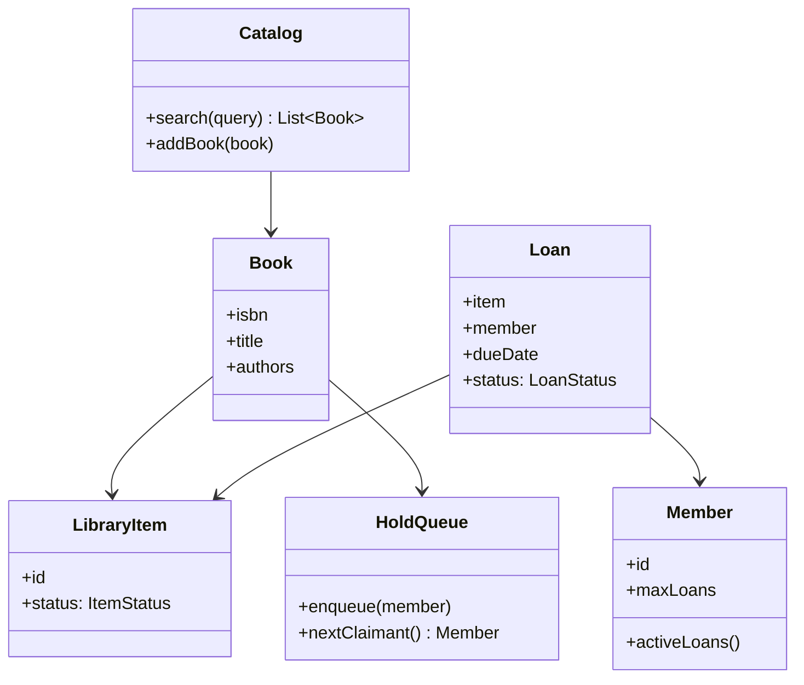
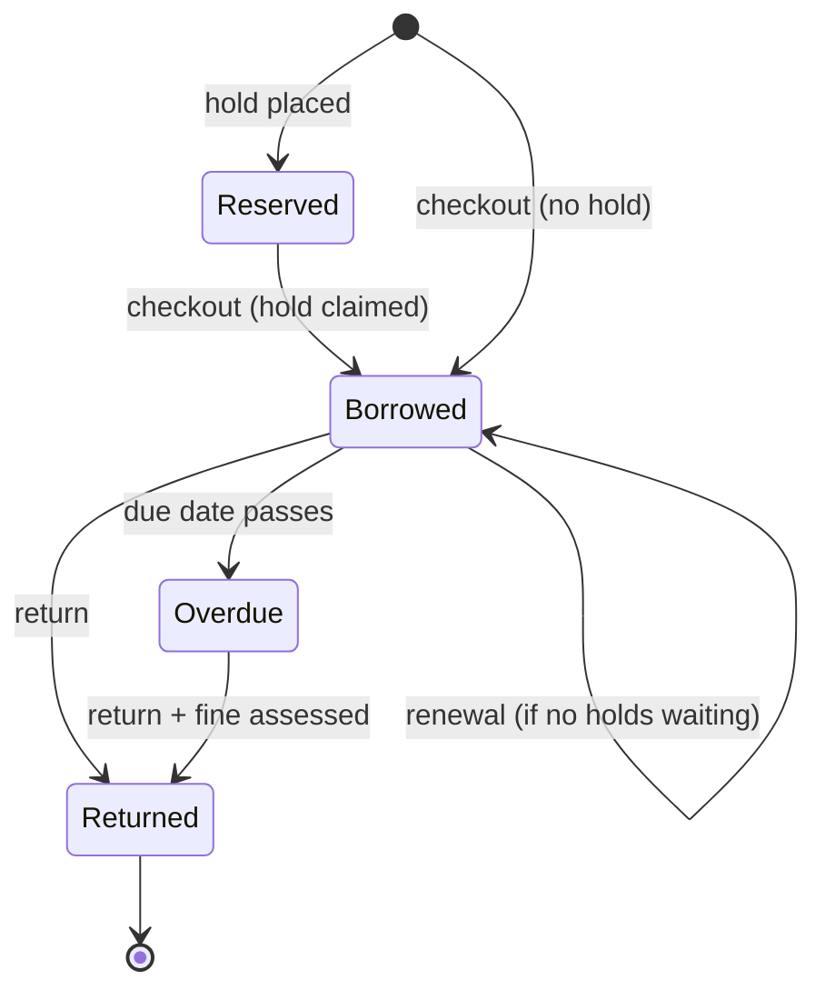

A library management system is the LLD that looks like a CRUD exercise
("books, members, loans") and earns its interview slot from two places:
the **catalog vs. copy** split (one *work* in the catalog, many physical
*items* that can be borrowed, each independently tracked), and the
**loan state machine** (a loan is not a row, it is a lifecycle: reserved,
borrowed, overdue, returned, renewed), where every bug in every library
system ever written lives.

## Step 1: requirements, interrogated

- A catalog of books (and other media). Search by title, author, ISBN.
- Members who borrow items, with a limit on concurrent loans.
- Borrowing: checkout and return, due dates, renewals.
- Holds/reservations: a member can reserve a popular title and be
  notified when a copy frees up.
- Fines for overdue returns.

The questions that shape the design, worth asking out loud:

- **Catalog or copies?** "Is *War and Peace* available?" is a question
  about the catalog; "which copy is in whose hands" is a question about
  individual items. Conflating them (one row per book) is the classic
  mistake: the moment a library holds two copies, a single-row model
  cannot answer "who has the second one".
- **What enforces the borrowing limit?** A count checked at checkout
  (a race under concurrency, the
  [movie ticket](/system-design/lld/movie-ticket-booking) problem) or a
  database constraint.
- **What happens to a hold when the book returns?** This is a queue
  with expiry (the hold must be claimed within N days or pass to the
  next member), which is a small scheduling design of its own.

## Step 2: the class model



- **Book** is the catalog entry (the *work*): title, authors, ISBN,
  and no availability state whatsoever.
- **LibraryItem** is a physical copy: an ID, a status
  (`ON_SHELF`, `ON_LOAN`, `HELD`, `LOST`), and a reference to its book.
  Every availability question is answered by counting items, never by
  a boolean on the book.
- **Loan** is the lifecycle object, and the load-bearing class: a
  state machine over time rather than a record of an event.
- **Member** holds the borrowing policy (the limit) and the queryable
  set of active loans.
- **HoldQueue** is per-book, ordered, with expiry: the
  [queue](/dsa/patterns/stacks-and-queues) discipline applied to
  reservations.

## Step 3: the loan state machine

The design's heart, stated before the code:



The guarded transitions are the interview content: a **renewal is
refused when a hold is waiting** (the renewal would starve the
queue, the [elevator scheduling](/system-design/lld/elevator-system)
fairness question in a smaller box), and an **overdue return assesses
a fine** (a *different* kind of event than a normal return, which is
why `Returned` from each path carries different side effects, modeled
here as two transitions rather than one with a flag).

## Step 4: the C++ sketch

```cpp
enum class ItemStatus { OnShelf, OnLoan, Held, Lost };
enum class LoanStatus { Borrowed, Returned, Overdue };

struct LibraryItem {
    std::string id;
    std::string isbn;
    ItemStatus status = ItemStatus::OnShelf;
};

struct Loan {
    std::string id;
    std::string memberId;
    std::string itemId;
    std::chrono::system_clock::time_point dueDate;
    LoanStatus status = LoanStatus::Borrowed;
};

class Library {
public:
    bool checkout(const std::string& memberId,
                  const std::string& isbn) {
        // Guarded transition: the whole sequence is one transaction
        // (member limit, hold claim, item status, loan creation).
        if (activeLoansFor(memberId) >= maxLoans_) {
            return false;                    // borrowing limit reached
        }
        LibraryItem* item = findAvailable(isbn);
        if (item == nullptr) {
            return false;                    // no free copy
        }
        if (!holdQueue_[isbn].empty() &&
            holdQueue_[isbn].front() != memberId) {
            return false;                    // copy is promised to a hold
        }
        item->status = ItemStatus::OnLoan;
        loans_.push_back(makeLoan(memberId, item->id));
        return true;
    }

    void returnItem(const std::string& itemId) {
        Loan* loan = findOpenLoan(itemId);
        if (loan == nullptr) {
            return;
        }
        loan->status = LoanStatus::Returned;
        LibraryItem* item = &items_[itemId];
        if (!holdQueue_[item->isbn].empty()) {
            item->status = ItemStatus::Held;   // reserved for the queue head
            notify(holdQueue_[item->isbn].front());
        } else {
            item->status = ItemStatus::OnShelf;
        }
        if (isOverdue(*loan)) {
            assessFine(*loan);                // the overdue side effect
        }
    }

private:
    std::map<std::string, std::vector<LibraryItem>> itemsByIsbn_;
    std::map<std::string, LibraryItem> items_;
    std::vector<Loan> loans_;
    std::map<std::string, std::deque<std::string>> holdQueue_;
    int maxLoans_ = 5;
};
```

The invariant sentence worth reciting: **an item's status and its
open loans are always consistent** (an `OnLoan` item has exactly one
open loan; a `Held` item has none and a queue head; a returned item
has none), and every guard runs inside the same critical section as
the transition it protects, the same
"check-then-act under one lock" discipline as the
[ticket booking](/system-design/lld/movie-ticket-booking) hold.

## Known variations

- **Multiple branches**: items gain a branch, "available" becomes
  per-branch, and inter-branch loans (a transfer, not a checkout) are
  their own lifecycle.
- **Fine policy as a strategy**: flat/day/threshold, the
  [parking lot pricing](/system-design/lld/parking-lot) move.
- **Lost items**: a fee lifecycle parallel to the fine, and a "long
  overdue → declared lost" transition, which is why `Lost` is an item
  status rather than an exception.

## Related C++ tools

- [std::deque](/cpp/deque): O(1) pushes and pops at both ends.
- [std::map / std::set](/cpp/map): ordered keys with O(log n) lookups and lower_bound.
- [std::string](/cpp/string): substr, find, and the operations that copy.

## Related concepts

- [Design a Parking Lot](/system-design/lld/parking-lot) is the sibling
  resource-allocation LLD (spots versus items, holds versus
  occupancy).
- [Design a Movie Ticket Booking](/system-design/lld/movie-ticket-booking)
  is the same hold/claim concurrency at higher stakes.
- [Design a Task Scheduler](/system-design/lld/task-scheduler-lld) is
  the same guarded-transition discipline over time.
