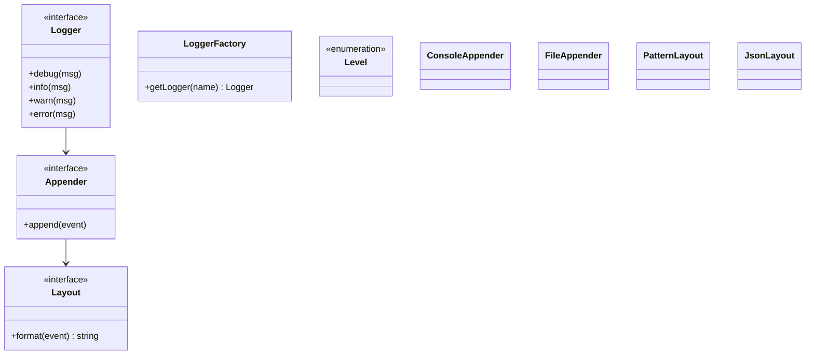

A logging framework is the LLD where *you* are the library author
rather than the application author, and that reversal changes every
design decision. The [parking lot](/system-design/lld/parking-lot) and
the [ATM](/system-design/lld/atm) are services: you design their
behavior. A logging framework is *infrastructure*: dozens of
applications you have never seen will embed it, each with its own
configurations, threading behavior, performance constraints, and
output destinations, and the design's job is to make decisions *that
do not foreclose* any of them.

The requirements that follow from that reversal:

- **Configurable levels** (DEBUG to FATAL): which messages get emitted
  is a *caller* decision, made at runtime.
- **Pluggable output** ("sinks"): console, file, syslog, network, test
  capture, whatever comes next.
- **Pluggable format**: layouts (pattern, JSON, plain), per sink.
- **Cheap when disabled**: a disabled debug log statement should cost
  nearly nothing, because logs are everywhere and most are filtered
  out.
- **Thread-safe by default**, with concurrent callers writing through
  the same logger.

## The class model



- **Logger** is the caller-facing interface, one instance per class or
  module name, obtained from a **factory** (the named-instance registry
  that every real framework (log4j, spdlog) uses, so configuration can
  target "com.orders.*" without code changes).
- **Appender** (the industry's name; "sink" is the same idea) is a
  destination; a logger can have several, each with its own **Layout**.
- The pieces are individually swappable, and the *composition* is the
  product: that is what "framework" means, structurally.

## The core mechanism: level filtering first, everything else second

The performance requirement ("cheap when disabled") dictates the core
shape, and it is the interview's favorite detail of this problem: the
**level check happens before any message formatting**.

```cpp
enum class Level { Debug = 0, Info, Warn, Error, Fatal };

struct LogEvent {
    Level level;
    std::string message;
    std::string loggerName;
    std::chrono::system_clock::time_point timestamp;
};

class Appender {
public:
    virtual ~Appender() = default;
    virtual void append(const LogEvent& event) = 0;
};

class Layout {
public:
    virtual ~Layout() = default;
    virtual std::string format(const LogEvent& event) = 0;
};

class PatternLayout : public Layout {
public:
    explicit PatternLayout(std::string pattern)
        : pattern_(std::move(pattern)) {}

    std::string format(const LogEvent& event) override {
        // Substitute %t timestamp, %n logger name, %l level, %m message.
        std::string out = pattern_;
        replaceAll(out, "%t", formatTimestamp(event.timestamp));
        replaceAll(out, "%n", event.loggerName);
        replaceAll(out, "%l", levelName(event.level));
        replaceAll(out, "%m", event.message);
        return out;
    }
private:
    std::string pattern_;
};

class Logger {
public:
    void log(Level level, const std::string& message) {
        if (level < threshold_) {
            return;                        // FIRST: the cheap gate
        }
        LogEvent event{level, message, name_,
                       std::chrono::system_clock::now()};
        for (Appender* sink : appenders_) {
            sink->append(event);          // each sink formats as needed
        }
    }

    void debug(const std::string& message) { log(Level::Debug, message); }
    void info(const std::string& message) { log(Level::Info, message); }

    void setThreshold(Level level) { threshold_.store(level); }

private:
    std::string name_;
    std::atomic<Level> threshold_{Level::Info};
    std::vector<Appender*> appenders_;
};
```

Read the ordering discipline: `if (level < threshold_) return` runs
*before* the event is built and *long before* any layout runs, which is
why a disabled `debug()` call costs one comparison rather than a
string-format. The real-world version makes this stronger (the
*caller's* side: `logger.debug("x = " + expensiveToString(x))`
concatenates before the call, which is why frameworks offer
`debug(fmt, args...)` with formatting deferred until after the
check): the check-then-format split is the pattern
"**guard first, pay only for what passes**", the same shape as the
[rate limiter](/system-design/lld/rate-limiter-lld)'s early exit and
the compiler's own short-circuit discipline.

## Thread safety and the queue

Concurrent callers sharing one logger means the appender's write path
is a shared resource, and the design decision is the standard one
([concurrency](/system-design/fundamentals/concurrency-and-parallelism)):

1. **Lock the write, not the log call**: a mutex inside each appender
   around its I/O. Simple, correct, and serializes every log line
   (which, since logs are human-rate-readable anyway, is usually fine).
2. **A background queue** (the async logger): log calls enqueue an
   event (lock-free or a small mutex on the ring) and return; a worker
   thread drains to the sinks. Now the caller's cost is O(1) memory
   rather than an I/O stall, and this is where the
   [ring buffer](/dsa/patterns/linear-structures/problems/design-circular-deque)
   with drop-policy appears (log frameworks are the classic
   "drop-oldest under load" system, which is
   [backpressure](/system-design/fundamentals/backpressure-and-flow-control)
   as a product decision).
3. **Per-sink locks**, so a slow sink (a network syslog) does not
   stall a fast one (stdout).

The async option is where the [circular
deque](/dsa/patterns/linear-structures/problems/design-circular-deque)
from this site's DSA section becomes an LLD component: bounded ring,
drop-oldest on overflow, one draining thread. Worth connecting out
loud.

## Variations worth knowing

- **Structured logging** (JSON events, fields rather than a formatted
  string): the [layout](/system-design/fundamentals/observability)'s
  machine-readable sibling, and the modern default for services (the
  pattern is the same: the *event* carries fields, the sink chooses
  representation).
- **Hierarchical configuration** ("com.orders" inherits "com" inherits
  root), which is why the factory hands out *named* loggers.
- **MDC / context**: a per-thread map of ambient fields (request id)
  the layout merges in, the threading discipline this site's
  [tracing](/system-design/fundamentals/observability) discussion
  wants.

## Related concepts

- [Observability](/system-design/fundamentals/observability) is what
  the framework serves (logs as one of the three pillars).
- [Design a Log Aggregation System](/system-design/hld/log-aggregation-system)
  is the fleet-scale version of what one appender ships to.
- [Design a Pub/Sub Broker](/system-design/lld/pubsub-broker-lld) is
  the same pluggable-transport design with delivery semantics added.
