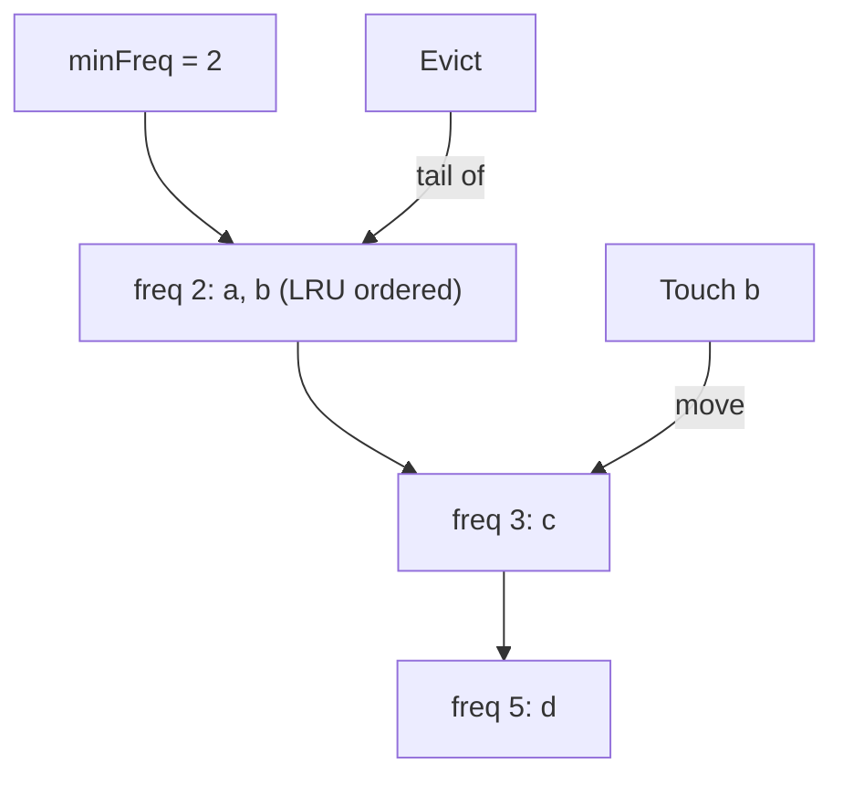

A cache's eviction policy answers one question: when memory runs out, who
gets thrown away? The two classic answers are LRU ("whoever hasn't been
touched in longest") and LFU ("whoever was touched least"), and the LLD
interview version of this problem is not really about caching. It's about
what it costs to answer those questions in O(1), because the naive answer
is a scan on every eviction, and the interview question is really asking
you to notice that scans are a data-structure choice away from constant
time.

This is one of the rare LLDs where the requirements are usually given to
you precisely, so the design pressure lands almost entirely on the data
structures.

## Requirements

Typical constraints for this problem:

- Fixed capacity `cap`, given at construction.
- `get(key)`: return the value, or -1/not-found. A `get` *counts as a
  use*.
- `put(key, value)`: insert or update. If inserting at capacity, evict
  according to policy first.
- Both operations must be **O(1)**. That's the requirement doing all the
  work: it's what bans the obvious designs.
- For LFU, define tie-breaking: on equal frequency, evict the
  least-recently-used among them (the standard convention, and worth
  stating explicitly, because it's the part of the spec people forget to
  ask about).

## The core insight (both policies share it)

The store must answer two different questions: "what is the value of
key K?" (lookup) and "which entry is the least useful?" (eviction
candidate). No single structure answers both in O(1):

- A [hash map](/dsa/patterns/hash-based-structures) answers lookup but
  knows nothing about order or frequency.
- A sorted structure answers "least useful" but not O(1) lookup.

So both designs are a **hash map plus a structure that maintains the
eviction order**, with the map pointing *into* the structure. The whole
problem is choosing and maintaining that second structure.

## LRU: recency as a doubly linked list

Recency is strict total order, and it changes on every touch: the touched
entry becomes "most recent", wherever it was. You need to move an
arbitrary entry to the front, and remove the back, both in O(1). That is
exactly what a **doubly linked list** with a hash map into its nodes
provides.

```cpp
struct Node {
    int key;
    int value;
    Node* prev = nullptr;
    Node* next = nullptr;
};

class LRUCache {
public:
    explicit LRUCache(int capacity) : capacity_(capacity) {}

    int get(int key) {
        auto it = map_.find(key);
        if (it == map_.end()) {
            return -1;
        }
        moveToFront(it->second);            // a get counts as a use
        return it->second->value;
    }

    void put(int key, int value) {
        auto it = map_.find(key);
        if (it != map_.end()) {             // update in place
            it->second->value = value;
            moveToFront(it->second);
            return;
        }
        if (static_cast<int>(map_.size()) >= capacity_) {
            evictOldest();                  // remove tail AND its map entry
        }
        insertNew(key, value);
    }

private:
    void moveToFront(Node* node) { /* unlink, relink at head */ }
    void evictOldest() {
        Node* lru = tail_->prev;           // true least-recently-used
        map_.erase(lru->key);              // both structures must agree
        unlink(lru);
        delete lru;
    }
    // ... capacity_, map_, head_/tail_ sentinels
    std::unordered_map<int, Node*> map_;
};
```

Two details carry the whole implementation. The **map must store the
list node's address**, not the value: O(1) eviction requires jumping
straight from "key" to "the node to remove", and storing values forces a
list scan. And **eviction must update both structures** (the map entry
and the list node) or they drift out of sync, which is the classic bug in
this problem: the map says a key exists, the list disagrees, and every
subsequent operation is wrong.

The sentinels (dummy head and tail) are worth a sentence of explanation:
they eliminate every "is the list empty / is this the head / is this the
tail" branch, and the node-unlink code becomes three pointer
assignments, branch-free.

## LFU: frequency buckets, each an LRU list

LFU can't use one list, because order isn't total: entries cluster by
frequency, and eviction needs the *lowest* frequency, ties broken by
recency. The fix composes the LRU structure with a bucket structure.

Maintain a **map from frequency to a doubly linked list** (each list
holding entries of that frequency, ordered by recency), plus a pointer to
the current minimum frequency. On a touch, an entry moves from bucket `f`
to bucket `f+1`; eviction takes the tail of the `minFreq` bucket.



The subtle part is maintaining `minFreq` in O(1). On a touch of an entry
in bucket `minFreq`, it moves to `minFreq + 1`, so the minimum either
stays (other entries remain) or becomes `minFreq + 1` (if the old bucket
emptied and nothing lower exists, which is guaranteed, because you only
touch an entry *at* the minimum). On eviction, the minimum is unchanged
(you removed the last-touched entry *of* the minimum). On insert, the
entry starts at frequency 1, so `minFreq = 1`. Each case is O(1), so the
whole policy is O(1), but the case analysis is the interview-grade part:
miss one case and the minimum drifts, and evictions start removing the
wrong bucket.

## Variations and follow-ups

- **O(1) LRU without pointers**: a fixed-size array of slots, where each
  slot stores its last-use *timestamp* (or better, a counter) and eviction
  scans for the oldest. Linear eviction, constant factors tiny: the right
  answer for an embedded cache where pointer nodes are too expensive.
- **Why not a heap?** A min-heap on last-use-time answers eviction in
  O(log n) and *misses the O(1) requirement*: every get changes the key
  of an existing entry (its recency), which a heap cannot update without a
  search. This is worth saying out loud, because "heap" is the
  plausible-but-wrong answer interviewers listen for.
- **Concurrency**: lock the whole structure (fine for small caches), or
  shard the key space across independent LRU/LFUs (the common scaling
  answer: each shard evicts independently, and the approximation is
  acceptable). A truly lock-free version is a research problem, not an
  interview answer.
- **Wire this to a real cache**: this class *is* the eviction policy of a
  real [cache](/system-design/fundamentals/caching); the memory policy,
  TTL, and admission (what deserves caching at all) are separate decisions.

## Related C++ tools

- [std::unordered_map / unordered_set](/cpp/unordered-map): average O(1) lookups, and find versus operator[].
- [Iterator Invalidation](/cpp/invalidation): which operations break iterators you are holding.

## Related concepts

- [Caching](/system-design/fundamentals/caching) is the system-level
  context: eviction is one of the three questions (placement, eviction,
  invalidation).
- [Hash-Based Structures](/dsa/patterns/hash-based-structures) covers the
  lookup half of the design.
- [Design a Parking Lot](/system-design/lld/parking-lot) shares the
  "maintain two structures in agreement" discipline this problem teaches.
- [Stacks & Queues](/dsa/patterns/stacks-and-queues) is where the
  doubly-linked-list surgery moves come from.
