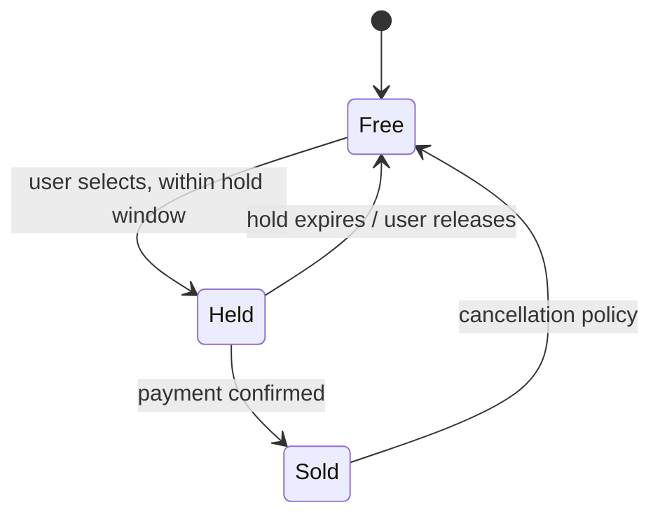
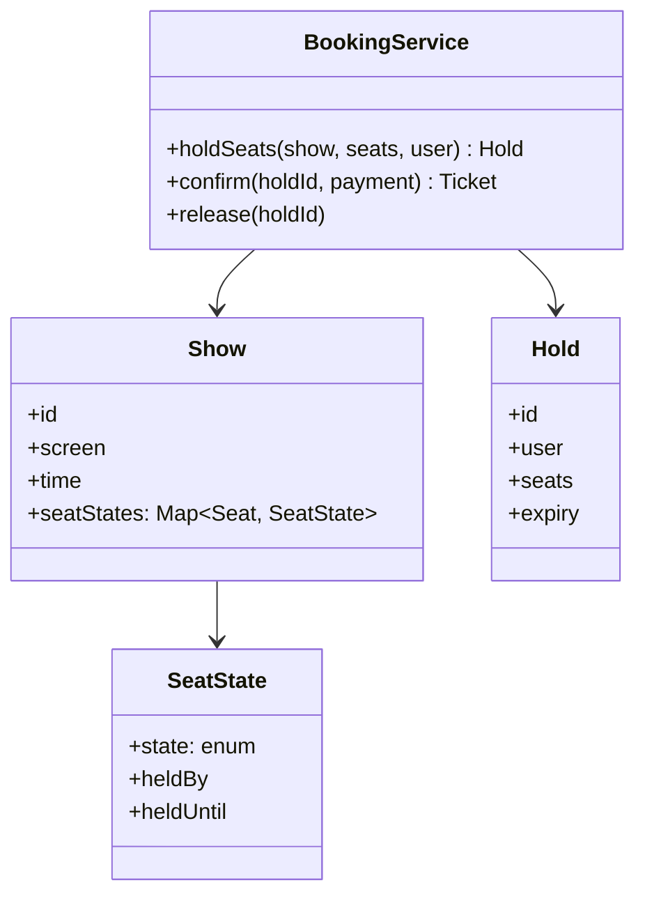

Movie ticket booking is the LLD that is secretly a
[concurrency](/system-design/fundamentals/concurrency-and-parallelism)
interview. The classes (show, screen, seat, booking) are straightforward
domain modeling; what the problem actually tests is the moment two users
tap "book" for seat 12F at the same moment, and everything in the design
exists to make that moment boring. It is the code-level sibling of the
[e-commerce flash sale](/system-design/hld/e-commerce-flash-sale)'s
inventory core, and of the [parking lot](/system-design/lld/parking-lot)'s
spot assignment, with the same shape: a fixed resource, many contenders,
and a rule that exactly one contender can win.

## Step 1: requirements

Pin the scope explicitly, because booking problems hide their decisions
in assumptions:

- One (or many) theaters; screens have shows at times; shows have seats.
- A user selects seats and books, paying in a later step.
- **The core rule: no seat is ever double-sold**, and a seat's state is
  always knowable (free, held, sold).
- Booking should have a **hold window**: selecting a seat holds it for
  some minutes (payment happens within that window), or the seats release
  automatically.
- Optional: seat maps per show, concurrent browsers, cancellation.

The hold window is the requirement doing all the work below. Without it,
every seat is either instantly sold (and the user has no time to pay) or
double-bookable during payment. With it, the design gets a clean state
machine and a single synchronization point.

## Step 2: the state machine

Each seat, per show, moves through:



The two transitions out of `Held` are where correctness lives: exactly
one of them wins. If payment confirmation and hold expiry can race, the
seat might be sold to one user and released to another, which is the
double-sale in disguise. The design answer: both transitions go through
the same atomic `compare-and-set` on the seat's state
(`Held -> Sold` or `Held -> Free`), so whichever runs second simply
fails.

## Step 3: the class model



- **Show** owns the per-show seat states: the same physical seat is a
  different state object per show, so the map is
  `(show, seat) -> SeatState`, which is what "no double-selling *per
  show*" means structurally.
- **Hold** is a first-class object, not a boolean on a seat: it groups
  the selected seats, the user, and a single expiry, so releasing or
  confirming is one operation on one aggregate rather than a scatter of
  per-seat updates.
- **BookingService** is the facade and the only place that mutates seat
  state, which is what makes the invariants checkable in one file.

## Step 4: the C++ sketch, centered on the hold

```cpp
enum class SeatState { Free, Held, Sold };

struct SeatStateRow {
    std::mutex mtx;                    // guards this seat's transition
    SeatState state = SeatState::Free;
    std::string heldBy;
    std::chrono::steady_clock::time_point heldUntil;
};

class BookingService {
public:
    // Attempt to hold seats for a user. All-or-nothing.
    bool holdSeats(Show& show, const std::vector<std::string>& seatIds,
                   const std::string& user,
                   std::chrono::seconds holdDuration) {
        // Sort for a stable lock order (prevents deadlock between two
        // multi-seat bookings that share seats in opposite order).
        std::vector<std::string> sorted = seatIds;
        std::sort(sorted.begin(), sorted.end());

        std::vector<std::unique_lock<std::mutex>> locks;
        locks.reserve(sorted.size());
        for (const auto& id : sorted) {
            locks.emplace_back(show.seat(id).mtx, std::defer_lock);
        }
        for (auto& lock : locks) {
            lock.lock();                // lock all, in order
        }

        for (const auto& id : sorted) {        // verify all free
            if (show.seat(id).state != SeatState::Free &&
                !holdExpired(show.seat(id))) {
                return false;           // release via RAII: no partial hold
            }
        }
        auto expiry = std::chrono::steady_clock::now() + holdDuration;
        for (const auto& id : sorted) {
            SeatStateRow& row = show.seat(id);
            row.state = SeatState::Held;   // atomically: all seats or none
            row.heldBy = user;
            row.heldUntil = expiry;
        }
        return true;
    }

    // Confirm a hold into a sale. Returns false if the hold expired.
    bool confirm(Show& show, const std::vector<std::string>& seatIds,
                 const std::string& user) {
        std::unique_lock<std::mutex> guard(show.bookingMtx());
        for (const auto& id : seatIds) {
            std::unique_lock<std::mutex> seatLock(show.seat(id).mtx);
            SeatStateRow& row = show.seat(id);
            if (row.state != SeatState::Held || row.heldBy != user) {
                return false;           // expired and re-held: lost the race
            }
        }
        for (const auto& id : seatIds) {
            show.seat(id).state = SeatState::Sold;
        }
        return true;
    }

private:
    static bool holdExpired(const SeatStateRow& row) {
        return row.state == SeatState::Held &&
               std::chrono::steady_clock::now() >= row.heldUntil;
    }
};
```

Three decisions in that code are the interview's actual content:

**All-or-nothing holds.** Booking two seats together must not hold one:
the user would pay for a single seat of a pair. The sketch locks all the
sorted seats, verifies all are free, then marks all held, releasing
everything through RAII if any check fails. The *sort* is not cosmetic:
two users booking overlapping seat sets in opposite orders will deadlock
without a fixed lock order, which is the classic
[concurrency](/system-design/fundamentals/concurrency-and-parallelism)
point this problem exists to surface.

**Expiry as a check, not a thread.** Holds expire lazily: a seat whose
`heldUntil` has passed is treated as free by whoever looks next, so
there is no sweeper thread, no timer per hold, and no wakeups. The
cost is that expired holds linger until someone touches the seat, which
is fine (they look free), and a periodic janitor can clean them for
reporting. Lazy expiry is the pattern to name out loud: timers are
stateful machinery, comparisons are free.

**Confirm as a guarded transition.** The confirm path re-checks state
under the same lock discipline as the hold, so a payment landing one
millisecond after expiry correctly fails (the seat was re-held or
released), and a hold-expiry racing a payment resolves to whichever
transition won the lock, never both.

## Variations and follow-ups

- **Distributed version**: the per-seat mutex becomes a database row
  transaction (`UPDATE ... WHERE state='HELD' AND held_by=?`) or a Redis
  `SET NX` with TTL per seat, which is exactly the
  [flash sale](/system-design/hld/e-commerce-flash-sale) inventory
  design; the hold window becomes the TTL, and expiry becomes real
  (Redis expires it) rather than lazy.
- **Optimistic booking**: no locks, just versioned rows and retry on
  conflict, which scales better under contention but complicates the
  all-or-nothing grouping.
- **Seat recommendations / auto-release UX**: the client polls or is
  pushed the seat map, which is a read-model concern, separate from the
  booking state machine (a small
  [CQRS](/system-design/fundamentals/event-sourcing-and-cqrs) split).

## Related C++ tools

- [Sorting & nth_element](/cpp/algorithms): sort, nth_element, and what each guarantees.
- [std::string](/cpp/string): substr, find, and the operations that copy.

## Related concepts

- [Concurrency & Parallelism](/system-design/fundamentals/concurrency-and-parallelism)
  is the subject under the costume: locking order, atomic transitions.
- [Design an E-commerce / Flash Sale](/system-design/hld/e-commerce-flash-sale)
  is the same inventory core at fleet scale.
- [Design a Parking Lot](/system-design/lld/parking-lot) is the sibling
  resource-allocation LLD.
- [Stacks & Queues](/dsa/patterns/stacks-and-queues) covers the
  queue-of-holds shape the distributed version uses.
