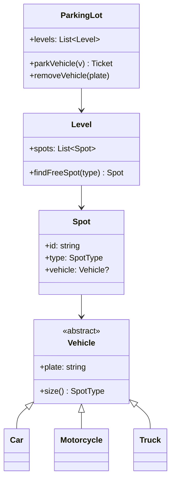

The parking lot is the most common low-level design interview, and the
reason isn't parking. The interviewer wants to see how you translate a fuzzy
real-world system into classes: where you draw the boundaries between what
varies and what doesn't, and how you keep the design open to change (a new
vehicle type, a new pricing rule) without rewriting it.

Start by interrogating the requirements, because parking lot questions are
famous for hiding decisions in their assumptions.

## Step 1: nail down the requirements

Ask these before anything else:

- What vehicle types? (motorcycles, cars, trucks? Do motorcycles fit in car
  spots? Usually yes; a car doesn't fit in a motorcycle spot.)
- How are spots arranged? (levels, rows, spot numbering for finding the
  vehicle later?)
- What's the payment model? (flat rate, hourly, per vehicle type?)
- Who are the actors? (a driver, an attendant, an admin, and maybe a payment
  machine.)
- How does a vehicle leave? (ticket at entry, payment at exit, gate opens?)

A small but decisive assumption: **the system must prevent two vehicles
being assigned the same spot**, and must support lookup by vehicle so a
returning driver can find their car. Say those out loud; they justify the
data structures later.

The scope you choose for a 45-minute interview: one parking lot, multiple
levels, three vehicle types, ticket-based entry/exit, hourly payment. State
clearly what you're leaving out (multiple locations, reservations, dynamic
pricing).

## Step 2: the class model

Four abstractions carry the design, each earning its place:



- **Vehicle** is an abstraction over the types. The polymorphism is one
  method: `size()`, which says what kind of spot it needs. The parking lot
  never asks "is this a car?" anywhere; it asks the vehicle what spot it
  fits. Adding an EV-with-charging later means one new subclass, no
  changes to the lot logic. That's the point of the abstraction.
- **Spot** knows its type and its current occupant. The type is an enum
  (`MOTORCYCLE`, `COMPACT`, `LARGE`), not a class hierarchy: spot behavior
  doesn't vary, only its category.
- **Level** exists because "where" matters: the ticket says 3rd floor, row
  B. It's also the natural unit for a spot search.
- **ParkingLot** is the facade. All clients talk to it; nobody reaches
  through it to poke Spots directly.

The supporting classes: **Ticket** (entry time, vehicle, spot, payment
status), **PaymentStrategy** (interface), and **PaymentMachine/Attendant**
(the actor that triggers payment).

## Step 3: the C++ sketch

```cpp
enum class SpotType { Motorcycle, Compact, Large };

class Vehicle {
public:
    virtual ~Vehicle() = default;
    explicit Vehicle(std::string plate) : plate_(std::move(plate)) {}
    const std::string& plate() const { return plate_; }
    virtual SpotType requiredSpot() const = 0;

private:
    std::string plate_;
};

class Car : public Vehicle {
public:
    using Vehicle::Vehicle;
    SpotType requiredSpot() const override { return SpotType::Compact; }
};

class Spot {
public:
    Spot(std::string id, SpotType type) : id_(std::move(id)), type_(type) {}
    bool isFree() const { return vehicle_ == nullptr; }
    bool fits(const Vehicle& v) const {
        return isFree() && type_ == v.requiredSpot();
    }
    void assign(const Vehicle& v) { vehicle_ = &v; }
    void release() { vehicle_ = nullptr; }

private:
    std::string id_;
    SpotType type_;
    const Vehicle* vehicle_ = nullptr;
};

class ParkingLot {
public:
    Ticket park(Vehicle& v) {
        Spot* spot = findFreeSpot(v.requiredSpot());
        if (!spot) {
            throw std::runtime_error("lot full");
        }
        spot->assign(v);
        return Ticket(&v, spot);          // records entry time internally
    }

private:
    Spot* findFreeSpot(SpotType type) {
        for (Level& level : levels_) {
            if (Spot* s = level.findFreeSpot(type)) {
                return s;
            }
        }
        return nullptr;
    }
    std::vector<Level> levels_;
};
```

The interesting choice here is `findFreeSpot`. The naive version scans
every spot on every park call, O(total spots). The scalable version keeps
per-type free lists, one list per spot type per level, so finding a free
spot is pop-from-list. Mention both, and the trade: the lists must be
maintained on every park/release. Interviewers listen for exactly this kind
of "and here's the cost of the faster structure" reasoning.

## Step 4: pricing as a strategy

Payment is the part of the design most worth doing well, because it's the
part that varies. Flat rate, hourly, early-bird, weekend rates: none of
these should live inside the `ParkingLot` class, or every new promotion
means touching it. Instead:

```cpp
class PricingStrategy {
public:
    virtual ~PricingStrategy() = default;
    virtual Money priceFor(const Ticket& t) const = 0;
};

class HourlyPricing : public PricingStrategy {
public:
    Money priceFor(const Ticket& t) const override {
        auto hours = ceilHours(t.duration());
        return Money::fromCents(hours * hourlyRateCents_);
    }
private:
    long long hourlyRateCents_;
};
```

The ticket computes from entry/exit timestamps; the strategy computes money
from a ticket; the lot is completely uninvolved. **Money is its own type**
worth mentioning, not a float: cents as an integer avoids the classic
rounding bugs, and reprices cleanly across currencies.

## The boundary questions interviewers actually grade

- **Concurrency**: what happens when two attendants press "issue ticket"
  for the last compact spot at the same time? (Answer: the spot assignment
  must be atomic; one lookup-and-assign under a lock, or an atomic
  compare-and-swap on the spot state. Notice that the free-list version
  makes this a single pop, which serializes cleanly.)
- **Failures**: if the gate arm breaks after payment, the driver paid but
  the spot is still occupied. How does the system reconcile? (An exit
  event marks the spot free; a "paid but never exited" state needs a
  sweep.)
- **Extensibility**: what changes for a monthly-pass holder? (A new
  authorization check at the entry gate, not a new spot type. What changes
  for valet parking? A new actor, and spots assigned by an attendant rather
  than by the free list.)

## Known variations

- Some designs model `ParkingSpot` hierarchically (MotorcycleSpot,
  CarSpot...) instead of a type enum. Wasteful in most interviews: behavior
  is identical, only the category differs, and an enum plus one `fits()`
  check is simpler.
- Some skip the Level class for a flat lot. Fine at toy scale, but the
  "find my car" requirement drags the level/row back in almost immediately.
- Commercial garages add license-plate-recognition at entry/exit instead of
  tickets, which removes the ticket class and makes the plate the lookup
  key. Ask which the interviewer wants; both are legitimate.

## Related concepts

- [Concurrency & Parallelism](/system-design/fundamentals/concurrency-and-parallelism)
  explains the atomicity question that the two-attendants case is really
  asking.
- [Caching](/system-design/fundamentals/caching) if the interview scales it
  up: spot availability as a cached counter behind a gate API.
- [Database Fundamentals](/system-design/fundamentals/database-fundamentals)
  for what actually persists the tickets and payment records.
