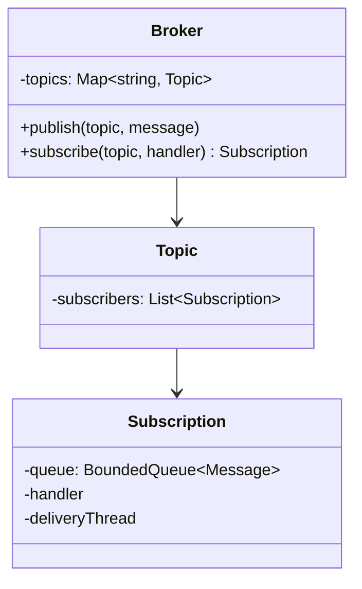

The [fundamentals page](/system-design/fundamentals/message-queues-and-pubsub)
covers what queues and pub/sub *are*; the
[distributed HLD](/system-design/hld/distributed-message-queue) covers
building the broker as a fleet. The code-level LLD is the middle piece
and the most common real-world version of this problem: **a library
that provides publish/subscribe *inside one process***, the way every
event bus, in-process message broker, and application-level pub/sub
actually ships. The design's subject is the data structures for
topics and subscriptions, the delivery loop's threading, and the
boundary where "reliable" must be defined honestly rather than
promised.

## Requirements

- `publish(topic, message)`: broadcast to all current subscribers of
  the topic.
- `subscribe(topic, handler)`: register a callback; an unsubscribe.
- Per-subscriber delivery: slow handlers must not stall the others.
- Thread-safe: publishers and subscribers on any thread.
- The honest limitation, stated up front: in-process means
  in-process. If the process dies, messages die. The design's
  reliability story stops at "delivery is attempted once per handler"
  and says what that costs.

The design question underneath the requirements: **does delivery
block the publisher?** Synchronous delivery (call each handler inside
`publish`) is the simplest possible design, and it makes every
publisher's latency the *sum* of its subscribers' handler latencies:
one slow handler taxes every message to that topic. The answer, in
every real broker, is a per-subscriber queue plus a delivery loop,
which is the [backpressure](/system-design/fundamentals/backpressure-and-flow-control)
decision applied at library scale.

## The class model



The **Subscription owns its queue and its delivery loop**, which is
the design's central move: isolation per subscriber (one bad handler
fills *its own* queue, backs up *its own* delivery, and nothing else's),
the same "contain the blast radius" reasoning as the
[multi-tenant](/system-design/fundamentals/multi-tenancy-and-data-residency)
noisy-neighbor containment.

## The C++ sketch

```cpp
#include <condition_variable>
#include <deque>
#include <functional>
#include <mutex>
#include <string>
#include <thread>
#include <unordered_map>
#include <vector>

struct Message {
    std::string topic;
    std::string payload;
};

class Subscription {
public:
    using Handler = std::function<void(const Message&)>;

    Subscription(Handler handler, size_t capacity)
        : handler_(std::move(handler)), capacity_(capacity) {
        running_ = true;
        delivery_ = std::thread([this] { deliveryLoop(); });
    }

    void enqueue(const Message& message) {
        {
            std::lock_guard<std::mutex> guard(mtx_);
            if (queue_.size() < capacity_) {
                queue_.push_back(message);   // bounded: drop when full
            } else {
                dropped_++;                  // the policy, counted honestly
            }
        }
        cv_.notify_one();
    }

    void shutdown() {
        {
            std::lock_guard<std::mutex> guard(mtx_);
            running_ = false;
        }
        cv_.notify_all();
        if (delivery_.joinable()) {
            delivery_.join();
        }
    }

private:
    void deliveryLoop() {
        std::unique_lock<std::mutex> lock(mtx_);
        while (true) {
            cv_.wait(lock, [this] {
                return !queue_.empty() || !running_;
            });
            while (!queue_.empty()) {
                Message message = queue_.front();
                queue_.pop_front();
                lock.unlock();             // handler runs OUTSIDE the lock
                handler_(message);          // slow handler: its own queue only
                lock.lock();
            }
            if (!running_) {
                break;
            }
        }
    }

    Handler handler_;
    size_t capacity_;
    std::deque<Message> queue_;
    std::mutex mtx_;
    std::condition_variable cv_;
    std::thread delivery_;
    bool running_;
    std::atomic<size_t> dropped_{0};
};

class Broker {
public:
    void publish(const std::string& topicName, const std::string& payload) {
        Message message{topicName, payload};
        std::lock_guard<std::mutex> guard(topicsMtx_);
        auto it = topics_.find(topicName);
        if (it == topics_.end()) {
            return;                          // no subscribers: message dies here
        }
        for (auto& subscription : it->second) {
            subscription->enqueue(message);  // non-blocking: hand off
        }
    }

    std::shared_ptr<Subscription> subscribe(
            const std::string& topicName,
            Subscription::Handler handler) {
        auto subscription =
            std::make_shared<Subscription>(std::move(handler), 1024);
        std::lock_guard<std::mutex> guard(topicsMtx_);
        topics_[topicName].push_back(subscription);
        return subscription;                // the handle: keep it to unsubscribe
    }

    ~Broker() {
        std::lock_guard<std::mutex> guard(topicsMtx_);
        for (auto& [_, subscribers] : topics_) {
            for (auto& subscription : subscribers) {
                subscription->shutdown();
            }
        }
    }

private:
    std::mutex topicsMtx_;
    std::unordered_map<std::string,
        std::vector<std::shared_ptr<Subscription>>> topics_;
};
```

Three threading decisions carry the design, and each is a named
discipline from the site:

- **`publish` never calls handlers**: it enqueues and returns
  (holding only the topics lock, briefly), so a publisher's latency
  is O(subscribers) pointer pushes, not handler time. This is
  [lock the bookkeeping, never the work](/system-design/fundamentals/concurrency-and-parallelism),
  the same rule as the [rate limiter](/system-design/lld/rate-limiter-lld).
- **The delivery loop unlocks around the handler**:
  `lock.unlock(); handler_(message); lock.lock();`, because holding
  the queue's mutex while running user code serializes *enqueue*
  against *delivery* (publishers stall on a slow handler's lock),
  which defeats the whole isolation design. The queue lock guards the
  deque; the handler runs free.
- **The bounded queue with a drop counter** is the honest reliability
  statement: `capacity_` (the
  [backpressure](/system-design/fundamentals/backpressure-and-flow-control)
  buffer/shed/slow decision, made per subscriber) and `dropped_`
  (the meter that makes the policy *visible* rather than silent).
  "Drop new messages when full" is one choice; drop-oldest (the
  [logging](/system-design/lld/logging-framework) async-appender
  policy) is the other, and the point is that the choice is *explicit
  and measured*.

## The reliability boundary, stated honestly

This is an *at-most-once* broker: a message published to a subscriber
whose queue is full is dropped (counted), and a process death loses
everything in flight. Making it *at-least-once* needs durability
(the queue becomes a [write-ahead](/system-design/lld/bank-ledger-system)
log: the append before the enqueue, the replay on startup), which is
the boundary where this design hands off to the
[distributed broker](/system-design/hld/distributed-message-queue),
and where the handler itself must become
[idempotent](/system-design/fundamentals/idempotency-and-exactly-once).
The interview-grade move is drawing the line out loud: this library
buys *isolation and ordering-per-subscriber*, and *reliability is not
among its products*.

## Variations worth knowing

- **Wildcard/hierarchical topics** ("orders.*" matching
  "orders.created"): the topic map becomes a
  [trie](/dsa/patterns/trie-prefix-tree) or a pattern registry, the
  [autocomplete](/system-design/hld/search-autocomplete) matching move.
- **Replay/cursor subscriptions** ("give me everything from message
  1000"): the per-subscriber queue becomes a *log with cursors*
  (retained per topic), which is the
  [event sourcing](/system-design/fundamentals/event-sourcing-and-cqrs)
  shape and the moment this design grows durability.
- **Re-entrancy** (a handler that publishes to the same topic): the
  unlocked delivery means a handler publishing is safe (it enqueues,
  its own loop is not on the stack), the deadlock-free answer the
  design above already gives for free.

## Related concepts

- [Message Queues & Pub/Sub](/system-design/fundamentals/message-queues-and-pubsub)
  is the concepts page (queue vs topic, delivery semantics).
- [Design a Logging Framework](/system-design/lld/logging-framework)
  is the same queue-plus-sink design with formatting instead of
  topics.
- [Design a Distributed Message Queue](/system-design/hld/distributed-message-queue)
  is the durable, fleet-scale version this design hands off to.
- [Backpressure & Flow Control](/system-design/fundamentals/backpressure-and-flow-control)
  is the drop-policy vocabulary this design makes explicit.
