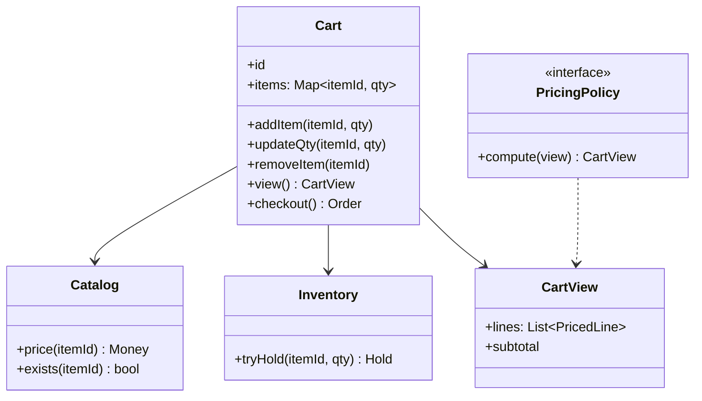

A shopping cart sounds like the simplest possible LLD ("a map of items
to quantities"), and it is the *right* smallest version of a
domain-driven design question: the cart is an **aggregate** (a thing
with its own invariants, its own lifecycle, and a boundary around
what outside code may do to it), and every real cart system's bugs come
from treating it as a bare map. The three things a cart is, beyond
item-count pairs: **priced** (the price you see at checkout is a
*derived*, time-sensitive value), **bounded** (inventory and limits
are the cart's business, not just the catalog's), and **transitional**
(the moment it becomes an order, an inventory
[hold](/system-design/lld/movie-ticket-booking) must exist or the
cart was a promise the checkout cannot keep).

## Requirements

- A cart per user (anonymous carts merging into account carts on
  login), with add/update/remove/quantity semantics.
- Prices are shown from the catalog, but *re-derived* at every view
  (prices change).
- The cart respects limits: max quantity per item, max distinct items,
  and stock availability at add-to-cart time.
- Checkout turns the cart into an order: the bridge to the
  [flash sale](/system-design/hld/e-commerce-flash-sale) inventory
  problem.
- The cart is long-lived (days), so it must survive service restarts
  and tolerate catalog changes (an item's price rising, an item being
  discontinued).

The modeling questions, in order:

- **What is the cart's identity?** A cart id (not the user id): an
  anonymous browser builds a cart, logs in, and the two carts merge,
  which is a *cart-lifecycle* event, not a user-table update. Carts
  have ids, users adopt them.
- **What does the cart store?** Item *references* and quantities, and
  **not**: prices, titles, stock, or any catalog data. The moment the
  cart stores a price, it has made a promise the catalog did not keep,
  and "the cart said $10 but checkout charged $12" is the classic
  consequence. The cart is *references plus intent*; every displayable
  value is a join, re-derived now.
- **What are the cart's invariants?** Quantity at least 1 (or the
  item is removed, never zero-quantity), quantity at most the
  per-item limit, item count at most the distinct limit, and (the
  soft one) item still exists in the catalog, checked at every read.

## The class model



The **CartView** as a separate object is the quiet load-bearing
decision: the cart is *storage of intent*, the view is *everything a
human or checkout sees* (priced lines, discounts applied, subtotal),
and the two are different objects because they change at different
times for different reasons. Pricing (coupons, tiered discounts,
[pricing](/system-design/lld/parking-lot)-strategy logic) computes
over the view, never mutates the cart: derived-value discipline, the
[ledger](/system-design/lld/bank-ledger-system)'s
"balances are derived" idea at product scale.

## The C++ sketch

```cpp
struct CartItem {
    std::string itemId;
    int quantity;
};

class Cart {
public:
    explicit Cart(std::string id) : id_(std::move(id)) {}

    // Add with the cart's own limits enforced at the aggregate.
    void addItem(const std::string& itemId, int quantity,
                 Catalog& catalog, int perItemLimit, int distinctLimit) {
        if (!catalog.exists(itemId)) {
            throw std::runtime_error("unknown item");
        }
        int current = items_.count(itemId) ? items_[itemId] : 0;
        if (current + quantity > perItemLimit) {
            throw std::runtime_error("per-item limit");
        }
        if (current == 0 &&
            static_cast<int>(items_.size()) + 1 > distinctLimit) {
            throw std::runtime_error("too many distinct items");
        }
        items_[itemId] = current + quantity;
    }

    // Zero quantity REMOVES the line (invariant: no zero-quantity rows).
    void updateQuantity(const std::string& itemId, int quantity) {
        auto it = items_.find(itemId);
        if (it == items_.end()) {
            return;
        }
        if (quantity <= 0) {
            items_.erase(it);
        } else {
            it->second = quantity;
        }
    }

    // The view: prices fetched NOW, quantities from the cart,
    // catalog changes surfaced (discontinued item -> flagged line).
    CartView view(Catalog& catalog) const {
        CartView out;
        for (const auto& [itemId, quantity] : items_) {
            if (!catalog.exists(itemId)) {
                out.lines.push_back(
                    {itemId, quantity, 0, /*unavailable=*/true});
                continue;                  // keep the line, flag it
            }
            out.lines.push_back(
                {itemId, quantity, catalog.price(itemId), false});
        }
        return out;
    }

    // Checkout: hold inventory FIRST (flash-sale discipline),
    // then create the order, then clear the cart.
    std::vector<Hold> checkout(Inventory& inventory) {
        std::vector<Hold> holds;
        for (const auto& [itemId, quantity] : items_) {
            auto hold = inventory.tryHold(itemId, quantity);
            if (!hold) {
                releaseAll(holds);         // all-or-nothing
                throw std::runtime_error("insufficient stock: " + itemId);
            }
            holds.push_back(*hold);
        }
        items_.clear();                    // cart empties on success only
        return holds;
    }

    void releaseAll(std::vector<Hold>& holds) {
        for (Hold& hold : holds) {
            hold.release();
        }
    }

private:
    std::string id_;
    std::unordered_map<std::string, int> items_;
};
```

The design decisions worth stating out loud:

- **Checkout holds before it clears** (the
  [all-or-nothing hold](/system-design/lld/movie-ticket-booking)
  discipline): every item's inventory hold is acquired before any
  cart state changes, a failure releases everything acquired, and the
  cart survives (the user can remove the failed item and retry).
  Clearing the cart first would destroy the user's intent on a
  transient stock failure, the worst of both worlds.
- **Unavailable items are *flagged, not dropped*, in the view**: the
  user sees "this item is no longer available" (and can remove it),
  rather than their cart silently shrinking. Silent removal destroys
  trust in the cart as a record of intent, which is its entire
  product value.
- **The merge-on-login event** (the anonymous cart's id changes
  ownership): the user's cart absorbs the anonymous cart's items
  (quantity-summed, limit-checked), and the anonymous cart dies, which
  is a cart-lifecycle operation in the cart's own terms, not a user
  table's.

## Where this hands off

The cart is the *front half* of the
[flash sale](/system-design/hld/e-commerce-flash-sale)'s checkout: its
holds are that design's inventory layer, its checkout creates the
order that the [payment system](/system-design/hld/payment-system)
charges (with [idempotency
keys](/system-design/fundamentals/idempotency-and-exactly-once) on the
checkout call itself, because "place order" is exactly the kind of
operation a retrying client submits twice). The LLD's scope ends at
the holds, and saying where it ends is part of the design.

## Variations worth knowing

- **Saved carts / wishlists**: the same aggregate with a different
  lifecycle (no checkout transition, no limits), which is why limits
  are *policy injected* rather than hardcoded in the aggregate.
- **Price-drop triggers** ("cart item went on sale"): the view is
  derived, so a diff between views is the trigger, and the
  [notification](/system-design/hld/notification-system) system
  consumes it, the pub/sub [broker](/system-design/lld/pubsub-broker-lld)
  from this site doing product work.
- **Abandoned-cart analytics**: the cart's *history* (adds, removes,
  views) as an event stream, which is
  [event sourcing](/system-design/fundamentals/event-sourcing-and-cqrs)'s
  smallest natural application in retail.

## Related C++ tools

- [std::unordered_map / unordered_set](/cpp/unordered-map): average O(1) lookups, and find versus operator[].
- [std::pair / std::tuple](/cpp/pair-tuple): pairs, structured bindings, and lexicographic comparison.
- [std::string](/cpp/string): substr, find, and the operations that copy.

## Related concepts

- [Design a Movie Ticket Booking](/system-design/lld/movie-ticket-booking)
  is the hold/confirm discipline this checkout borrows.
- [Design an E-commerce / Flash Sale](/system-design/hld/e-commerce-flash-sale)
  is the fleet-scale system this cart fronts.
- [Design a Splitwise](/system-design/lld/splitwise) shares the
  "derived values, stored intent" modeling discipline.
- [Caching](/system-design/fundamentals/caching) is the catalog-price
  layer the view joins through.
