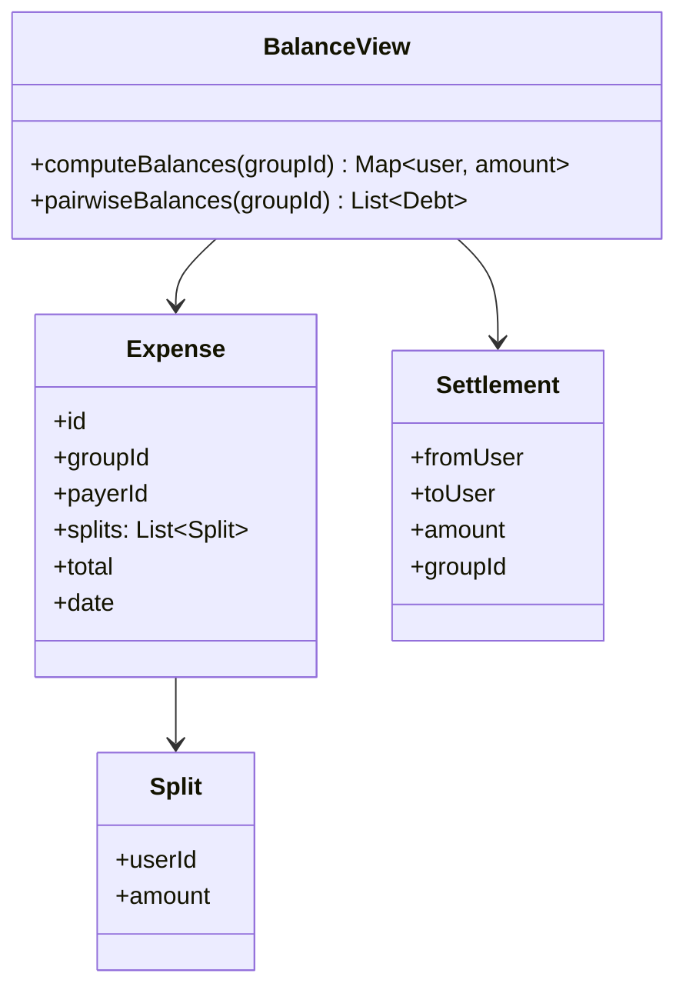

Splitwise is the LLD that is secretly a graph problem wearing a
product's clothes, and it earns its slot by forcing the one modeling
decision that everything else hangs on: **is a debt a stored fact
(a ledger of transactions between pairs) or a derived value (each
participant's net balance, computed from expenses)?** Pick wrong and
every feature after it (the "simplify debts" feature Splitwise is
famous for, the group statement, the "who owes whom" view) becomes
either impossible or quadratic.

## Requirements

- Users and groups; expenses belong to a group (or a direct
  one-on-one).
- Each expense: a payer (or several), participants, a total, an
  optional split strategy (equal, exact amounts, percentages), and a
  description/date.
- Balances per group and overall: who owes whom how much.
- **Settle up**: record a payment from one user to another.
- The famous stretch goal: **simplify debts** (see the hard part).

## The core modeling decision: balances are derived

The honest design stores exactly two things and derives everything
else:

1. **Expenses**: an immutable record (payer, participants, amounts)
   that *implies* debts. A $90 dinner paid by A with three equal
  participants (A, B, C) implies B owes A $30 and C owes A $30, and
  those implied debts are *never stored*: they are the result of a
  query over the expense log.
2. **Settlements**: payments that *discharge* implied debt (B pays
  A $30), also records.

The **net balance** per user (per group) is then a fold: for each
expense, payer += paid-for-others, participant -= owed-share; for each
settlement, payer -= amount, payee += amount. Everything the product
shows ("A owes B $12.50") is derived, and the derivation is the
append-only [ledger](/system-design/lld/bank-ledger-system) idea in
miniature, which is what makes the design auditable (the group
statement *reconstructs* from history) and correct under edits (fixing
a mis-entered expense changes no stored balances: it changes one
record, and every derived view follows).

The anti-pattern worth naming (the naive design): storing pairwise
balances as rows ("B owes A 30"), updated on each expense. It answers
the simple query fast, but it loses the audit trail (the stored 30 no
longer knows *which dinner* it came from), it makes corrections
impossible (fix the expense, recompute everything), and it is the
design that cannot support the simplify-debts feature, which needs the
*full graph*, not the cached totals.

## The class model



Note what is *absent*: no `Debt` class in the storage. `Debt` (a
directed pairwise amount) is a **view**: computed by folding expenses
and settlements, and the computation (per expense, one
credit edge and N-1 debit edges; net per pair) is the whole
"balances" logic.

```cpp
struct Split { std::string userId; long long cents; };

struct Expense {
    std::string id;
    std::string groupId;
    std::string payerId;
    std::vector<Split> splits;           // sums to total, by construction
    long long totalCents;
    std::chrono::system_clock::time_point date;
};

struct Settlement {
    std::string groupId;
    std::string fromUserId;
    std::string toUserId;
    long long cents;
};

// Net balance per user: payer is credited, participants are debited,
// settlements transfer credit directly.
std::unordered_map<std::string, long long>
netBalances(const std::vector<Expense>& expenses,
            const std::vector<Settlement>& settlements,
            const std::string& groupId) {
    std::unordered_map<std::string, long long> net;
    for (const Expense& e : expenses) {
        if (e.groupId != groupId) {
            continue;
        }
        net[e.payerId] += e.totalCents;      // payer fronted the money
        for (const Split& s : e.splits) {
            net[s.userId] -= s.cents;        // each participant owes theirs
        }
    }
    for (const Settlement& s : settlements) {
        if (s.groupId != groupId) {
            continue;
        }
        net[s.fromUserId] += s.cents;        // debt discharged
        net[s.toUserId] -= s.cents;
    }
    return net;                              // positive = is owed money
}
```

The **cents** type (integer, never float) is the
[bank ledger](/system-design/lld/bank-ledger-system) discipline
imported wholesale: money as binary fractions accumulates rounding
error, and a product that settles debts must not.

## The hard part: simplify debts

The famous feature: B owes A $10, C owes B $10, so (simplified) C
owes A $10 and B owes nothing. Three pairwise debts, one debt, the
same final net positions: a *transitive reduction* of the debt graph
that preserves everyone's net balance.

The honest implementation:

1. Compute the **net balance per user** (the fold above).
2. Split into creditors (positive) and debtors (negative).
3. Greedily match the largest debtor to the largest creditor (or any
   greedy pairing), transferring as much as the smaller magnitude
   allows, zeroing one side per transfer, until everyone is zero.

```cpp
struct Transfer { std::string from; std::string to; long long cents; };

std::vector<Transfer> simplifyDebts(
        std::unordered_map<std::string, long long> net) {
    // Max-heap of creditors (positive), min-heap of debtors
    // (negative): repeatedly match the extremes.
    using P = std::pair<long long, std::string>;
    std::priority_queue<P, std::vector<P>, std::less<>> creditors;  // by amount desc
    std::priority_queue<P, std::vector<P>, std::greater<>> debtors; // by amount asc
    for (auto& [user, balance] : net) {
        if (balance > 0) {
            creditors.push({balance, user});
        } else if (balance < 0) {
            debtors.push({balance, user});   // negative: most-negative first
        }
    }
    std::vector<Transfer> transfers;
    while (!creditors.empty() && !debtors.empty()) {
        auto [credit, creditor] = creditors.top();
        auto [debt, debtor] = debtors.top();
        creditors.pop();
        debtors.pop();
        long long amount = std::min(credit, -debt);
        if (amount > 0) {
            transfers.push_back({debtor, creditor, amount});
        }
        if (credit > amount) {
            creditors.push({credit - amount, creditor});
        }
        if (-debt > amount) {
            debtors.push({-(amount + debt), debtor});
        }
    }
    return transfers;
}
```

Two things worth stating out loud about this algorithm, because they
are the interview's actual content:

- **The result is not unique.** Greedy pairing minimizes the *number*
  of transfers approximately, but different pairings preserve the nets
  (which is the only invariant: everyone ends at their original net
  balance). "Optimal fewest transfers" is NP-hard (a
  [set-cover](https://en.wikipedia.org/wiki/Set_cover_problem)-flavored
  matching); greedy is the honest engineering answer, and saying
  *that* out loud is the senior move.
- **Simplification changes who pays whom, but not the total.** The
  conservation invariant ("the sum of nets is zero", the
  [double-entry](/system-design/lld/bank-ledger-system) property
  again) is what makes any simplification trustworthy, and checking it
  is the unit test.

## Related C++ tools

- [std::priority_queue](/cpp/priority-queue): the heap, and why its comparator reads backwards.
- [std::unordered_map / unordered_set](/cpp/unordered-map): average O(1) lookups, and find versus operator[].
- [Custom Comparators](/cpp/comparators): the ordering contract every comparator must keep.

## Related concepts

- [Design a Bank / Ledger System](/system-design/lld/bank-ledger-system)
  is the same append-only, derive-everything discipline with
  conservation laws.
- [Heaps / Priority Queues](/dsa/patterns/heaps-and-priority-queues)
  is the structure the greedy simplification runs on (max/min
  matching).
- [Design a Movie Ticket Booking](/system-design/lld/movie-ticket-booking)
  shares the "who owes what after a shared event" shape at higher
  stakes.
- [Event Sourcing & CQRS](/system-design/fundamentals/event-sourcing-and-cqrs)
  is the architecture the expense log instantiates.
