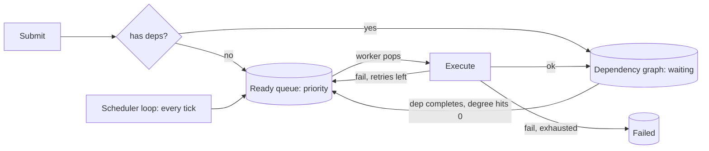

"Run this job after those jobs, with this priority, retry it if it fails,
and run these others on a schedule" is a recurring design need inside
almost every service, and it is the LLD sibling of the
[distributed job scheduler](/system-design/hld/distributed-job-scheduler).
The code-level version drops the fleet questions (leases, heartbeats,
multiple workers) and isolates the interesting local ones: **what data
structure answers "what should run next", how dependencies are
expressed and detected, and what a retry policy is allowed to promise.**
It is also the best LLD example of the [design data
structures](/dsa/patterns/design-data-structures) meeting
[graph algorithms](/dsa/patterns/graph-specializations), because those
two are genuinely all it is.

## Requirements

- `submit(task, options)`: register a task with a priority, an optional
  schedule (one-shot delay or recurring interval), optional dependencies,
  and a retry policy.
- `tick()` / a background runner: execute due tasks, respecting priority
  (higher first) and dependencies (a task runs only after its
  dependencies complete successfully).
- Failed tasks retry per policy; exhausted retries park as failed.
- Observable state: query pending, running, and failed tasks.
- Single process, thread-safe submission, one or a few worker threads.

State the non-goals, because they shape everything: no durability (a
restart loses the queue, which is acceptable for in-process work), no
cross-process coordination, and best-effort timing (tasks run "roughly
when due", not to the millisecond).

## The two structures

The design is two structures with a coordination point between them,
and naming them is most of the interview:

**The ready queue** (a [priority queue](/dsa/patterns/heaps-and-priority-queues))
holds tasks that are *ready now*: dependencies satisfied, waiting their
turn. Ordering is by (priority, due time), and each worker loop is: pop
the best, run it, decide its fate.

**The dependency graph** (an implicit DAG) holds tasks that are *not
ready*: waiting on dependencies. The structure is the standard
[topological sort](/dsa/patterns/graph-specializations/problems/course-schedule)
state: an in-degree per task (unsatisfied dependency count) and an
adjacency list (dependents waiting on each task). When a dependency
completes successfully, decrement each dependent's in-degree; a
dependent reaching zero moves from the waiting set into the ready queue.



## The C++ sketch

```cpp
struct Task {
    std::string id;
    std::function<void()> job;
    int priority = 0;
    std::vector<std::string> dependencies;
    int maxRetries = 0;
    int attemptsLeft = maxRetries;
    TaskState state = TaskState::Pending;
};

class TaskScheduler {
public:
    void submit(Task task) {
        std::lock_guard<std::mutex> guard(mtx_);
        if (task.dependencies.empty()) {
            pushReady(std::move(task));
        } else {
            for (const auto& dep : task.dependencies) {
                dependents_[dep].push_back(task.id);   // reverse edges
                unsatisfied_[task.id] = task.dependencies.size();
            }
            waiting_[task.id] = std::move(task);
        }
    }

    void runNext() {
        std::unique_ptr<Task> task;
        {
            std::lock_guard<std::mutex> guard(mtx_);
            if (ready_.empty()) {
                return;
            }
            task = std::move(const_cast<std::unique_ptr<Task>&>(
                ready_.top()));
            ready_.pop();
            task->state = TaskState::Running;
        }
        runWithRetry(std::move(task));
    }

private:
    void pushReady(Task task) {
        ready_.push(std::make_unique<Task>(std::move(task)));
    }

    void onTaskCompleted(const std::string& id, bool success) {
        std::lock_guard<std::mutex> guard(mtx_);
        if (!success) {
            return;                      // dependents stay blocked: dep failed
        }
        for (const auto& dependentId : dependents_[id]) {
            if (--unsatisfied_[dependentId] == 0) {
                Task ready = std::move(waiting_[dependentId]);
                waiting_.erase(dependentId);
                pushReady(std::move(ready));
            }
        }
    }

    void runWithRetry(std::unique_ptr<Task> task) {
        bool success = false;
        try {
            task->job();
            success = true;
        } catch (...) {
            success = false;
        }
        if (success) {
            task->state = TaskState::Done;
            onTaskCompleted(task->id, true);
            return;
        }
        if (--task->attemptsLeft > 0) {
            task->state = TaskState::Pending;
            std::lock_guard<std::mutex> guard(mtx_);
            pushReady(std::move(task));       // retry: back to the queue
        } else {
            task->state = TaskState::Failed;
            onTaskCompleted(task->id, false);  // dependents blocked
        }
    }

    struct ReadyOrder {                   // heap: higher priority first
        bool operator()(const std::unique_ptr<Task>& a,
                        const std::unique_ptr<Task>& b) const {
            return a->priority < b->priority;
        }
    };

    std::mutex mtx_;
    std::priority_queue<std::unique_ptr<Task>,
                        std::vector<std::unique_ptr<Task>>,
                        ReadyOrder> ready_;
    std::unordered_map<std::string, Task> waiting_;       // not yet ready
    std::unordered_map<std::string, std::vector<std::string>> dependents_;
    std::unordered_map<std::string, int> unsatisfied_;
};
```

Four decisions carry the design, and each is worth stating out loud:

**The lock scope is small and specific.** The mutex guards the *queues
and maps*, never the task execution: work runs outside the lock, so a
slow job does not block submissions or other workers. This is the same
"lock the bookkeeping, never the work" rule as the
[rate limiter LLD](/system-design/lld/rate-limiter-lld), and it is the
first thing to say about the threading.

**A failed dependency blocks, and stays blocked.** `onTaskCompleted`
with `success=false` decrements nothing, so dependents of a failed task
wait forever, by design: the alternative (releasing dependents on
dependency failure) runs tasks whose inputs never materialized, which is
worse. "What happens to B when A fails" is the design question this
problem is really asking, and blocked-forever-until-human-intervention
is the defensible default, worth saying explicitly.

**Retries go back through the queue, not into a tight loop.** A failed
task with retries left re-enters the ready queue (in a real design, with
a delay: the [exponential backoff](/system-design/fundamentals/backpressure-and-flow-control)
that turns a failing storm into a slowing one). The retry policy is
"attempts, with delay", and a task that fails fast in a tight loop would
monopolize the worker, which is why the delay is not optional in
practice.

**Ready is a state, not a place.** A task moves between "waiting on
dependencies" and "ready", and the graph structure's whole job is
maintaining that boundary. The in-degree map (`unsatisfied_`) is
[course schedule](/dsa/patterns/graph-specializations/problems/course-schedule)
exactly: decrement on completion, release at zero, and the failure mode
(it stays positive forever) is a dependency cycle, which a real
submission API would reject up front for exactly the reason the
[topological sort](/dsa/patterns/graph-specializations) page says.

## Variations

- **Scheduled/recurring tasks**: a time-ordered queue (a min-heap on next
  run time) beside the priority queue, with a ticker that moves due
  items into `ready_`, and recurring tasks resubmitting themselves on
  completion (computed from the previous run time, not "now", to avoid
  drift, per the [distributed scheduler](/system-design/hld/distributed-job-scheduler)).
- **Cancellation**: a cancelled task's removal must also remove its
  edges, decrementing every dependent it was blocking, which is where
  the graph bookkeeping earns its keep.
- **Multiple workers**: `runNext` from a pool, still safe under the one
  mutex, still correct because a task is claimed by being popped.

## Related concepts

- [Heaps / Priority Queues](/dsa/patterns/heaps-and-priority-queues) is
  the ready queue's structure and its comparator trap.
- [Graph Specializations](/dsa/patterns/graph-specializations) covers the
  in-degree/topological mechanics the dependency graph runs.
- [Design a Distributed Job Scheduler](/system-design/hld/distributed-job-scheduler)
  is this design plus leases, heartbeats, and a fleet of workers.
- [Backpressure & Flow Control](/system-design/fundamentals/backpressure-and-flow-control)
  is the retry-delay policy's reason.
