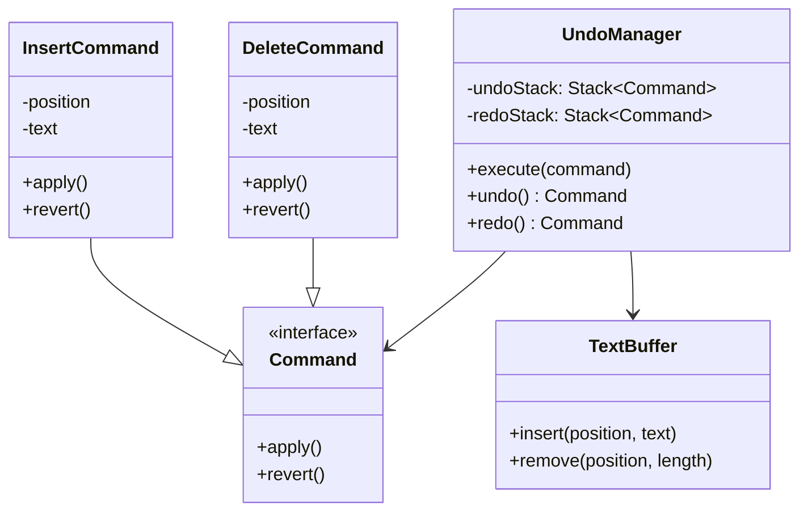

Undo/redo is the canonical showcase of the **command pattern**: every
mutation becomes an *object* that knows how to apply and reverse
itself, and the editor's undo system is just two stacks of those
objects. The pattern is easy to state; the LLD's actual content is the
boundary conditions, the places a naive "store snapshots" or "store
keystrokes" design silently breaks, and each one is a named, classic
text-editor bug.

## Requirements

- A text buffer (insert text, delete a range).
- `undo()` reverses the last edit; `redo()` re-applies the last
  undone edit.
- Undo survives *new edits* (typing after undoing invalidates the redo
  stack).
- Memory is bounded (an editor running for days cannot remember
  everything).
- Optional: the real-editor extensions (cursor restore, selection
  restore, undo grouping).

## The core design: commands as reversible objects



Every edit becomes a **Command** holding exactly what it needs to
apply *and* revert itself: an insert stores (position, text) and its
revert is a remove of that range; a delete stores (position, text)
and its revert is a re-insert. The delete capturing the *deleted
text* is the load-bearing detail (revert needs the bytes, so the
command must keep them), and it is the difference between the
command pattern and the naive "log the operation" designs, which are
the same idea minus the payload that makes reversal possible.

## The C++ sketch, centered on the boundary conditions

```cpp
struct InsertCommand : Command {
    size_t position;
    std::string text;
    void apply(TextBuffer& buffer) override {
        buffer.insert(position, text);
    }
    void revert(TextBuffer& buffer) override {
        buffer.remove(position, text.size());
    }
};

struct DeleteCommand : Command {
    size_t position;
    std::string text;                  // the deleted bytes: revert's payload
    void apply(TextBuffer& buffer) override {
        buffer.remove(position, text.size());
    }
    void revert(TextBuffer& buffer) override {
        buffer.insert(position, text);
    }
};

class UndoManager {
public:
    void execute(std::unique_ptr<Command> command, TextBuffer& buffer) {
        command->apply(buffer);
        undoStack_.push_back(std::move(command));
        redoStack_.clear();            // BOUNDARY 1: new edit kills redo
    }

    bool undo(TextBuffer& buffer) {
        if (undoStack_.empty()) {
            return false;
        }
        redoStack_.push_back(std::pop(undoStack_));   // move across
        redoStack_.back()->revert(buffer);
        return true;
    }

    bool redo(TextBuffer& buffer) {
        if (redoStack_.empty()) {
            return false;
        }
        undoStack_.push_back(std::pop(redoStack_));
        undoStack_.back()->apply(buffer);
        return true;
    }

private:
    static std::unique_ptr<Command> std::pop(
        std::vector<std::unique_ptr<Command>>& stack) {
        auto top = std::move(stack.back());
        stack.pop_back();
        return top;
    }
    std::vector<std::unique_ptr<Command>> undoStack_;
    std::vector<std::unique_ptr<Command>> redoStack_;
};
```

The design's whole correctness lives in its boundary conditions, and
each deserves a named line, because each is a real editor bug:

- **A new edit clears the redo stack** (`redoStack_.clear()` in
  `execute`). Without it: undo a delete, type a character, redo, and
  the delete reverts onto a buffer it was never applied to, corrupting
  text. The redo stack is valid *only* as a suffix of the edit
  history, and any new edit destroys that suffix.
- **Undo and redo are stack *moves*, not re-creations**: the command
  travels between stacks (the same object, the same payload), so redo
  re-applies *exactly* the original operation. The alternative
  (re-executing the inverse of the undo) drifts: it composes a new
  command from the *current* state, which may differ.
- **The commands are position-absolute, and that is a real
  limitation**: an insert at position 10 is reverted by removing
  exactly that range, which is correct *only because* the undo stack
  replays in strict LIFO order (the buffer is exactly as it was when
  the command ran). The moment the design allows *non-linear* undo
  (undo edit 3 while edits 4-10 stand: the "selective undo" of
  collaborative editors), positions must become stable identifiers
  (piece-table offsets) rather than absolute numbers, which is the
  boundary this simple design deliberately stops at.

## The memory story: why not snapshots?

The two naive alternatives, and where they break:

- **Full snapshots per edit** ("save the whole buffer before each
  change"): undo is trivially correct and memory is quadratic in edit
  count (a 1 MB file, 10k edits: 10 GB). It works for tiny documents
  and dies for real ones.
- **Keystroke replay** ("log every key, replay to undo"): memory is
  linear but *undo-by-undo* means replaying the whole history minus
  one step, and the "inverse keystroke" logic (what undoes a
  backspace mid-selection?) is where it corrupts.

The command stack is the middle: linear memory *per edit* (the
payload), O(1) undo/redo, and the bounded-memory extension
(**the undo limit**: a ring of the last N commands, the
[circular deque](/dsa/patterns/linear-structures/problems/design-circular-deque)
from this site's DSA section in its natural habitat, with oldest-edits
silently becoming permanent), which is the honest answer to "days-long
editing sessions".

## The extensions, each a real editor feature

- **Coalescing** (typing "hello" is *one* undo, not five): the manager
  merges commands (adjacent inserts, same position, same edit
  "session") before pushing, which is a *policy* on top of the stack
  and the reason real editors feel usable.
- **Cursor/selection restore**: the command carries (position,
  selection) as *additional revert state*, which is why undo puts
  your cursor back where the edit was, the detail that makes the
  feature feel right.
- **The piece table** (the real-editor buffer design): an append-only
  original + edits log with a "current sequence" as a list of pieces,
  whose whole point is that undo is *already* the data structure's
  native operation (drop the last edit piece), which is where this
  design converges when it grows up.

## Related concepts

- [Stacks & Queues](/dsa/patterns/stacks-and-queues) is the structure
  and the "most recent unresolved first" discipline this is.
- [Design a Chess Game](/system-design/lld/chess-game) names the
  command pattern for its move log (undo a move: the same reversible
  object).
- [Event Sourcing & CQRS](/system-design/fundamentals/event-sourcing-and-cqrs)
  is this idea as an *architecture*: the log as source of truth, the
  current state derived, replay as undo-by-construction.
- [Design an In-Memory File System](/system-design/lld/in-memory-file-system)
  is the other composite-tree LLD this site pairs it with.
