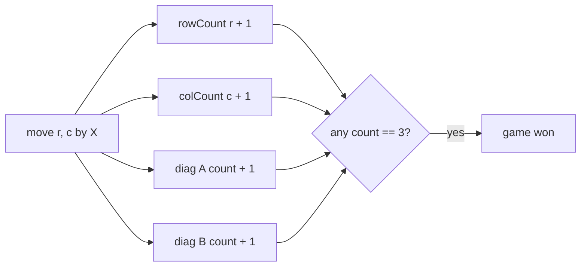
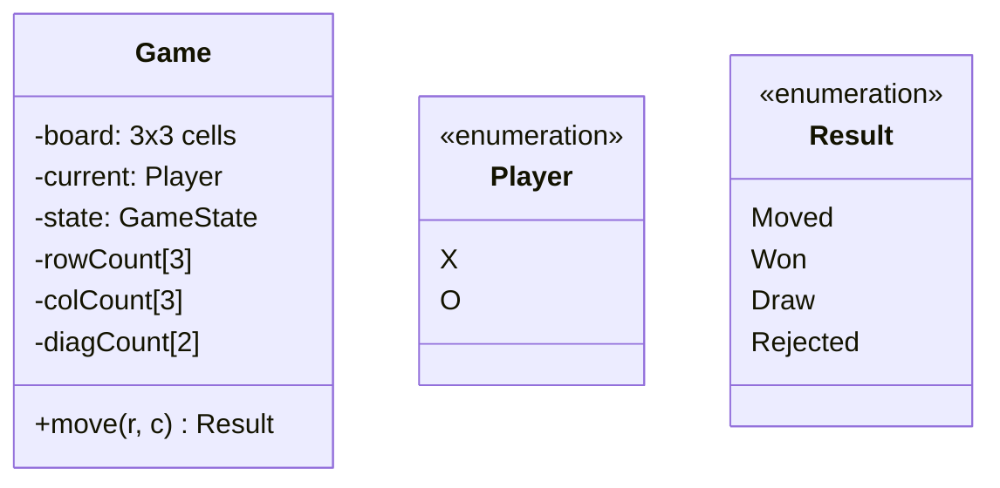

Tic-tac-toe looks like a toy, and that is exactly why it is a good
LLD: it is the smallest possible instance of *game systems* (board
state, turn legality, win/loss/draw detection), small enough to
design completely in an interview, and every decision in it scales to
real games ([chess](/system-design/lld/chess-game)'s rule engine,
[2048](https://en.wikipedia.org/wiki/2048_(video_game))'s slides, Go's
groups). The [chess LLD](/system-design/lld/chess-game) covers the
rules-heavy version; this page is the minimal skeleton underneath.

## Requirements

- 3x3 board, two players (X first), alternating turns.
- `move(row, col)` by the current player; illegal moves rejected
  (occupied cell, out of turn, game over).
- Win detection (three in a row), draw detection (board full).
- Extensible: the natural follow-up probes (N x N, N-in-a-row
  variants) must not break the design.

## The design's one clever bit: win detection as counters

The naive win check scans all rows, columns, and diagonals after every
move: 8 lines * 3 cells, O(1) at fixed size but scanning work that
*grows with the board* in the general version. The classic trick:
**maintain a running count per line, and increment on each move**.



Each move touches exactly one row, one column, and (on the main
diagonal squares) one or two diagonals: 2-4 counter updates, and a
win is "some counter reached N". The check is O(1) per move instead of
O(N) or O(N²), and the structure generalizes exactly ([connect
four](https://en.wikipedia.org/wiki/Connect_Four) tracks rows,
columns, and two diagonal directions the same way at 7x6).

## The class model



The **Result enum** is a quiet load-bearing decision worth naming:
rather than `move` returning `void` plus exceptions (or booleans that
conflate "illegal" with "someone already won"), the *four* outcomes
are data: the caller learns what happened, and the UI/test layer
branches on the answer. The board-as-flat-array
(`cells[9]`, `r * 3 + c`) rather than nested vectors is the same
[contiguous discipline](/dsa/patterns/linear-structures) as always.

## The C++ sketch

```cpp
enum class Player { X, O };
enum class Result { Moved, Won, Draw, Rejected };

class TicTacToe {
public:
    TicTacToe() : board_(9, 0), row_(3, 0), col_(3, 0),
                  diag_(2, 0), current_(Player::X),
                  movesMade_(0), gameOver_(false) {}

    Result move(int r, int c) {
        if (gameOver_ || r < 0 || r >= 3 || c < 0 || c >= 3 ||
            board_[r * 3 + c] != 0) {
            return Result::Rejected;          // all illegal cases
        }
        int sign = (current_ == Player::X) ? 1 : -1;
        board_[r * 3 + c] = sign;
        ++movesMade_;

        row_[r] += sign;
        col_[c] += sign;
        if (r == c) {
            diag_[0] += sign;                // main diagonal
        }
        if (r + c == 2) {
            diag_[1] += sign;                // anti-diagonal
        }

        bool won = row_[r] == 3 * sign || col_[c] == 3 * sign ||
                   diag_[0] == 3 * sign || diag_[1] == 3 * sign;
        if (won) {
            gameOver_ = true;
            return Result::Won;
        }
        if (movesMade_ == 9) {
            gameOver_ = true;
            return Result::Draw;
        }
        current_ = (current_ == Player::X) ? Player::O : Player::X;
        return Result::Moved;
    }

    Player current() const { return current_; }
    bool over() const { return gameOver_; }

private:
    std::vector<int> board_;                 // +1 X, -1 O, 0 empty
    std::vector<int> row_;
    std::vector<int> col_;
    std::vector<int> diag_;
    Player current_;
    int movesMade_;
    bool gameOver_;
};
```

The **signed-counter encoding** is worth a second look, because it is
the quiet elegance: `+1` for X and `-1` for O means a *win is any
counter reaching +3 or -3* (`row_[r] == 3 * sign` checks the mover's
own win only, which is correct: a move can only complete its own
line), and it needs no per-player arrays. The
[bit](/dsa/patterns/bit-manipulation)-flavored cousin (two bitboards,
one per player) is the version that generalizes to games where lines
are masks rather than counters.

## The extensibility probes

- **N x N with N in a row**: the counters generalize directly (arrays
  of size N, `diag_` only when the square is on one, threshold N),
  which is the design's payoff for maintaining counters rather than
  rescanning.
- **Undo/redo**: a move *log* (the
  [command](/system-design/lld/text-editor-undo-redo) pattern) with
  the counter updates reversed (a move's inverse is the same updates
  negated), which is why the counters *plus log* combination is the
  full design.
- **Arbitrary line sets** (chess-like games, Tetris clears): the
  counter trick becomes "each cell knows its lines" (a cell -> lines
  map), which is the same structure the
  [chess LLD](/system-design/lld/chess-game) uses for piece rules:
  the general shape is *incremental state + per-cell rule
  membership*, and this problem is its smallest instance.

## Related C++ tools

- [std::vector](/cpp/vector): the dynamic array underneath almost every solution.

## Related concepts

- [Design a Chess Game](/system-design/lld/chess-game) is the full
  version (move generation, per-piece rules, check semantics).
- [Design a Text Editor (Undo/Redo)](/system-design/lld/text-editor-undo-redo)
  is the command-log discipline the undo probe wants.
- [Matrix & Grid Algorithms](/dsa/patterns/matrix-and-grid-algorithms)
  is the board-as-grid foundation.
- [Stacks & Queues](/dsa/patterns/stacks-and-queues) covers the
  move-history discipline.
