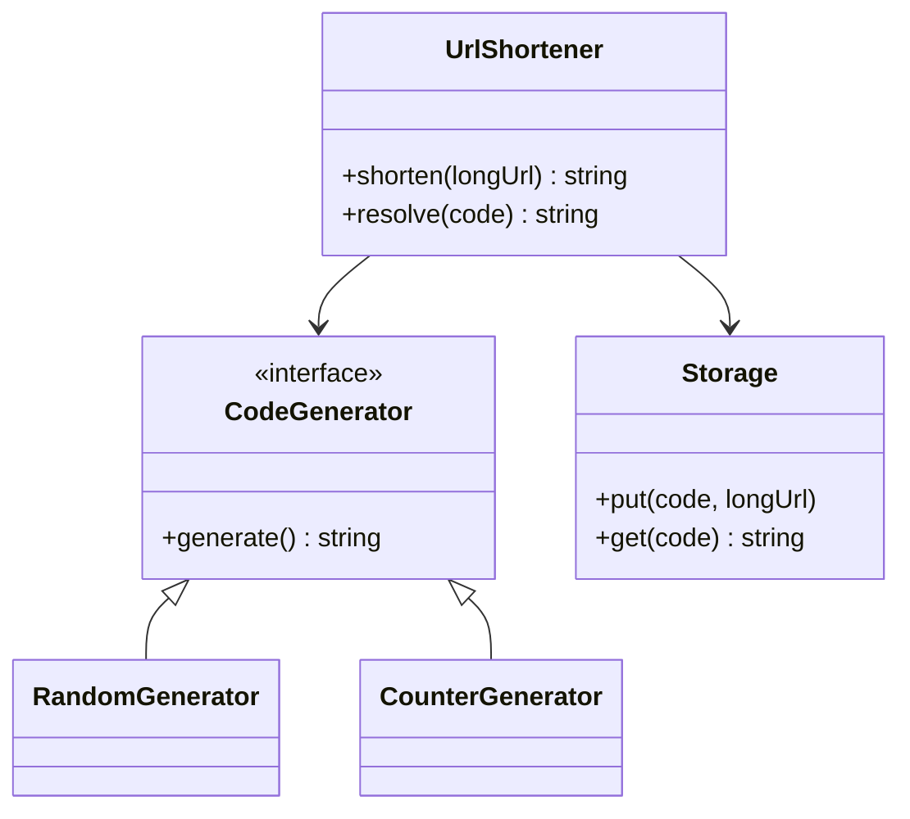

The [system-level design](/system-design/hld/url-shortener) covers the
architecture: read-heavy, cache-aside, sharded key-value storage, and
the code-generation decision (random vs counter vs hash). The
code-level LLD is the single-service version of that core: the
`shorten`/`resolve` pair, the code generator as a swappable
[strategy](/dsa/patterns/design-data-structures), and the collision
handling that the system-level page waves at, made concrete.

## Requirements

- `shorten(longUrl) -> shortUrl` (a 7-character code).
- `resolve(code) -> longUrl` (the reverse lookup).
- Codes are unique, unguessable-enough, and stable forever.
- Single service, in-memory or local-database storage.
- The encoding strategy is a decision the interview makes you defend,
  so it must be swappable.

## The class model



`CodeGenerator` as an interface is the design's one deliberate
abstraction, for exactly the reason the
[parking lot pricing](/system-design/lld/parking-lot) strategy exists:
the choice of generator is a trade-off conversation
(uniqueness guarantees, coordination, guessability) that you want to
have *once*, and the rest of the system should not know the answer.

## The C++ sketch, centered on the collision retry

```cpp
class RandomCodeGenerator : public CodeGenerator {
public:
    explicit RandomCodeGenerator(int length) : length_(length) {}
    std::string generate() override {
        static const char alphabet[] =
            "abcdefghijklmnopqrstuvwxyzABCDEFGHIJKLMNOPQRSTUVWXYZ0123456789";
        std::string code(length_, ' ');
        for (char& c : code) {
            c = alphabet[dist_(rng_)];       // 62 choices per character
        }
        return code;
    }
private:
    int length_;
    std::mt19937 rng_{std::random_device{}()};
    std::uniform_int_distribution<int> dist_{0, 61};
};

class UrlShortener {
public:
    std::string shorten(const std::string& longUrl) {
        for (int attempt = 0; attempt < maxAttempts_; ++attempt) {
            std::string code = generator_->generate();
            if (!storage_.contains(code)) {       // uniqueness check
                storage_.put(code, longUrl);
                return code;                       // hit: done
            }
        }
        // Expected collisions after millions of codes is still ~0
        // (birthday bound), so this is belt-and-suspenders, not load.
        throw std::runtime_error("code space exhausted at this length");
    }

    std::string resolve(const std::string& code) {
        auto it = storage_.find(code);
        return it != storage_.end() ? it->second : "";
    }

private:
    static constexpr int maxAttempts_ = 5;
    std::unique_ptr<CodeGenerator> generator_ =
        std::make_unique<RandomCodeGenerator>(7);
    std::unordered_map<std::string, std::string> storage_;
};
```

The **birthday-bound arithmetic** is the interview's actual content,
and it is worth doing out loud: with 62^7 ≈ 3.5 * 10^12 possible
codes, the probability that a *new* code collides with any existing one
after n stored codes is n / 62^7, so even at a billion stored codes
the per-generate collision probability is ~0.03%, and a single retry
makes it negligible. The retry loop is therefore *insurance*, not
load: the expected number of attempts per shorten is 1.0003, and the
loop's `maxAttempts_` is a safety valve, not a hot path.

The counter generator (the other
[strategy](/system-design/hld/url-shortener)): take the next integer,
encode it in [base-62](https://en.wikipedia.org/wiki/Base62), and the
code is the encoding. Guaranteed unique, no retry, and sequential
(which is the security conversation: an enumerator can walk your
entire code space, which the random generator prevents). Block
allocation (each instance takes 10,000 counters from a coordinator,
then hands them out locally) removes the coordination cost, and the
base-62 encode is worth writing once:

```cpp
std::string encodeBase62(unsigned long long value) {
    static const char alphabet[] =
        "0123456789abcdefghijklmnopqrstuvwxyzABCDEFGHIJKLMNOPQRSTUVWXYZ";
    std::string code;
    do {
        code += alphabet[value % 62];       // least significant digit first
        value /= 62;
    } while (value > 0);
    std::reverse(code.begin(), code.end());
    return code;
}
```

## The design decisions worth stating

- **Idempotent shorten**: should shortening the same long URL twice
  return the same code? Usually yes (a
  [deterministic](/system-design/fundamentals/idempotency-and-exactly-once)
  map by long URL, which also caps storage growth against repeated
  submissions), and the storage gains a second index (longUrl -> code)
  to answer it. The system-level page's "custom alias" requirement is
  the same decision surfaced as a product feature.
- **The storage boundary**: this class is the *local* version
  (`unordered_map`); the system-level version swaps `Storage` for a
  sharded database plus
  [cache](/system-design/fundamentals/caching), and nothing else
  changes, which is the point of the interface.
- **Codes as the primary key**: everything (storage, caching, the
  [consistent hashing](/system-design/fundamentals/consistent-hashing)
  shard key) is keyed by the code, so the code must be short,
  uniform-length, and URL-safe (no `/` or `+`), which is what base-62
  with an alphabet chosen for URL safety buys.

## Related concepts

- [Design a URL Shortener (System-Level)](/system-design/hld/url-shortener)
  is the parent design (capacity, caching, the code-generation trade).
- [Hash-Based Structures](/dsa/patterns/hash-based-structures) covers
  the lookup half, and the uniqueness check's birthday arithmetic.
- [Design a Rate Limiter](/system-design/lld/rate-limiter-lld) is the
  sibling "single-service strategy class" design.
