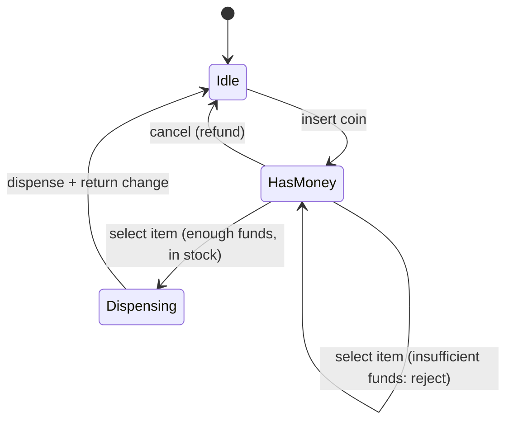
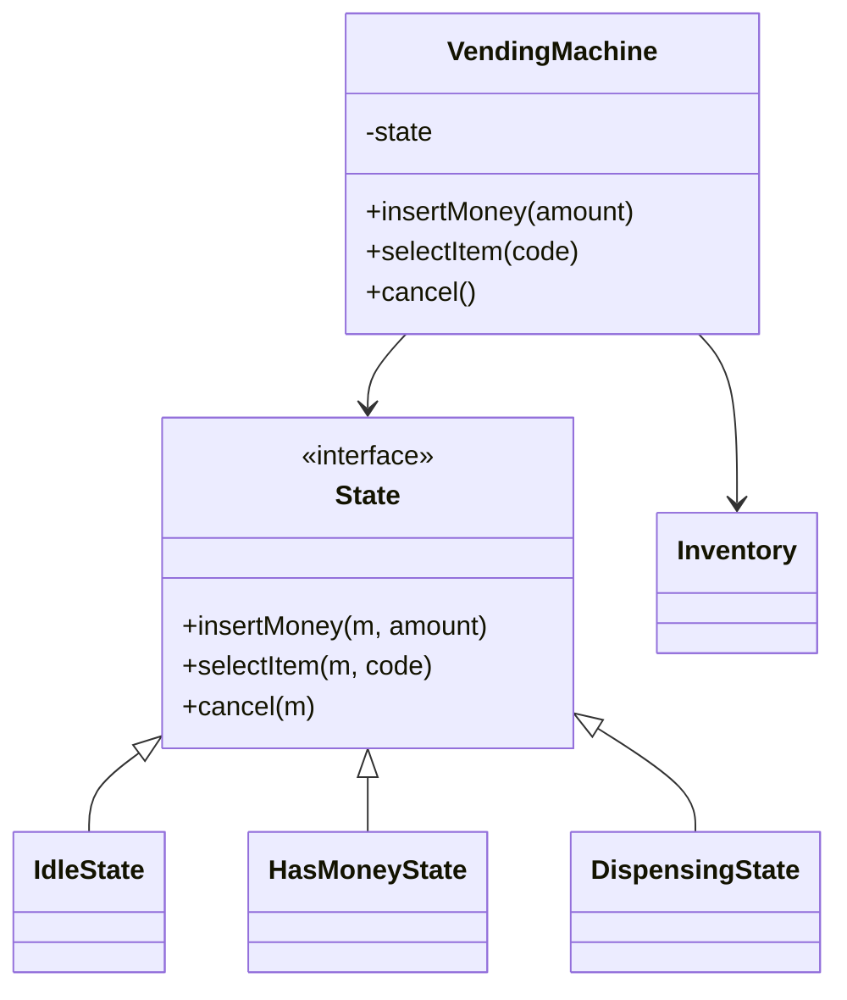

A vending machine is small enough to design completely in an interview, and
that is exactly why it is useful: it forces the state-machine style of
design into focus with nothing to hide behind. A purchase is not a
sequence of method calls; it is a *journey through states* (idle, money
inserted, item selected, dispensing, change returned), and almost every
requirement is a rule about which transitions are legal. Get the state
machine right and the classes fall out; get it wrong and you end up with a
tangle of booleans trying to remember "has money been inserted".

## Requirements

- The machine holds a catalog of items, each with a price and a stock
  count.
- A user inserts money (coins or bills), accumulates a balance, and selects
  an item.
- If the balance covers the price and the item is in stock, dispense the
  item and return change.
- Allow cancel at any point, returning the inserted money.
- Handle edge cases: insufficient funds, out of stock, exact change
  unavailable.

## The state machine

This is the design, so it comes first. A purchase is a state machine, and
each state allows only specific operations.



The critical insight the state machine encodes: **the same operation means
different things in different states**. Selecting an item in `Idle` is an
error; in `HasMoney` with enough balance it triggers dispensing; in
`HasMoney` with too little it is rejected. A design that models "select
item" as a single method with internal `if` checks spreads the state across
booleans; a design that dispatches by state keeps each state's rules in one
place. This is the State pattern, and it is the named design pattern the
interviewer is looking for.

## The class model



- **VendingMachine** is the context: it holds the current state, the
  inventory, and the inserted balance, and it delegates each user action to
  the current state.
- **State** is an interface; each concrete state implements the three user
  actions with its own rules and its own legal transitions.
- **Inventory** maps item codes to `(price, quantity)` and handles the
  "is it in stock" check.
- **Coin/Bill** handling and a **change maker** are supporting pieces: the
  change maker is the piece most likely to need its own design (see
  variations).

## The C++ sketch

```cpp
class VendingMachine;

class State {
public:
    virtual ~State() = default;
    virtual void insertMoney(VendingMachine& m, int amount) = 0;
    virtual void selectItem(VendingMachine& m, const std::string& code) = 0;
    virtual void cancel(VendingMachine& m) = 0;
};

class VendingMachine {
public:
    void setState(std::unique_ptr<State> state) { state_ = std::move(state); }

    void insertMoney(int amount) {
        balance_ += amount;
        state_->insertMoney(*this, amount);
    }
    void selectItem(const std::string& code) { state_->selectItem(*this, code); }
    void cancel() { state_->cancel(*this); }

    Inventory& inventory() { return inventory_; }
    int balance() const { return balance_; }
    void setBalance(int balance) { balance_ = balance; }

private:
    std::unique_ptr<State> state_;
    Inventory inventory_;
    int balance_ = 0;
};

class HasMoneyState : public State {
public:
    void insertMoney(VendingMachine& m, int /*amount*/) override {
        // Balance already updated by the context; stay in this state.
        (void)m;
    }

    void selectItem(VendingMachine& m, const std::string& code) override {
        Item* item = m.inventory().find(code);
        if (item == nullptr || item->quantity == 0) {
            std::cout << "Out of stock\n";
            return;                        // stay in HasMoney: user can pick another
        }
        if (m.balance() < item->price) {
            std::cout << "Insufficient funds\n";
            return;                        // stay in HasMoney
        }
        m.setState(std::make_unique<DispensingState>(item));
        // DispensingState will dispense, return change, then go Idle.
    }

    void cancel(VendingMachine& m) override {
        std::cout << "Refunding " << m.balance() << "\n";
        m.setBalance(0);
        m.setState(std::make_unique<IdleState>());
    }
};
```

Read how each state owns its rules. `HasMoneyState::selectItem` checks
stock and funds and either rejects (staying in the same state, so the user
can try another item) or transitions to `DispensingState`. The context
(`VendingMachine`) owns the data (balance, inventory) and the current
state; the state owns the *behavior*. This separation is the whole point
of the pattern: adding a state (say, "exact change only") means adding one
class, not editing every method with another `if`.

## The hard part: making change

The one genuinely algorithmic piece is the change maker: given an amount
and the machine's available coins, return a set of coins summing to the
amount. This is the [coin change problem](/dsa/patterns/dynamic-programming),
and its greedy solution (largest coin first) is optimal only for
well-chosen denominations; arbitrary coin sets need dynamic programming.
The design implication: the change maker should be its own component with
its own algorithm, because it can fail ("I cannot make exact change"), and
that failure is a state transition (refuse the purchase) rather than a
crash.

## Known variations

- **Cashless machines**: the payment step becomes an external call (a card
  reader), which introduces a new state (`AwaitingPayment`) and a timeout,
  because the external system can fail or hang. This is where the state
  machine earns its keep: a hung payment is a state, not a boolean.
- **Refund and partial refund**: dispensing can fail mechanically after
  payment, requiring a refund path. Again a state.
- **Restocking**: an admin operation that changes inventory, orthogonal to
  the purchase state machine.

## Related concepts

- [Design an ATM](/system-design/lld/atm) is the same state-machine shape
  with money and a bank as the external system.
- [Design a Parking Lot](/system-design/lld/parking-lot) is the sibling
  LLD focused on resource modeling rather than state.
- [Dynamic Programming](/dsa/patterns/dynamic-programming) is the change
  maker's algorithm when the coin denominations are not canonical.
